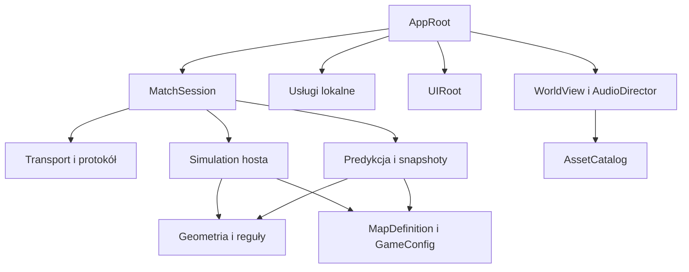
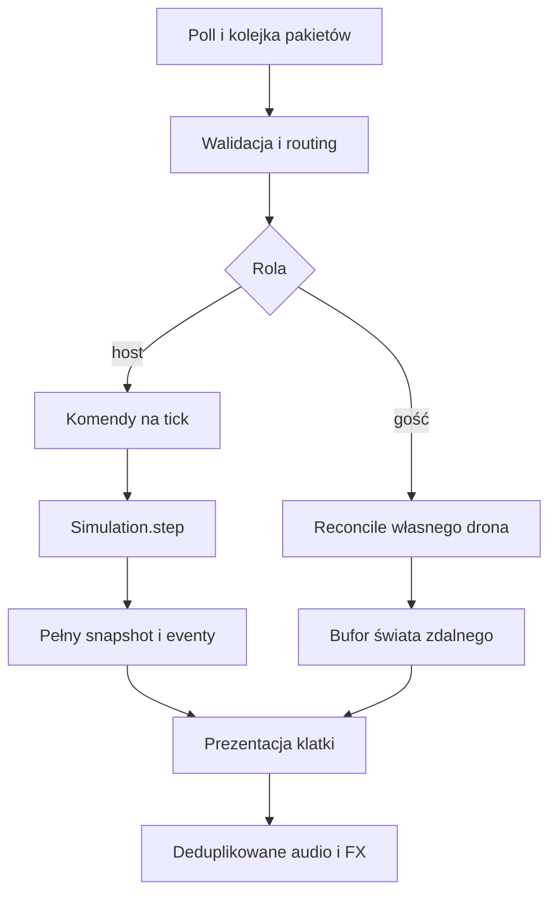
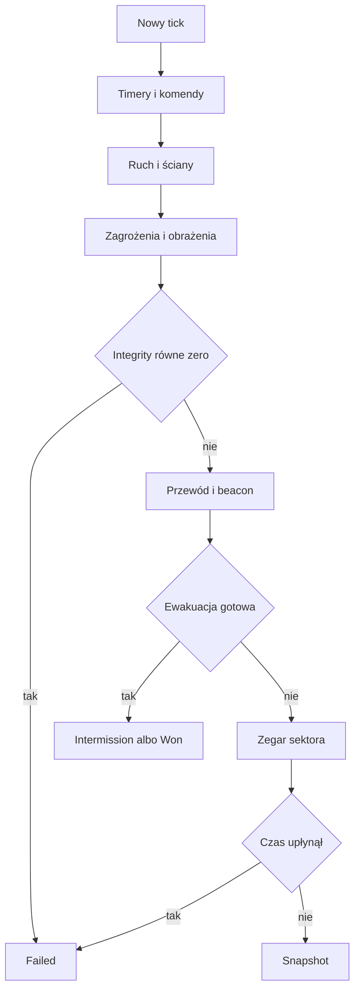
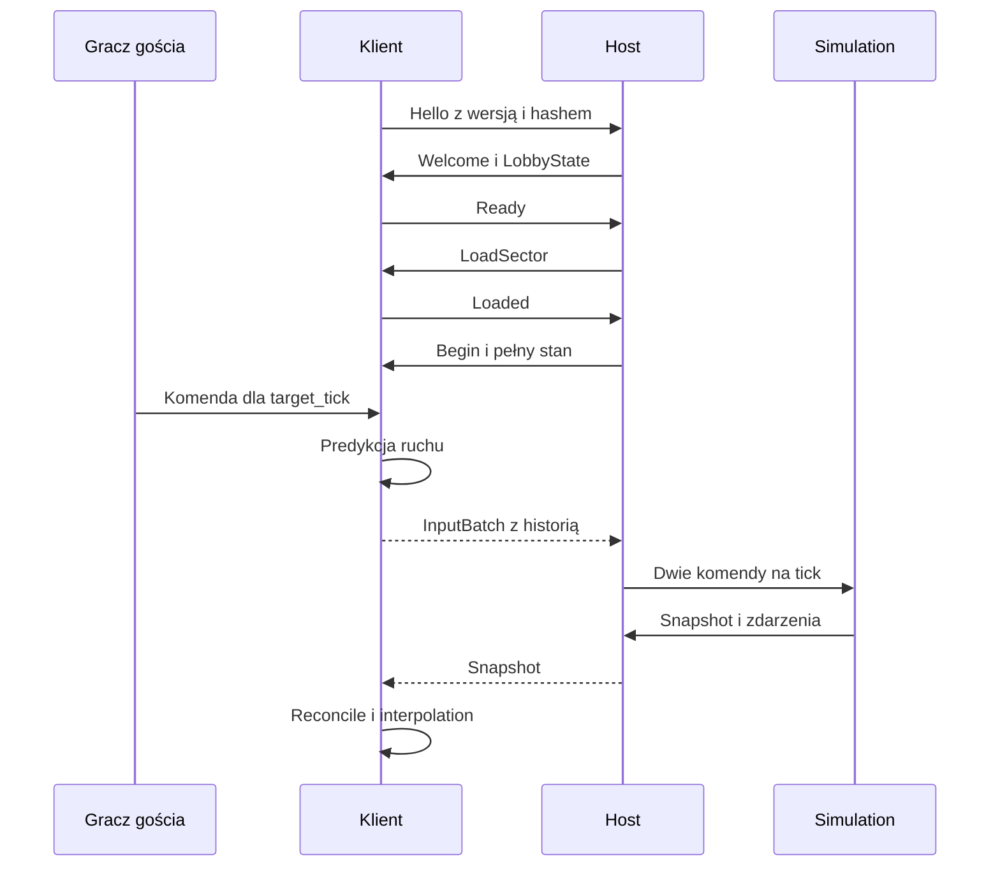
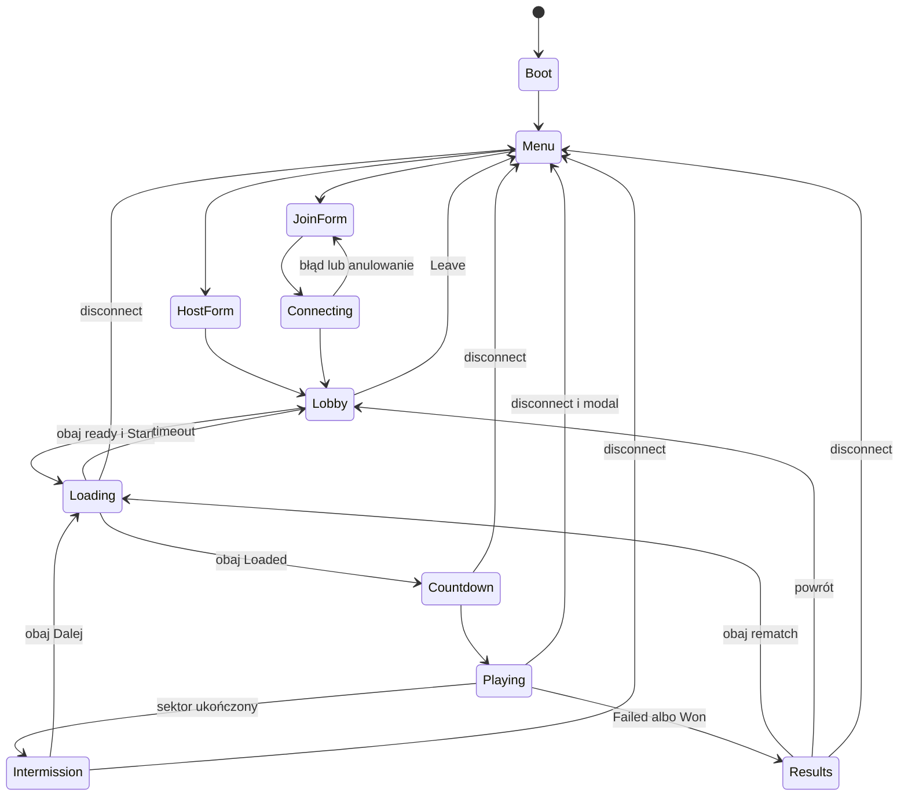

# ARCHITECTURE — kontrakt 1.0

Źródło: [MASTER_SPEC.md](MASTER_SPEC.md), specyfikacja 1.0 (14 listopada 2026).
Poniższe rozdziały zachowują pełną treść źródła. Opisują wymagania docelowe; stan implementacji podaje [PROJECT_STATUS.md](PROJECT_STATUS.md).

## 11. Ocena stosu technologicznego

Oceny dotyczą tej gry, a nie uniwersalnej wartości języków. Kryteria uwzględniają ryzyko utrzymania i niezawodność implementacji generowanej etapami.

| Stack | Implementacja i AI 25% | 2D/UI 20% | LAN 15% | CPU/pamięć 15% | Narzędzia/testy 15% | Dystrybucja 10% | /10 |
|---|---:|---:|---:|---:|---:|---:|---:|
| Godot + typed GDScript | 10 | 10 | 9 | 7 | 8 | 10 | **9,10** |
| Godot + C# | 9 | 10 | 9 | 8 | 9 | 8 | 8,95 |
| Unity + C# | 8 | 9 | 7 | 9 | 9 | 7 | 8,25 |
| raylib + C++ | 6 | 6 | 5 | 10 | 7 | 8 | 6,80 |
| SDL3 + C++ | 5 | 5 | 5 | 10 | 7 | 8 | 6,35 |
| Bevy + Rust | 6 | 6 | 5 | 10 | 7 | 7 | 6,70 |
| LÖVE + Lua | 8 | 7 | 6 | 8 | 6 | 8 | 7,20 |

GDScript: mniej infrastruktury, bez cyklu C#↔Godot, naturalne Resources/Scenes, referencyjne zarządzanie obiektami; koszt CPU większy niż C#/C++, ale kilkadziesiąt testów geometrii na tick nie jest zadaniem wymagającym natywnego kodu. Cykl referencji należy przerwać przy teardown.

C#: mocne typy, dobre testowanie poza silnikiem i wydajność; kandydat bardzo bliski zwycięstwa. Dla tego zakresu dodatkowy SDK, eksport .NET i pilnowanie wersji nie przynoszą wystarczającej korzyści. Dokumentacja potwierdza konieczność edytora .NET i osobnego SDK do budowania, podczas gdy desktop jest wspieranym celem [S2].

C++: najlepsza kontrola pamięci i CPU, ale ręczna infrastruktura UI, audio, zasobów i sieci wydłuża budowę. Rust: solidna pamięć i typy, lecz ECS oraz integracja kompletnego desktop UI zwiększają liczbę decyzji. Lua: szybki prototyping, słabsze kontrakty danych bez dodatkowych narzędzi. Python i JavaScript nie dają tu przewagi nad gotowym silnikiem desktop 2D.

Porównanie jest oceną architektoniczną, nie benchmarkiem i nie deklaracją ograniczeń najnowszych wersji konkurencyjnych silników. Nie instalujemy żadnego z odrzuconych stacków.

## 12. Ostateczny wybór technologii

| Element | Ustalenie | Powód / ryzyko |
|---|---|---|
| Silnik | Godot **4.5.2-stable Standard**, dokładnie ten editor i export templates | zweryfikowane wydanie archiwalne [S1]; świadomy pin, nie twierdzenie „najnowszy” |
| Język | GDScript zgodny z4.5, typy na granicach wszystkich funkcji | zoptymalizowane operacje przy znanych typach i błędy wykrywane wcześniej [S3] |
| Sieć | wbudowany ENetMultiplayerPeer + SceneMultiplayer.send_bytes | transport UDP i kanały; bez dodatkowego SDK [S4,S5] |
| Discovery | PacketPeerUDP, ograniczony broadcast IPv4 | wbudowane bind/broadcast/odbiór [S6] |
| Renderer | Compatibility, OpenGL3.3 | niski próg sprzętowy [S7] |
| Fizyka | własna kinematyka AABB i geometria2D w GDScript | mały, kontrolowany zakres; brak RigidBody2D i deterministycznego lockstep |
| Testy | mały TestRunner w Godot headless; sceny integration i soak | bez wymaganej zewnętrznej biblioteki; jawne failure count i exit code |
| Assets | SVG/PNG, TTF, WAV/OGG, Godot shader language | jedynym językiem gameplayu jest GDScript; shader DSL i skrypty shell tylko narzędziowe |
| Build | Godot CLI, PowerShell7/Bash wrappers, Git | użytkownik końcowy nie potrzebuje silnika ani runtime języka |
| CI | workflow GitHub Actions opcjonalny dla repo; te same polecenia lokalnie | build nie wymaga tego serwisu; gra zawsze offline |

P0 używa wyłącznie stabilnych API4.5. Nie używać nightly, preview .NET, NativeAOT, silnikowego multiplayer synchronizera, pluginów RPC, FMOD, ECS ani GDExtension bez pomiaru wykazującego konkretną potrzebę. Aktualizacja silnika wymaga osobnego ADR i eksportowego smoke testu Windows↔Linux; nie wykonuje się samoczynnie w połowie milestone'u. Protokół SceneMultiplayer jest wewnętrzny dla Godot [S5], więc obie strony wymagają identycznego engine build ID.

## 13. Architektura oprogramowania

### 13.1 Warstwy i właściciele

**Hybryda scen, czystych modeli danych, jawnych systemów i maszyn stanów.** Bez ECS i service locator. `AppRoot` jest jedynym composition root, stale obecnym w scenie głównej. Nie ma autoload singletonów. Wstrzykuje konkretne zależności przez `configure(...)` przed aktywacją child node. Wszystko związane z gameplayem dzieje się na głównym wątku. Globalny tick rośnie w COUNTDOWN i PLAYING; `sector_tick` oraz zegar limitu czasu rosną/maleją wyłącznie w PLAYING. INTERMISSION i wyniki nie wykonują gameplay ticków, ale transport i heartbeat pracują dalej.

- `core/`: obliczenia i stan gry, klasy RefCounted; bez Node, Input, OS, Audio i transportu.
- `net/`: transport, kodek, walidacja, kolejki, czas i synchronizacja; nie rysuje.
- `app/`: cykl życia i orkiestracja; jedyny właściciel sesji.
- `presentation/`: czyta snapshot lub przewidywany view state, nigdy WorldState hosta.
- `ui/`: wysyła intencje do AppRoot; pokazuje modele ekranów.
- `data/`: lokalne, walidowane JSON; `services/` importuje i zapisuje.
- `tests/`: headless core, integration w silniku i manual release records.

Host ma jedną `Simulation` i jeden mutowalny `WorldState`. Klient nigdy nie tworzy Simulation poza testem; ma `ClientPrediction` dotyczący tylko własnego drona oraz `SnapshotBuffer`. Nie przewiduje kosztów obrażeń, ładowania, przełączenia socketu ani wyniku.

### 13.2 Moduły i cykl życia

| Moduł / pliki | Odpowiedzialność i publiczna granica | Dane i zależności | Init → runtime → cleanup; błędy/testy |
|---|---|---|---|
| Bootstrap: app_root, app_state, scene_router | `boot`, `dispatch`, `go_to`, `shutdown` | właściciel services i MatchSession | config→assets→menu; Node teardown po stop sieci; test_boot, test_flow |
| Dane: game_config, map_definition, asset_catalog | `load_all`, `validate`, `get_map` | immutable konfiguracja i zasoby | przed Lobby; brak mapy blokuje start; test_content |
| Symulacja: simulation, world_state, movement, collision_world, link_system, hazard_system, objective_system | `step`, `snapshot`, `reset_sector` | WorldState tylko host; statyczna mapa | create w loading; step60 Hz; dispose po wyniku/leave; test_simulation |
| Wejście: input_router, input_command | `sample`, `clear`, seriale | lokalny binding i bufor komend | zero przy menu; jeden standardowy kanał obu graczy; test_input |
| Sesja: match_session, lobby_state | `host`, `join`, `set_ready`, `start`, `vote_next`, `leave` | peer→slot, match_id, settings, barriers | trwa przez zmianę mapy; anulowanie wyłącza pending work; test_session |
| Transport: net_transport, lan_discovery | `send`, `poll`, `close`; signal packet | SceneMultiplayer/ENet; UDP discovery osobno | poll jawny raz/tick; zamknięcie idempotentne; test_network |
| Protokół: protocol, packet_codec, message_guard | `encode`, `decode`, `accept` | bytes; brak zasobów/scen | przed routingiem; malformed to error/drop; test_protocol |
| Synchronizacja: host_replication, client_prediction, snapshot_buffer, network_clock | `capture`, `reconcile`, `sample`, `estimate` | immutable snapshot, pending commands | bufory o limitach; reset per sector; test_prediction |
| Widok: world_view, drone_view, link_view, fx_pool, camera_rig | `present`, `emit_event`, `reset` | tylko view state, assety | load raz, render co frame, free po fade; test_presentation |
| UI: ui_root, menu_presenter, lobby_presenter, hud_presenter, settings_presenter, results_presenter | intencje i render modeli | nie mutuje gry | bind/unbind signals; focus restore; test_ui |
| Audio: audio_director | `play_event`, `set_mix`, `stop_session` | pule, bank assetów, event dedup | preload, priorytety, fade-out; test_audio |
| Lokalne dane: settings_store, records_store, log_service, diagnostics | `load/save`, `record`, `sample` | user://; bez sieci | atomic save; fallback defaults; test_persistence |

### 13.3 Niezmienniki

1. Tylko Simulation hosta zmienia integrity, charge, objective_index i wynik.
2. Widok nie ma referencji do mutowalnego WorldState.
3. Ruch hosta i klienta przechodzi przez InputCommand i Movement, nie bezpośrednio przez Node.position.
4. SceneMultiplayer jest odpytywany tylko przez NetTransport; automatyczne poll SceneTree wyłączone.
5. Network callback tylko waliduje i kolejkuje; nie zmienia stanu w środku `Simulation.step`.
6. Timery gameplayu są integer tickami; UI/audio używają czasu prezentacji.
7. Snapshot jest pełny i samowystarczalny dla stanu bieżącego sektora.
8. Event nie jest warunkiem odtworzenia wyniku ani otwarcia wyjścia.
9. Wszystkie pakiety mają wersję, session_id i match_id; stare pakiety nie wchodzą do nowej gry.
10. Zmiana sektora zeruje historię predykcji, kolejki wejść i render interpolation; zachowuje integrity, score i połączenie.
11. Sprzątanie można wykonać dwukrotnie; brak podwójnych sygnałów po rematch.
12. Żadna klasa core nie ładuje assetów, plików ani sieci.
13. Export release nie zawiera developerskiego sterowania drugim graczem, automatyzacji wejścia ani przyjmowania komend z pliku.
14. Zależności nie są odwracane w celu „szybkiej poprawki” milestone'u.

## 14. Diagramy architektury i przepływu

### 14.1 Systemy i zależności

Strzałka oznacza „wywołuje/zależy od”, nigdy współwłasność stanu.



### 14.2 Przepływ podczas klatki



### 14.3 Aktualizacja gameplayu



### 14.4 Sieć i bariery



### 14.5 Stany sesji i nawigacja



Settings i Controls są lokalnymi ekranami/nakładkami powracającymi do zapamiętanego origin; nie są stanami protokołu sesji. ErrorModal nakłada się na docelowy bezpieczny ekran. `NORMAL↔DASH`, `NORMAL→STUN→NORMAL` to stany drona. Trafienie nie przełącza `DASH→STUN`, bo dash jest odporny.

## 15. Pełna struktura projektu

Poniżej lista plików docelowych. Katalogi `.godot/`, cache importu, lokalne logi i eksporty są generowane i ignorowane. Pliki `.gd.uid` tworzone przez edytor należy commitować; nie wypisujemy osobno mechanicznego pliku UID dla każdego skryptu. `*.import` metadanych zasobów nie usuwać bez przyczyny; `.godot/imported` nigdy nie commitować.

```text
lumen-link/
  project.godot
  export_presets.cfg
  .gitignore
  .editorconfig
  README.md
  LICENSE
  THIRD_PARTY_NOTICES.md
  build_manifest.json
  docs/
    MASTER_SPEC.md
    GAME_DESIGN.md
    ARCHITECTURE.md
    NETWORK_PROTOCOL.md
    CODE_CONTRACTS.md
    IMPLEMENTATION_PLAN.md
    PROJECT_STATUS.md
    ASSET_MANIFEST.md
    TEST_PLAN.md
    RELEASE_CHECKLIST.md
    ADR.md
  app/
    app_root.gd
    app_state.gd
    scene_router.gd
    match_session.gd
    input_router.gd
  core/
    game_types.gd
    game_config.gd
    map_definition.gd
    input_command.gd
    world_state.gd
    game_snapshot.gd
    game_event.gd
    simulation.gd
    movement.gd
    collision_world.gd
    link_system.gd
    hazard_system.gd
    objective_system.gd
  net/
    protocol.gd
    packet_codec.gd
    message_guard.gd
    net_transport.gd
    lan_discovery.gd
    lobby_state.gd
    host_replication.gd
    client_prediction.gd
    snapshot_buffer.gd
    network_clock.gd
  presentation/
    world_view.gd
    drone_view.gd
    link_view.gd
    fx_pool.gd
    camera_rig.gd
    audio_director.gd
  services/
    asset_catalog.gd
    settings_store.gd
    records_store.gd
    log_service.gd
    diagnostics.gd
  ui/
    ui_root.gd
    menu_presenter.gd
    lobby_presenter.gd
    hud_presenter.gd
    settings_presenter.gd
    results_presenter.gd
    ui_theme.tres
  scenes/
    app.tscn
    world.tscn
    drone.tscn
    menus.tscn
    lobby.tscn
    hud.tscn
    settings.tscn
    results.tscn
  shaders/
    link.gdshader
    device.gdshader
    background.gdshader
  data/
    gameplay.json
    maps/dock.json
    maps/garden.json
    maps/reactor.json
    audio_bank.json
  assets/
    art/
      drone_a.svg
      drone_b.svg
      sensor.svg
      station_atlas.svg
      devices.svg
      atlas_regions.json
      grain.png
      particle.svg
      dock_bg.svg
      garden_bg.svg
      reactor_bg.svg
    ui/icons.svg
    ui/title.svg
    fonts/AtkinsonHyperlegible-Regular.ttf
    fonts/AtkinsonHyperlegible-Bold.ttf
    fonts/OFL.txt
    audio/music_base.ogg
    audio/music_pulse.ogg
    audio/music_resolve.ogg
    audio/ambience.ogg
    audio/move.wav
    audio/dash.wav
    audio/socket.wav
    audio/charge.wav
    audio/beacon.wav
    audio/hit.wav
    audio/telegraph.wav
    audio/ping.wav
    audio/ui_focus.wav
    audio/ui_accept.wav
    audio/ui_back.wav
    audio/victory.wav
    audio/defeat.wav
  tools/
    asset_bake.gd
    validate_content.gd
    build_manifest.gd
    export.sh
    export.ps1
  tests/
    test_runner.gd
    test_assert.gd
    unit/test_content.gd
    unit/test_movement.gd
    unit/test_collision.gd
    unit/test_link.gd
    unit/test_objectives.gd
    unit/test_hazards.gd
    unit/test_simulation.gd
    unit/test_input.gd
    unit/test_protocol.gd
    unit/test_prediction.gd
    unit/test_persistence.gd
    integration/test_boot.gd
    integration/test_session.gd
    integration/test_network.gd
    integration/test_flow.gd
    integration/test_presentation.gd
    integration/test_ui.gd
    integration/test_audio.gd
    integration/network_harness.tscn
    integration/network_harness.gd
    integration/fault_link.gd
    fixtures/valid_map.json
    fixtures/invalid_map.json
    fixtures/protocol_vectors.json
    fixtures/dock_success.json
    fixtures/garden_success.json
    fixtures/reactor_success.json
    perf/benchmark.tscn
    perf/benchmark.gd
    manual/playtest_matrix.md
    manual/release_matrix.md
  .github/workflows/verify.yml
```

Sceny: `app` zawiera AppRoot oraz kontenery UI, WorldContainer, AudioDirector; `world` ma CameraRig, map visuals, dwie instancje `drone`, LinkView i FxPool. `menus` jest kolekcją paneli Main/Host/Join/Discovery/Credits. `lobby` obejmuje również loading; `results` obsługuje intermission i finał. Nie tworzyć osobnych scen dla każdego statycznego przycisku. `world` nie zawiera CollisionShape2D służących symulacji.

## 20. Architektura renderowania

Logical viewport1280×720, stretch `canvas_items`, aspect `keep`. Przy innym aspect ratio letterbox/pillarbox, bez odsłaniania dodatkowego pola gry. Okno start1280×720, minimum960×540; fullscreen borderless z zachowaniem aspect. Cursor po wejściu w grę pozostaje dostępny dla menu, nie steruje dronem.

Warstwy z_index: tło−100, dekoracje−80,podłoga−60, ściany−40, telegraph−20, beacony/sockety0, drony20, aktywne hazardy30, link40, FX50. HUD CanvasLayer10, menu20, modal30. Zagrożenia renderowane nad ścianami podkreślają brak osłony fizycznej. Nie używać y-sort dla geometrii o tak stałej kolejności.

Filtr linear dla wektorowego stylu, mipmaps dla dużych teł/atlasów zmniejszanych; padding2 px zapobiega bleeding. Jedna tekstura station, jedna devices, jedna icons. Nie mnożyć unikalnych materiałów na każdy kafel. Wspólne shadery, parametry per-instance tylko gdy potrzebne; `device.gdshader` obsługuje charge/telegraph, `link.gdshader` przepływ fazy, `background.gdshader` delikatny grain. Shader sample count≤3 w P0. Nie korzystać z funkcji rendererów Forward+/Mobile.

Światło jest stylizowane: additive sprite halos plus jasne kontury. Cienie to statyczne sylwetki przesunięte6 px, alpha0,18. Brak dynamicznych shadow maps i pełnoekranowego bloom. P1 może dodać maksymalnie2 PointLight2D bez cieni po pomiarach, ale P0 ma wyglądać kompletnie bez nich.

Budżet docelowy w1280×720:≤150 draw calls,≤320 jednoczesnych drobin,≤128 aktywnych obiektów FX, GPU frame≤8 ms na Intel HD520 przy niskich ustawieniach,≤4 ms na klasie GTX1050Ti. To hipotezy do sprawdzenia na sprzęcie, nie gwarancje silnika. Low:160 drobin i jedna warstwa halo; High:320 i dwie. HUD i geometria zawsze te same.

Na zmianie mapy AssetCatalog asynchronicznie ładuje scenę, tło i materiały, następnie tworzy obiekty w loading. Pierwsze narysowanie wszystkich materiałów odbywa się przed Ready, pod zakrywającą nakładką. Headless import nie dowodzi braku shader stutter: trzeba rzeczywiście wyrenderować scenę. Na exit zwalnia się wyłącznie zasoby sektora; wspólne fonty i atlasy pozostają.

## 21. Wydajność

### 21.1 Budżety

| Miara | Cel bazowy | Metoda |
|---|---|---|
| Frame time60 FPS | p95≤16,7 ms,p99≤25 ms; brak >50 ms w steady state | 10min po60s warmup, release na ekranie |
| 120 FPS | p95≤8,33 ms na mocniejszym sprzęcie w 720p | VSync off, cap120, osobny wynik |
| Symulacja hosta | p95≤1 ms/tick, p99≤2 ms | Time.get_ticks_usec wokół step |
| Ruch klienta i reconcile | p95≤1 ms, wyjątki≤3 ms | worst-case replay12 |
| RAM | working set≤350 MiB po warmup | OS monitor; silnik i zasoby razem |
| Wzrost RAM | <10 MiB po30 rewanżach | porównaj po settle, nie cache pierwszego ładowania |
| Ładowanie | do2s kolejny sektor naSSD; pierwszy boot≤5s | realny release bez cache też raportuj |
| LAN | gameplay payload <20 KiB/s/kierunek; wire <40 KiB/s/kierunek | liczniki aplikacji i capture UDP |
| Opóźnienie input→własny obraz | ≤2 render frames przy 60 FPS | nagranie/fotodiody jeśli dostępne; wewnętrzny timing to proxy |

Prawdziwy baseline: laptop klasy i5-6300U, Intel HD520,8 GiB RAM,1280×720, Linux oraz komputer Windows z poprawnym sterownikiem OpenGL. Opcjonalny test1050Ti. Jeśli sprzęt nie jest dostępny, raport brzmi „niezweryfikowane na sprzęcie bazowym”, a nie „stabilne60 FPS”.

### 21.2 Koszty i działania

CPU: niewielka geometria, potencjalnie dużo tworzenia DTO i aktualizacji tekstu. Używać ring buffers i prealokowanych PackedArrays tam, gdzie profiler wykazuje alokacje. Nie tworzyć Dictionary na każdą cząstkę. Snapshot30 Hz dla dwóch dronów jest mały; nie wprowadzać delta compression.

GPU: głównym ryzykiem jest alpha overdraw halo i dużych teł, nie liczba trójkątów. Ograniczyć obszar efektów, unikać przezroczystych pełnoekranowych warstw, mierzyć po aktywacji wszystkich beaconów. UI aktualizuje zegar10 Hz albo po zmianie wartości, charge ring można interpolować wizualnie.

Pamięć GDScript: obiekty RefCounted zwalniają się po zwolnieniu referencji, ale cykle i przechwycone Callable mogą utrzymywać zasoby. Odłączać signals, zerować kontenery i nie tworzyć cyklicznej relacji View↔Session. Nie projektować „pauz garbage collectora .NET”, bo stack go nie używa. Nadal możliwe są skoki alokatora i importu zasobów.

Profiling: Godot profiler/monitors, własne rolling statistics, narzędzia OS i capture Wireshark/tcpdump na testowej maszynie. Regresja: ten sam build config, mapa, seed, ustawienia, hardware i60s warmup. Alarm, gdy p95 wzrasta>15% lub limit jest przekroczony. Nie uznawać jednej szybszej próbki za dowód optymalizacji.


## Implementacja M10

Mapy kampanii to dock/garden/reactor, map_id0/1/2 zgodny z sector_index.
LoadSector wariant musi odpowiadać (seed+17×sector)%3; brak zmiany wire1.
AssetCatalog.maps i map_for_sector(index) udostępniają trzy zwalidowane definicje.
SceneRouter.show(scene_id,map_id=&"dock") zachowuje domyślne API; produkcyjna
kampania jawnie wybiera mapę sektora. MatchSession, ClientPrediction i WorldView
używają tej samej geometrii lokalnej. Simulation.reset_sector zachowuje integrity,
score, globalny tick i event IDs, resetując stan sektora/seriale.
Testowe pliki sukcesu zawierają rzeczywiste RLE InputCommand obu slotów,18 tras;
nie są wejściem normalnej gry. Flood-fill nie zastępuje replay ani playtestu duetu.

## Implementacja M11a/b

AssetCatalog ładuje lokalne tekstury/fonty i tworzy współdzielone AtlasTexture.
WorldView.configure(...,catalog=null) przyjmuje katalog; play_event kopiuje event,
nie mutuje Simulation/Snapshot. FxPool.emit_event/update_effects/clear ma limity
128/320 lub160 i bounded dedup512. DroneView.present/play_event dotyczy wyłącznie
Visual, CameraRig.impulse wyłącznie render offset; HUD jest w CanvasLayer10.
prewarm/finish_warmup obejmują shadery i właściwe prymitywy FX, w natywnym AppRoot
przed Loaded. Generation po await uniemożliwia start anulowanego ładowania.
Low/reduced motion nie usuwają geometrii i informacji o niebezpieczeństwie.

## M11c

Pola należą do reguł celu w MapDefinition; wyłącznie hostowy ObjectiveSystem
rozstrzyga ich zajęcie i latch150. WorldState→GameSnapshot→PacketCodec(P2)
przenosi3-bitową maskę w pełnym stanie. Widok wyprowadza aktywną parę i occupancy
z autorytatywnych graczy/maski; predykcja nie decyduje o charge. Animacja wykrywa
nowy bit, ale trwałe etykiety działają również po utracie animacji/pakietów.
Narzędzia solution_driver i dane rozwiązania są autorstwem/testami, bez
wywoływania ich w normalnej aplikacji.

## Rozszerzenie do dziewięciu poziomów (po M11c)

Aktualne reguły kampanii i zapisu zastępują dawne przenoszenie zdrowia/punktów między trzema sektorami. `core/level_catalog.gd` czyta jeden uporządkowany `data/levels.json`; AssetCatalog, Validator, MatchSession, UI i ProgressStore wyliczają z niego listę. Trzy oryginalne mapy pozostają, sześć nowych używa schema3 MapDefinition (objectives + obstacles). Numer sektora jest chwilową pozycją w katalogu, stable ID kluczem zapisu i wyboru.

`core/obstacle_system.gd` liczy OFF/WARN/ACTIVE z sector_tick hosta, danych trudności i wariantu. LinkSystem sprawdza aktywne SHUTTER na wszystkich odcinkach i JAM względem colliderów dronów; CollisionWorld i HazardSystem pozostają odpowiedzialne odpowiednio za fizyczne ściany i obrażenia. Nowe przeszkody nie blokują ruchu i nie zadają obrażeń. Stan masek i stabilny ID są w pełnym snapshotcie protokołu3.

`services/progress_store.gd` jest jedynym magazynem postępów poziomów. `ui/level_select_presenter.gd` jest wspólnym ekranem wyboru/podglądu w menu i istniejącym lobby hosta. LobbyPresenter udostępnia skrót wyboru i pokazuje gościowi ten sam ID/trudność. MatchSession potwierdza wynik raz na match_id: lokalnie na hoście, na gościu tylko z reliable SessionState. AppRoot nie zapisuje wyniku przy samym wejściu prezentacji w RESULTS. RecordsStore obsługuje wyłącznie historyczne rekordy całej kampanii, odczytywane bez migracji do ukończeń.

Każdy start lub dwugłos za następnym poziomem/powtórką tworzy świeżą Simulation i match_id, resetuje integralność6/9 i wynik. Szczegółowe dane i ograniczenia: LEVELS9.md, PROGRESS.md, NETWORK_PROTOCOL.md. Część M12 wyboru i zapisu jest już wykonana; nie budować drugiego systemu.
