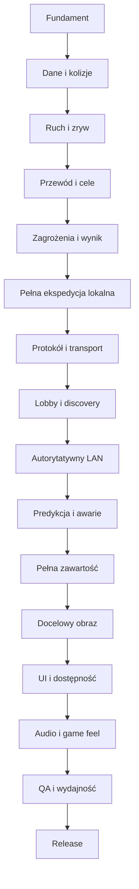

> Aktualizacja M11c: bieżące mapy, pola stabilizacji, stała kolejność celów0→1→2 i zakres weryfikacji opisuje [M11C_POZIOMY_I_WSPOLPRACA.md](M11C_POZIOMY_I_WSPOLPRACA.md). Poniższa specyfikacja bazowa nie nadpisuje tej aktualizacji.

# GAME_DESIGN — kontrakt 1.0

Źródło: [MASTER_SPEC.md](MASTER_SPEC.md), specyfikacja 1.0 (14 listopada 2026).
Poniższe rozdziały zachowują pełną treść źródła. Opisują wymagania docelowe; stan implementacji podaje [PROJECT_STATUS.md](PROJECT_STATUS.md).

## 1. Executive Summary

**LUMEN LINK** to kooperacyjna gra akcji i zagadek: dwa niewielkie drony tworzą pomiędzy sobą świetlny przewód. Gracze ustawiają jego przebieg, zaczepiają go o przekaźniki i zasilają opuszczoną stację, unikając wyraźnie zapowiadanych impulsów energetycznych. Każdy ruch zmienia wspólne narzędzie. Zryw pozwala uratować drona, ale na chwilę wyłącza przewód.

Pierwsze wydanie: trzy dopracowane mapy, trzy warianty kolejności celów i faz zagrożeń na mapę, dwa poziomy trudności, pełna ekspedycja, samouczek kontekstowy, wyniki, rewanż, wyszukiwanie LAN i połączenie po IP. Bez kont, internetu, botów i usług zewnętrznych podczas gry.

Wybór technologii: **Godot 4.5.2 Standard, statycznie typowany GDScript, Compatibility/OpenGL, ENet przez SceneMultiplayer**. Niewielka symulacja nie uzasadnia dodatkowego runtime .NET ani własnego silnika. Stan gry należy wyłącznie do hosta. Symulacja 60 Hz, wejście i pełne snapshoty 30 Hz, lokalne przewidywanie ruchu gościa. Kamera obejmuje całą planszę.

Najważniejsza decyzja ograniczająca ryzyko: przewód jest jednym lub dwoma odcinkami geometrycznymi, a nie fizyczną liną. Gra ma przewidywalne kolizje, mało obiektów i czytelny język wizualny. Profesjonalna jakość wynika z konsekwencji, animacji i dźwięku, nie z ogromnej liczby mechanik.

## 2. Pięć oryginalnych koncepcji

### A. LUMEN LINK

- **Gatunek:** kooperacyjna akcja przestrzenna z zagadkami.
- **Pomysł:** pozycje dwóch dronów wyznaczają świetlny przewód zasilający urządzenia.
- **Pętla:** odczytaj układ → ustaw przewód → utrzymuj zasilanie mimo impulsów → uruchom kolejne urządzenie → ewakuuj duet.
- **Wyróżnik:** wspólny przewód z jednym przełączanym zaczepem; osobisty unik chwilowo odbiera drużynie zasilanie.
- **Relacja graczy:** równorzędna kooperacja, naprzemienne role kotwicy i zwiadowcy.
- **Obraz:** miękkie sylwetki dronów, ceramiczna stacja, ciemny granat, miedziane i miętowe światło.
- **Powtarzalność:** warianty celów, dwa poziomy, medale za czas i ostrożność.
- **Złożoność:** średnia; trudniejsze jest przewidywanie ruchu niż geometria świata.
- **Ryzyko:** statyczne trzymanie wiązki mogłoby nudzić; rozwiązaniem są krótkie cele i zapowiadane, rytmiczne zagrożenia.

### B. DEEP FREIGHT

- **Gatunek:** kooperacyjna logistyka pod presją.
- **Pomysł:** dwie załogi miniaturowych holowników transportują ładunek przez port pod lodem.
- **Pętla:** wybierz zlecenie → podłącz ładunek → zsynchronizuj ciąg → rozładuj → napraw sprzęt.
- **Wyróżnik:** masa i bezwładność ładunku zmieniają znaczenie ruchu każdego gracza.
- **Relacja:** wspólne sterowanie jednym problemem fizycznym, rozdzielanie obowiązków.
- **Obraz:** izometryczny port w turkusie, mleczne światło pod lodem, industrialne detale.
- **Powtarzalność:** trasy, kombinacje ładunków, limity czasu.
- **Złożoność:** wysoka; synchronizowana fizyka i kolizje wielobryłowe.
- **Ryzyko:** opóźnienia destabilizują transport; ograniczenie do kinematycznych ładunków osłabia główną atrakcję.

### C. PAPER HEIST

- **Gatunek:** asymetryczna skradanka i łamigłówka.
- **Pomysł:** jeden gracz porusza papierowym złodziejem, drugi przestawia elementy makiety muzeum.
- **Pętla:** obserwacja patroli → zmiana układu → kradzież → skoordynowana ucieczka.
- **Wyróżnik:** zmiana scenografii w czasie rzeczywistym wpływa na linie widzenia.
- **Relacja:** bardzo różne interfejsy i odpowiedzialności, zamiana ról między misjami.
- **Obraz:** ręcznie wycinany papier, ograniczona paleta, teatralne cienie.
- **Powtarzalność:** alternatywne ścieżki i ocena cichego przejścia.
- **Złożoność:** wysoka; patrol AI, dwa modele sterowania i wiele autorskich zagadek.
- **Ryzyko:** jedna rola okazuje się znacznie ciekawsza, koszt zawartości rośnie szybciej niż kod.

### D. ORBIT SALVAGE

- **Gatunek:** rywalizacyjna arena zręcznościowa.
- **Pomysł:** dwa statki zakrzywiają orbity złomu i przechwytują cenne rdzenie.
- **Pętla:** przewidź orbitę → użyj impulsu → przechwyć → zdeponuj → zakłóć przeciwnika.
- **Wyróżnik:** działania pośrednie zamiast strzelania bezpośrednio w gracza.
- **Relacja:** pojedynek o kontrolę przestrzeni i ryzyko przewożenia ładunku.
- **Obraz:** elegancka mapa orbitalna, drobne statki i świetlne ślady.
- **Powtarzalność:** krótkie mecze, różne pozycje źródeł grawitacji.
- **Złożoność:** średnio wysoka; dużo poruszających się elementów.
- **Ryzyko:** trudna czytelność i przewaga hosta w precyzyjnych przechwytach.

### E. MOSS & MACHINE

- **Gatunek:** kooperacyjna strategia na jednej planszy.
- **Pomysł:** ogrodnik i mechanik odbudowują ekosystem na chodzącej maszynie.
- **Pętla:** planuj przepływ → sadź i montuj → przetrwaj zmianę pogody → rozbuduj.
- **Wyróżnik:** rośliny dostarczają energii, a mechanika reguluje ich środowisko.
- **Relacja:** zależne ekonomie i wspólne decyzje długoterminowe.
- **Obraz:** przyjazne ilustracje botaniczne z precyzyjnymi animacjami mechanizmów.
- **Powtarzalność:** układy zasobów i pogody.
- **Złożoność:** średnia technicznie, wysoka projektowo.
- **Ryzyko:** duży koszt balansu ekonomii, potencjalne oczekiwanie na partnera.

## 3. Ważone porównanie koncepcji

Oceny 1–10 są oceną projektową, nie pomiarem zainteresowania rynku. Wynik = suma iloczynów oceny i wagi.

| Koncepcja | Rozgrywka 25% | Oryginalność 15% | Obraz 20% | Powtarzalność 15% | Wykonalność 15% | Duet 10% | Wynik /10 |
|---|---:|---:|---:|---:|---:|---:|---:|
| LUMEN LINK | 9 | 8 | 9 | 8 | 9 | 10 | **8,80** |
| DEEP FREIGHT | 8 | 8 | 9 | 8 | 5 | 10 | 7,95 |
| PAPER HEIST | 9 | 9 | 9 | 6 | 5 | 9 | 7,95 |
| ORBIT SALVAGE | 8 | 8 | 9 | 9 | 6 | 8 | 8,05 |
| MOSS & MACHINE | 8 | 8 | 9 | 8 | 6 | 8 | 7,90 |

LUMEN LINK wygrywa nie najmniejszą liczbą funkcji, lecz wyjątkowo dobrym związkiem podstawowej mechaniki, współpracy i obrazu. Każdy element prezentacji może pokazywać realny stan przewodu.

## 4. Ostatecznie wybrana gra

**Tytuł:** LUMEN LINK. **Polskie hasło:** „Dwa drony. Jeden obwód”.

**Elevator pitch:** steruj jednym z dwóch dronów i wspólnie z partnerem prowadź światło przez wygaszoną stację. Ustawiaj przewód, używaj przekaźników i wybieraj moment na unik. Uruchom trzy sektory, zanim awarie wygaszą ostatnie zasilanie.

Odbiorcy: dwie osoby na komputerach w tej samej sieci, chcące krótkiej, komunikacyjnej kooperacji. Atmosfera spokojnego odkrywania przechodzi w kontrolowaną presję. Bez fabuły wymagającej przerywników filmowych i bez karzącej utraty wielogodzinnego postępu.

Filary:

1. **Wspólne narzędzie:** sens ruchu wynika z położenia partnera.
2. **Czytelne zagrożenie:** każde niebezpieczeństwo uprzedza o aktywacji.
3. **Natychmiastowa odpowiedź:** ruch i własny zryw reagują lokalnie.
4. **Krótka ekspedycja:** pełna sesja zwykle 5–9 minut; cel do sprawdzenia w playtestach.
5. **Mała, dopracowana zawartość:** trzy rozpoznawalne sektory zamiast kilkunastu podobnych plansz.

## 5. Kompletny Game Design Document

### 5.1 Struktura sesji

Host tworzy pokój. Drugi człowiek dołącza. Obaj oznaczają gotowość, host rozpoczyna. Wybierany jest poziom `NORMAL` albo `RELAXED` i seed ekspedycji. Kampania ma kolejność `dock → garden → reactor`. Każdy sektor ma trzy cele ładowane kolejno i wyjście. Po ukończeniu sektora obaj zatwierdzają przejście; nie resetuje to integrity. Po trzecim sektorze pojawia się wspólny wynik.

Nie ma meczu jednoosobowego, botów ani hot-seat w wydaniu. Tryb dwóch wejść na jednej klawiaturze istnieje wyłącznie w buildzie developerskim jako fixture do testów mechaniki i nigdy nie zastępuje testów LAN.

### 5.2 Warunki końca

`NORMAL`: wspólne integrity = 6, 180 sekund na sektor. `RELAXED`: integrity = 9, 240 sekund, łagodniejsze czasy zagrożeń opisane w §6. Po skończeniu zegara albo spadku integrity do zera następuje `FAILED`. Ukończenie trzeciego sektora daje `WON`. Nie ma remisów.

Każdy beacon wymaga 300 poprawnych ticków zasilania, czyli 5 sekund. Po ukończeniu wszystkich trzech obaj gracze muszą jednocześnie przebywać w strefie ewakuacji przez 120 ticków. Wyjście przed ukończeniem beaconów nie robi nic.

### 5.3 Postęp i powtórna gra

Odblokowania są kosmetyczne tylko w P2. W P0 wszystkie mapy są dostępne przez pełną ekspedycję; wybór pojedynczego sektora jest narzędziem developerskim. Lokalne rekordy zapisują seed, trudność, wynik, czas i datę. Nie wysyłają danych do sieci.

Wynik po sukcesie:

`score = 1000 × ukończone_beacony + 10 × suma(floor(pozostałe_ticki_sektora / 60)) + 600 × końcowe_integrity`.

Medale tylko dla `NORMAL`: 1 gwiazdka za zwycięstwo, 2 przy co najmniej 12000 pkt, 3 przy co najmniej 15000 pkt. `RELAXED` pokazuje wynik i osobny rekord bez porównywania medali. Wynik przegranej = punkty za ukończone beacony; bez premii za czas i integrity. Wynik nie wpływa na mechanikę. `WorldState.score` gromadzi 1000 pkt przy ukończeniu każdego beaconu oraz premię czasu przy przejściu do INTERMISSION/WON. Premia integrity jest dodana raz przy przejściu do WON. Przy FAILED wynik zostaje ustawiony na 1000 × całkowita liczba wcześniej ukończonych beaconów; tę liczbę przechowuje host w `completed_beacons_total:int`, zerowanym przy nowej ekspedycji. UI nigdy nie nalicza tych premii. `ObjectiveSystem.final_score` oblicza wartość końcową bez mutacji, a Simulation przypisuje ją tylko przy pierwszym przejściu do stanu końcowego.

### 5.4 Sterowanie

| Akcja | Klawiatura | Pad | Reguła |
|---|---|---|---|
| Ruch | WASD lub strzałki | Lewy drążek | analog, deadzone 0,20, długość ograniczona do 1 |
| Zryw | Spacja | dolny przycisk | nowa krawędź naciśnięcia; cooldown |
| Przekaźnik | E | lewy przycisk | przełącz najbliższy socket w zasięgu |
| Wskaż cel | Q | górny przycisk | marker przy pozycji własnego drona |
| Menu | Escape | Start | menu lokalne; gra nadal trwa |

Pełne remapowanie P0; podwójne przypisanie ostrzega. Nie wolno usunąć ostatniego bindingu `ui_cancel`. Utrata focusu zeruje osie i nie wytwarza krawędzi akcji. Menu, ekran błędu i loading również zerują wejście. Przyciski pokazują aktualne bindingi.

## 6. Systemy rozgrywki i mechaniki

### 6.1 Układ jednostek, czas i ruch

Świat ma 1280 × 720 jednostek. Jeden unit odpowiada jednemu pikselowi logicznemu. Oś X w prawo, Y w dół. Symulacja hosta: `dt = 1/60`. Tick to nieujemny licznik `u32`; nowy mecz rozpoczyna od 0. Żaden etap nie trwa na tyle długo, by zbliżyć się do wraparound; kodek i porównania sekwencji mimo to stosują arytmetykę modularną.

Dron ma fizyczny kwadrat o połowie boku 12 units i rysunek 40 × 40. Drony przenikają przez siebie: nie blokują partnera, nie popychają i nie tworzą dynamicznych kolizji wymagających rollbacku.

`desired = normalized_if_needed(input) × 240`; `velocity = move_toward(velocity, desired, 1800 × dt)` przy ruchu, hamowanie `2400 × dt` bez ruchu. Prędkość diagonalna nie przekracza 240. Kierunek zrywu to niezerowy aktualny input, w przeciwnym razie ostatni niezerowy kierunek, początkowo `(1,0)`.

Zryw: 720 units/s, 10 ticków, cooldown 90 ticków liczony od przyjęcia. Daje odporność na zagrożenia podczas tych 10 ticków. Nie pozwala przejść przez ściany. Przewód gaśnie, gdy którykolwiek dron jest w `DASH` lub `STUN`. Po końcu zrywu velocity jest ograniczone do 240, potem działa zwykłe hamowanie. Cooldown maleje również podczas `STUN`.

Stany drona: `NORMAL=0`, `DASH=1`, `STUN=2`. Idle/Move nie są osobnymi stanami symulacji — wynikają z velocity. Trafienie: `STUN` 12 ticków, velocity zero, odporność 90 ticków od trafienia. Podczas stun osie są ignorowane, krawędzie akcji konsumowane bez wykonania. Efekt odporności nie wyłącza przewodu po zakończeniu stun.

### 6.2 Kolizje

Wszystkie fizyczne przeszkody to statyczne prostokąty osiowe. Granice są czterema dodatkowymi prostokątami. `CollisionWorld` rozszerza każdy prostokąt o 12 i testuje odcinek ruchu środka drona metodą slab. Wybiera najmniejsze `t` w `[0,1]`; przy remisie normalna X przed Y, następnie niższy `wall_id`. Przesuwa do kontaktu z marginesem 0,01 unit, usuwa składową velocity i pozostałego ruchu skierowaną w normalną. Maksymalnie trzy iteracje slide na tick.

Spawn wewnątrz ściany oznacza wadę danych mapy i blokuje jej start. Nie „naprawiać” mapy losowym teleportem. Przy minimalnym numerycznym przeniknięciu <0,02 po korekcji sieciowej odsunąć po najmniejszej osi; większe naruszenie klienta rozwiązać przez autorytatywny snapshot. Wielokrotne nakładające się ściany scala walidator lub odrzuca mapę.

Test obrażeń wykorzystuje cały faktyczny tor ruchu po slide, nie prosty odcinek od początku do końca przecinający narożnik. Obliczenia mają być wspólne dla hosta i predykcji, ale deterministyczny lockstep między OS nie jest wymagany.

### 6.3 Przewód i przekaźniki

Bez zaczepu trasa = `[player0, player1]`. Z zaczepem = `[player0, socket, player1]`. Istnieje maksymalnie jeden wspólny aktywny socket, wybierany spośród trzech na mapie.

E przyjmuje najbliższy socket od środka drona w odległości ≤44, przy remisie niższe ID. Jeśli jest aktywny, wyłącza go; jeśli inny, zastępuje aktywny. Globalny cooldown przełączenia = 30 ticków. Dwie akcje w jednym ticku rozstrzyga naprzemienny priorytet: parzysty tick player0, nieparzysty player1; po przyjęciu pierwszej druga napotyka cooldown. E poza zasięgiem daje krótkie lokalne „podejdź bliżej”, bez kosztu.

Warunki przewodu: długość całej łamanej w `[56,720]`, obaj gracze `NORMAL`, żaden odcinek nie przecina ściany. Linia widoczności sprawdza ściany rozszerzone o 3 units. Kontakt z rozszerzoną ścianą blokuje. Nie ma elastycznego ciągnięcia dronów: przekroczenie długości wyłącza przewód, pokazując etykietę „Za daleko”.

Przewód nie rani i nie blokuje zagrożeń. Przechodzenie przez partnera zmienia geometrię bez dodatkowej reguły. Gdy dystans <56, komunikat „Odsuńcie się”. Stan przewodu = `ACTIVE`, `TOO_SHORT`, `TOO_LONG`, `OCCLUDED`, `PLAYER_BUSY`; priorytet przy kilku przyczynach: busy, too_short, too_long, occluded.

### 6.4 Ładowanie celu

Tylko beacon o indeksie `objective_index` może się ładować. Ma promień 22. Odcinek aktywnego przewodu trafia cel, jeśli najmniejsza odległość do środka beaconu ≤25. Punkt trafienia musi leżeć co najmniej 48 units wzdłuż całej trasy od każdego drona. Oznacza to rzeczywiste przeciągnięcie przewodu przez cel, a nie dotknięcie go dronem. Jeśli oba segmenty trafiają ten sam beacon, liczy się jedno ładowanie na tick.

Poprawny tick: `charge += 1`, `last_power_tick = tick`. Brak zasilania: pierwsze 30 ticków bez zmiany; potem co drugi tick `charge -= 1` do minimum 0. Po osiągnięciu 300: cel zatrzaskuje się, emituje zdarzenie i nigdy nie traci energii. Następny aktywuje się w kolejnym ticku; jego charge zaczyna od 0, a last_power_tick ustawiany jest na tick aktywacji, aby grace miało jednoznaczny początek. Brak mnożników i brak losowego krytycznego ładowania.

Pingi Q tworzą marker przy autorytatywnej pozycji drona na 90 ticków. Host przyjmuje najwyżej jeden ping na gracza co 60 ticków; późniejszy zastępuje poprzedni, więc istnieją najwyżej dwa markery. Pominięty ping nie wpływa na reguły. Marker ma numer slotu i sylwetkę drona, nie sam kolor.

### 6.5 Zagrożenia

Dwa typy, wszystkie widoczne na jednej planszy:

- `PULSE`: nieruchomy dysk o promieniu 48. Pełny cykl `NORMAL` = 300 ticków: off 180, telegraph 60, active 60. W `RELAXED`: 360 ticków = off 240, telegraph 90, active 30.
- `SWEEP`: pozioma albo pionowa wiązka między punktami `a,b`, o szerokości 10, przemieszcza się o `travel` wzdłuż osi prostopadłej. Cykl NORMAL = 360: off 60, telegraph 90, active 180, cooldown 30. Podczas active pozycja liniowo przechodzi od 0 do travel; kierunek odwracany co pełny cykl. RELAXED = 420: off 120, telegraph 120, active 120, cooldown 60. Pole telegraph pokazuje cały przyszły pas, a nie tylko pozycję początkową.

Faza = `(sector_tick + phase_offset) % period`. Zagrożenia nie używają timera renderowania. Obrażenie, jeśli przesuwający się fizyczny kwadrat drona przecina aktywny dysk lub pas wiązki w tym ticku. Dla koła: odległość do swept AABB lub równoważny dokładny test odcinka z rounded rectangle. Dla sweep: względny ruch drona i wiązki oraz slab test; rozszerzenie pasa o half-size drona. Narożników koła nie aproksymować dużym kwadratem.

Trafienie nieodpornego drona odejmuje 1 integrity. Globalna blokada obrażeń 30 ticków ogranicza utratę do 1 przy jednoczesnym trafieniu obu. **Obaj faktycznie trafieni** dostają stun i odporność, nawet gdy globalny koszt został już naliczony. `DASH` i odporność wykluczają trafienie. Spadek do zera kończy tick przegraną przed naliczeniem zwycięstwa.

### 6.6 Kolejność ticka i rozstrzyganie granic

1. Odbiór i walidacja sieci; przyjęcie komend przypadających na następny tick.
2. Zwiększenie ticka; dekrementacja timerów do minimum 0.
3. Interpretacja krawędzi akcji i priorytetu socketów; nowe dash/stun ustawiają pełne timery.
4. Ruch obu dronów i kolizje; zapamiętanie odcinków toru.
5. Ocena zagrożeń i trafień; zakończenie przy integrity=0.
6. Obliczenie przewodu, ładowanie jednego beaconu, ewakuacja.
7. Jeśli sukces sektora w tym ticku: zalicz sektor. W przeciwnym razie zmniejsz pozostały czas; jeśli 0, porażka. Dzięki temu ukończenie dokładnie w ostatnim ticku jest sukcesem.
8. Wytworzenie zdarzeń, immutable snapshotu i danych diagnostycznych. Wysyłka co drugi tick.

### 6.7 Balans i sprawdzenie atrakcyjności

Pierwszy cel możliwy do zrozumienia bez instrukcji w 45 s. Cel playtestu: co najmniej 4 z 5 nowych duetów zasilają go samodzielnie w 90 s. Po trzech ekspedycjach mediana `NORMAL` powinna dawać 50–80% zwycięstw. Jeśli za trudno, najpierw wydłużyć telegraph albo ograniczyć pokrywanie się zagrożeń, dopiero potem dodać integrity. Jeśli za łatwo, zwiększyć potrzebę zmiany ustawienia, nie prędkość dronów ani ukryte losowanie.

Nie dodawać wymogu rozmowy głosowej: pingi i stan przewodu muszą wystarczyć do ukończenia gry.

## 7. Mapy, poziomy i zawartość

### 7.1 Kontrakt map

Pole gry: `Rect2(32,88,1216,600)`. HUD zajmuje górne 64 units; strefa 64–88 jest wizualnym marginesem. Centra dronów pozostają w `[44,1236] × [100,676]`. Wspólny spawn `(112,592)` i `(176,592)`, wyjście `(1168,592)`, promień 64. Żadna ściana, pulse ani obszar sweep nie może nachodzić na dysk radius96 przy wyjściu oraz obszar spawn `Rect2(64,536,176,112)`.

Dane nie są przesyłane przez sieć. Obie kopie gry mają identyczne mapy zweryfikowane hashem zawartości. Pozycje poniżej są normatywnym layoutem startowym. Zmiana pozycji wymaga aktualizacji danych, testu osiągalności i content hash.

| Mapa | Ściany `(x,y,w,h)` | Beacony ID 0,1,2 | Sockety ID 0,1,2 |
|---|---|---|---|
| `dock` | (432,384,96,176); (744,160,96,192) | (352,520); (640,232); (1008,456) | (384,336); (640,416); (896,368) |
| `garden` | (288,208,160,80); (560,392,160,80); (864,208,96,208) | (352,376); (688,224); (1040,432) | (496,320); (784,344); (1008,336) |
| `reactor` | (368,248,80,224); (608,152,96,176); (832,384,144,80) | (288,392); (784,240); (1008,520) | (496,240); (560,512); (944,304) |

| Mapa | PULSE: środek, offset NORMAL | SWEEP: a,b,travel,offset NORMAL |
|---|---|---|
| dock | (544,544),0; (944,224),150 | (512,176)→(688,176), (0,160), 90 |
| garden | (496,496),0; (752,176),100; (1056,320),200 | (480,304)→(800,304), (0,192), 0 |
| reactor | (272,272),0; (768,520),100; (1040,208),200 | (480,352)→(768,352), (0,176), 30; (1008,160)→(1008,432), (96,0), 180 |

Kolizje hazardów ze ścianami są dozwolone; ściany nie osłaniają przed hazardem, dlatego grafika active jest widoczna nad dekoracją ścian. Pasy nie przecinają bezpiecznego wyjścia. Beacony mogą leżeć w obszarze zagrożenia, ponieważ ładowanie odbywa się z dystansu. Walidator odrzuca fizycznie niedostępne sockety.

Wariant `v = (seed + 17 × sector_index) % 3`. Kolejności: v0 `[0,1,2]`, v1 `[1,2,0]`, v2 `[2,0,1]`. Każdy hazard dostaje dodatkowo `37 × v` ticków offsetu. Dla RELAXED bazowy offset skaluje się przez `relaxed_period / normal_period`, zaokrąglając w dół, potem dodaje `37 × v`. To wariacje autorskich układów, nie generator losowych, potencjalnie nierozwiązywalnych poziomów.

### 7.2 Progresja nauki

Dock uczy linii prostej, odległości i pierwszego socketu. Garden wymusza częstsze obchodzenie ścian i zmianę strony. Reactor łączy dwa rodzaje zagrożeń. Nie wymaga nowych nieobjaśnionych przycisków.

Pierwsza ekspedycja: trzy podpowiedzi, każda najwyżej raz — „Przeciągnijcie światło przez oznaczony cel”, „E przełącza przekaźnik”, „Zryw omija impuls, ale przerywa zasilanie”. Podpowiedź znika po odpowiednim zdarzeniu lub po 8 s; można wyłączyć lub ponownie włączyć w Controls.

### 7.3 Walidacja zawartości

Kontrola schematu, limitów i bezpiecznych obszarów jest automatyczna. Grid flood-fill krokiem 8 units z rozszerzonymi ścianami sprawdza dojście każdego drona do socketów i wyjścia. Nie dowodzi rozwiązania łamigłówki przewodu: dla każdej kombinacji mapa×wariant×trudność wymagany jest zapisany test manualny dwóch graczy. Dodatkowo deterministyczny scenariusz wejścia testuje przynajmniej jedną trasę sukcesu na mapę. P0 = 18 konfiguracji do odbioru, nie 18 osobno rysowanych map.

## 8. Kierunek artystyczny i produkcja assetów

### 8.1 Styl

Precyzyjna grafika 2D z miękkimi, lekko ilustracyjnymi kształtami. Stacja przypomina połączenie ceramiki i starego przyrządu optycznego. Bez realistycznych tekstur i bez stylistyki wojskowego HUD. Dron A ma okrągłą sylwetkę i dwa krótkie stabilizatory; B jest zaokrąglonym rombem z wycięciem. Rozróżnienie działa również w skali szarości.

Paleta: tło `#101B2 B`, panel `#1C2C3C`, powierzchnia `#344A58`, porcelana `#DCE8DE`, światło A `#66E0C2`, światło B `#FFBE78`, aktywny przewód `#E9F6BF`, zagrożenie `#F07178`, telegraph `#F4D27A`, tekst `#F2F5EF`, tekst wtórny `#B3C2C6`. Czerwony nigdy nie jest jedynym sygnałem obrażeń: dodaj obrys, ikonę i animację.

Dron: rdzeń 40×40 w ramce 64×64; collider 24×24 jest zaznaczany delikatnym cieniem centralnym. 65% jasny korpus, 20% kolor identyfikacji, 15% ciemne detale. „Twarz” to pojedynczy sensor, bez konieczności animowania kończyn.

### 8.2 Animacje i efekty

Dron ma wektorowy korpus i osobny sensor; animacje transformacjami: idle bob ±1,5 px/1,8 s; move lean max8° i squash 0,96×1,04; dash stretch 1,18 w osi ruchu przez 0,07 s; hit flash 0,08 s; stun drganie 2 px/0,12 s; odporność obrys pulsujący 4 Hz, bez ukrywania sylwetki.

Nie potrzeba klatek sprite sheet dla dronów: to **docelowy styl animacji części**, a nie placeholder. Wymagane klipy AnimationLibrary: `idle` 1,8 s loop, `move` 0,5 s loop, `dash` 0,167 s, `hit` 0,2 s, `celebrate` 1 s. Stan gry wyzwala klipy, nigdy odwrotnie. Efekty charge i hazard wynikają z parametrów shaderów.

Przewód ma linię rdzenia 3 px i dwie szersze, półprzezroczyste warstwy 8/16 px. Brak pełnoekranowego bloom. Przy zerwaniu przez ścianę rysuje się przerywany przebieg i znacznik blokady. Zakończenie beaconu: pierścień rozszerzający się 24→92 px przez 0,4 s, 20 drobin, zmiana dekoracyjnych kabli sektora.

Screen shake tylko lokalny, renderingowy: trafienie max3 px, 0,16 s; beacon max1,5 px, 0,1 s. Domyślnie 50%, możliwość 0%. Brak zatrzymywania hostowej symulacji dla hit-stop. Wizualne spowolnienie efektu trafienia może trwać 40 ms, lecz nie zmienia drona ani wejścia.

### 8.3 Manifest assetów

Wszystkie ścieżki względem katalogu projektu. SVG importowane do rastra przez Godot w skali 1. Dla SVG wymagane poprawne `viewBox`; bez zewnętrznych obrazów, fontów i skryptów. Grafika źródłowa jest własna. Font dostarczony z licencją OFL; nie pobierać go podczas uruchamiania gry.

| ID / ścieżka | Format i wymiary | Cel i animacja | Alpha / zależności |
|---|---|---|---|
| `drone_a`: assets/art/drone_a.svg | SVG 64×64 | korpus A, transformacje klipów | tak; drone.tscn |
| `drone_b`: assets/art/drone_b.svg | SVG 64×64 | korpus B | tak; drone.tscn |
| `sensor`: assets/art/sensor.svg | SVG 16×16 | osobna pozycja sensora 0–2 px | tak |
| `station_atlas`: assets/art/station_atlas.svg | SVG 1024×1024 | 16 kafli 256×256; ceramiczna podłoga/ściana | tak; atlas_regions.json |
| `devices`: assets/art/devices.svg | SVG 512×256 | osiem komórek128×128: beacon off/on, socket off/on, exit off/on, pulse, sweep emitter | tak; atlas_regions.json |
| `icons`: assets/ui/icons.svg | SVG 512×256 | 32 komórki64×64, pierwsze16: ruch,zryw,socket,ping,ready,host,join,back,sound,settings,warning,heart,star,clock,link,exit | tak; pozostałe przezroczyste |
| `title`: assets/ui/title.svg | SVG 640×160 | własny logotyp typograficzny wektorowy | tak |
| `grain`: assets/art/grain.png | PNG 128×128 | subtelna ziarnistość tła, bez animacji | nie; shader opcjonalny |
| `particle`: assets/art/particle.svg | SVG 16×16 | drobina; jeden wspólny materiał | tak |
| `font`: assets/fonts/AtkinsonHyperlegible-Regular.ttf | TTF | UI z polskimi znakami | licencja assets/fonts/OFL.txt |
| `font_bold`: assets/fonts/AtkinsonHyperlegible-Bold.ttf | TTF | nagłówki i wynik | ta sama licencja |
| `dock_bg`: assets/art/dock_bg.svg | SVG 1280×720 | dalekie rury, dok, spokojny granat | nie; mapa dock |
| `garden_bg`: assets/art/garden_bg.svg | SVG 1280×720 | roślinne ornamenty, mięta | nie |
| `reactor_bg`: assets/art/reactor_bg.svg | SVG 1280×720 | miedziane pierścienie, cieplejszy kontrast | nie |

`assets/art/atlas_regions.json`: mapowanie ID na całkowite `x,y,w,h`, margines bezpieczeństwa 2 px wewnątrz komórek. `AssetCatalog` tworzy współdzielone AtlasTexture podczas bootu. Żadne assety nie są ładowane z sieci.

Pipeline: szkic proporcji → SVG w edytorze wektorowym → import i podgląd w 720p → test w skali szarości → dopiero detale. Tła mogą być proceduralnie komponowane z własnych kształtów; seedy dekoracji nie wpływają na symulację. Narzędzia generatywne tylko do inspiracji lub dekoracyjnych teł, nigdy do kolizji, napisów, masek i atlasów wymagających dokładnych regionów. P0 nie wymaga ich użycia.

## 9. UI/UX

### 9.1 Wspólny system

Interfejs logiczny 1280×720, bazowa siatka8 px, margines32, odstęp elementów16, panel padding24, radius12. Tekst body20, pomoc16, nagłówek32, tytuł48. Minimalny button 200×48; rząd przycisków ma odstęp12. Klikalne ikony co najmniej48×48. Klawiatura i pad obsługują wszystkie funkcje, mysz też.

Stany komponentu: normal, hover, focus, pressed, disabled, busy. Focus ma jasny podwójny obrys; disabled nie polega tylko na przezroczystości. Przejście koloru 90 ms, pressed skala0,98/60 ms, przejście ekranu crossfade180 ms. Reduced motion: crossfade80 ms, bez przesuwania i skalowania.

Na 1280×720 wszystko mieści się bez scrolla poza listą pokoi. Okno minimum960×540; przy mniejszym fizycznym obrazie nie zmniejszać logicznych fontów. UI skaluje się wraz z viewportem. Dodatkowe `ui_scale` 1,0/1,15/1,3 zwiększa fonty i kontrolki; panele przechodzą w pionowy układ i mogą scrollować, HUD pozostaje jednowierszowy z krótszymi etykietami. Test 1,3 przy 960×540 obowiązkowy.

### 9.2 Specyfikacja ekranów

| Ekran / ID | Układ, elementy i akcje | Stany, błędy i przejście |
|---|---|---|
| Splash / BOOT | logo centralnie, wskaźnik ładowania, wersja w rogu | trwa tylko realny import/load; min0,4 s max bez sztucznego oczekiwania; błąd assetu → modal i Exit |
| Main / MENU | lewy panel: Graj przez LAN, Ustawienia, Sterowanie, Autorzy, Wyjdź; po prawej animowana stacja | pierwszy focus Graj; Back zamyka submenu; bez automatycznego network request |
| Host / HOST_FORM | nazwa pokoju≤24 znaki, port1024–65535, trudność, seed opcjonalny, Utwórz, Wstecz | błąd bind przy polu port; podczas tworzenia busy i Cancel; sukces Lobby |
| Join / JOIN_FORM | zakładki „W sieci” i „Adres IP”; IPv4, port, Dołącz; historia tylko ostatniego poprawnego adresu | walidacja lokalna; timeout8 s; Cancel natychmiast zamyka peer |
| Discovery / DISCOVER | lista: pokój, adres, zajętość, wersja; Odśwież; Połącz po IP | skan aktywny10 s, wyniki TTL3 s; po5 s pomoc o wspólnej sieci; brak wyników nie jest crashem |
| Lobby / LOBBY | dwie duże karty z nazwą, sylwetką i Ready; seed i trudność; IP hosta; Start tylko host | druga karta „Czekam”; modyfikacja ustawień zeruje obie gotowości; Start wymaga2 ready i zgodnych hashy |
| Loading / LOADING | nazwa sektora, postęp własny, „Czekam na partnera”, Cancel | deadline15 s; problem → Lobby z komunikatem; obie strony potwierdzają zasoby |
| HUD / PLAYING | góra: integrity, 3 cele, zegar, ping sieci; dół przy własnym dronie ring dash | przewód podaje jedną przyczynę nieaktywności; cel oznaczony numerem i ringiem, nie kolorem tylko |
| Pause / OVERLAY | Wróć, Ustawienia, Sterowanie, Opuść; napis „Gra nadal trwa” | to nakładka lokalna; sterowanie dronem=zero; opuszczenie potwierdzane, bo kończy duet |
| Settings / SETTINGS | zakładki Obraz, Dźwięk, Dostępność; suwaki, fullscreen, FPS, redukcja ruchu | obraz zatwierdź w10 s lub przywróć; audio natychmiast; zapis błędu nie blokuje grania |
| Controls / CONTROLS | tabela działań, Zmień, Przywróć; tutorial toggle | esc anuluje capture; konflikt pokazuje Zamień/Anuluj; żaden ruch z capture nie trafia do gry |
| Sector summary / INTERMISSION | sektory, czas, zachowane integrity; „Dalej” każdej osoby | ready obu → ładowanie kolejnego; odrzuca spóźnione komendy poprzedniego sektora |
| Results / RESULTS | wynik, 3 gwiazdki/relaxed, czas, uratowane integrity; rewanż, lobby | tylko host publikuje wynik; animacja naliczania≤1 s, klik pomija |
| Rematch / REMATCH_VOTE | dwa checkboxy przy zgodzie, Ten sam seed/Nowy seed hosta | dwa głosy tworzą nowy match_id; brak zgody nic nie resetuje; wyjście usuwa głos |
| Error / ERROR_MODAL | krótka przyczyna, szczegóły rozwijane, Ponów/Wróć/Kopiuj diagnostykę | modal przejmuje focus; po zamknięciu focus wraca do źródła; nie pokazuje surowego stack trace |
| Credits / CREDITS | autorstwo, Godot, font, licencje, Back | dostępne offline, długi tekst scrollowalny |

Menu nie wstrzymuje symulacji, bo cicha pauza jednej osoby byłaby niejasna. W P2 możliwa wspólna pauza po głosowaniu; nie projektować jej do P0.

## 10. Audio

Buses: `Master → Music`, `Master → SFX`, `Master → UI`, `Master → Ambience`. Master domyślnie0,8; Music0,5; SFX0,8; UI0,7; Ambience0,4. Slider0–1 mapowany przez `linear_to_db`, zero wycisza bus. Wszystkie ustawienia zapisują się lokalnie.

Muzyka: własna, oszczędna synteza, 96 BPM. Jeden utwór 80 s (32 takty4/4) w trzech zgodnych długością stemach: base, pulse, resolve. Start wspólny lokalnie przy starcie sektora; miks zmienia się płynnie250 ms zgodnie z postępem. Nie synchronizować audio sample-by-sample przez LAN. W P0 można wygenerować utwór offline przy użyciu `tools/asset_bake.gd`, ale musi mieć kompozycję, zmianę harmonii co8 taktów i ręcznie sprawdzony loop; przypadkowe tony nie przechodzą odbioru.

| Asset / ścieżka w assets/audio/ | Format | Trigger | Reguła |
|---|---|---|---|
| music_base.ogg; music_pulse.ogg; music_resolve.ogg | OGG48kHz stereo,80s każdy | start i postęp sektora | wspólny czas startu, loop bez kliknięcia |
| ambience.ogg | OGG48kHz stereo,20s | wejście na mapę | cicho, loop, fade300 ms |
| move.wav | WAV48kHz16-bit mono,1s loop | prędkość>20 | cichy silnik, pitch0,95–1,05, niezależne instancje |
| dash.wav | WAV48kHz16-bit mono,0,18s | przyjęty/predykowany zryw | deduplikacja po player+dash_serial |
| socket.wav | WAV mono,0,2s | przyjęcie socketu | autorytatywne zdarzenie |
| charge.wav | WAV mono,1s loop | aktywne ładowanie | pitch zależy od charge, nie tworzyć instancji co tick |
| beacon.wav | WAV mono,0,65s | ukończenie celu | priorytet8 |
| hit.wav | WAV mono,0,25s | trafienie | priorytet10, kompresja bez przesterowania |
| telegraph.wav | WAV mono,0,15s | start telegraph | priorytet6, max2/100 ms |
| ping.wav | WAV mono,0,18s | ping partnera | priorytet4 |
| ui_focus.wav; ui_accept.wav; ui_back.wav | WAV mono,0,05/0,1/0,1s | UI | debounce focus40 ms |
| victory.wav; defeat.wav | WAV stereo,1,5s/1s | wynik | przerwanie charge i wygaszenie ambience |

Maksymalnie24 głosy SFX,2 ciągłe silniki,1 charge,3 music,1 ambience. Pula AudioStreamPlayer2D dla efektów świata, UI bez panoramy. Panorama delikatna: zakres stereo ograniczony do0,5. Przy pełnej puli odrzuć najniższy priorytet albo najstarszy efekt tego samego typu. Dźwięk zagrożenia nigdy nie jest jedynym ostrzeżeniem.

Zdarzenia symulacji są jedynym źródłem hit/beacon/socket/result. Pojawienie się zmiany w snapshot może odtworzyć wizualny stan nawet po utracie eventu, ale nie musi odtwarzać dawnego dźwięku. Network snapshot nie jest zegarem odtwarzania sampli.

## 24. Zakres i priorytety

| Priorytet | Funkcje |
|---|---|
| **P0 — kompletne pierwsze wydanie** | dokładnie2osoby; trzy sektory; przewód i socket; dash; pulse/sweep; oba poziomy; warianty; pełny wynik i rekord; docelowa grafika i audio; tutorial kontekstowy; settings/remap/accessibility; host/join/discovery/directIP; ready/loading/disconnect/rematch; prediction/interpolation; walidacja protokołu; Windows/Linux export; testy |
| **P1 — po stabilnym P0** | skierowane broadcasty wielu interfejsów; dodatkowe2mapy; przegląd rekordów per seed; opcjonalne2 światła 2D; dodatkowe warianty muzyki; ulepszona adaptacja interpolation delay |
| **P2 — przyszłość** | wspólna pauza; kosmetyki dronów; edytor autorskich map; replay; reconnect ze snapshotem; lokalizacje; tryb pojedynku |

Nie należą do projektu: internet matchmaking, konta, płatności, voice chat, dedicated server, host migration, modowanie kodu w trakcie sesji. P1/P2 nie mogą być warunkiem sensownej gry P0. Brak reconnect i global pause jest świadomym zakresem, nie zakamuflowanym stubem.

### Zależności rozwoju i ścieżka krytyczna

Wykres jest zależnością małych, grywalnych przyrostów. Opracowanie artu może odbywać się wcześniej obok prac logicznych, ale jego integracja ma bramkę M11. Krytyczne technicznie: M01–M04, M06–M09, M14–M15. Krytyczne jakościowo: M10–M13. Przy małym budżecie czasu usuwać P1/P2, nie zespalać M08 iM09 w jeden niezweryfikowany skok.

