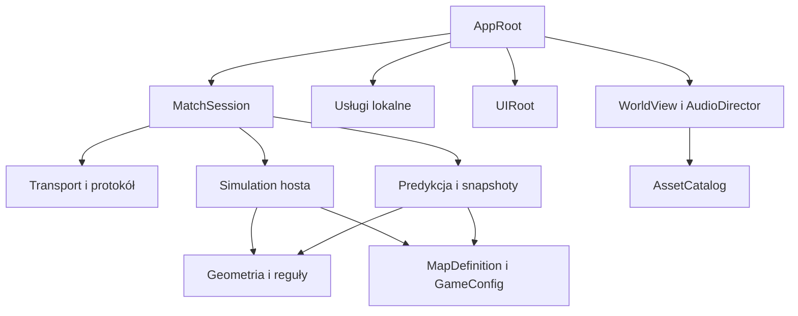
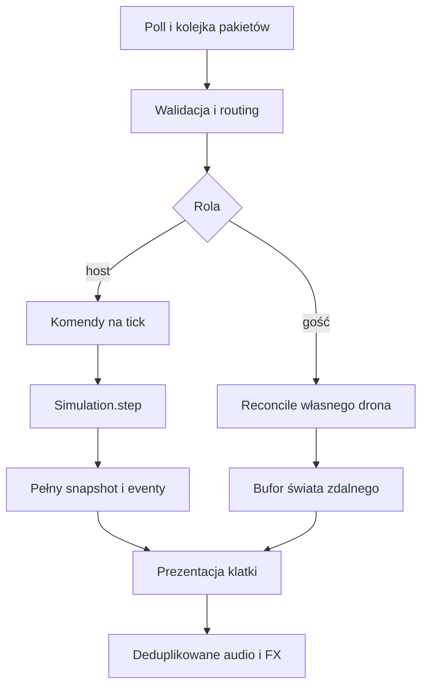
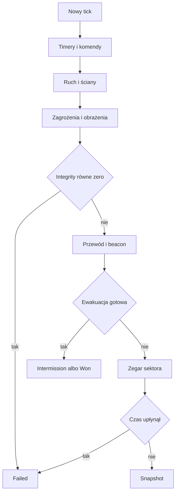
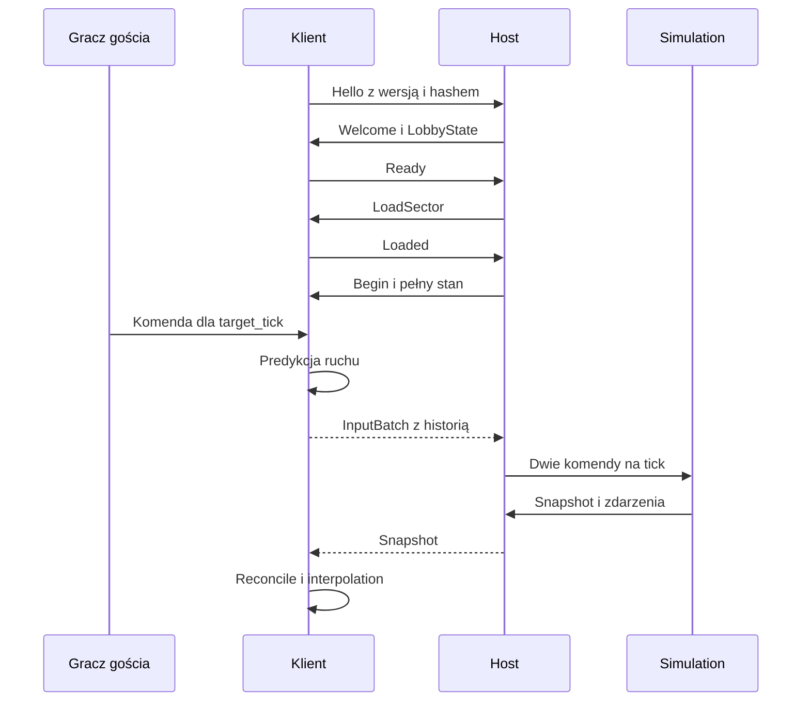
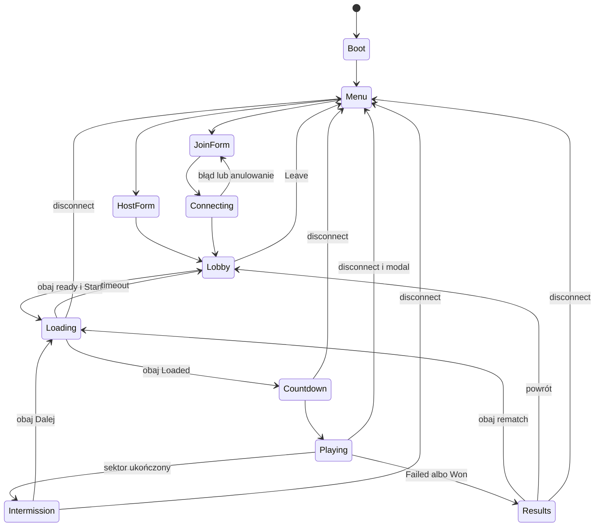
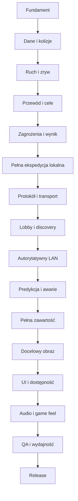

# LUMEN LINK — kompletny plan produkcji

**Specyfikacja 1.0 • 14 listopada 2026 • platformy: Windows i Linux • dokładnie dwóch graczy przez LAN**

Dokument jest projektem gry i kontraktem implementacyjnym dla GPT-6.1 Sol. Nie zawiera implementacji gry. Parametry balansu i wydajności są wartościami startowymi oraz kryteriami przyszłych pomiarów, nie wynikami przeprowadzonych testów gry. Nazwa jest roboczą nazwą produktu; przed publiczną dystrybucją należy sprawdzić możliwość jej używania.

## 1. Executive Summary

**LUMEN LINK** to kooperacyjna gra akcji i zagadek: dwa niewielkie drony tworzą pomiędzy sobą świetlny przewód. Gracze ustawiają jego przebieg, zaczepiają go o przekaźniki i zasilają opuszczoną stację, unikając wyraźnie zapowiadanych impulsów energetycznych. Każdy ruch zmienia wspólne narzędzie. Zryw pozwala uratować drona, ale na chwilę wyłącza przewód.

Pierwsze wydanie: trzy dopracowane mapy, trzy warianty kolejności celów i faz zagrożeń na mapę, dwa poziomy trudności, pełna ekspedycja, samouczek kontekstowy, wyniki, rewanż, wyszukiwanie LAN i połączenie po IP. Bez kont, internetu, botów i usług zewnętrznych podczas gry.

Wybór technologii: **Godot 4.5.2 Standard, statycznie typowany GDScript, Compatibility/OpenGL, ENet przez SceneMultiplayer**. Niewielka symulacja nie uzasadnia dodatkowego runtime .NET ani własnego silnika. Stan gry należy wyłącznie do hosta. Symulacja 60 Hz, wejście i pełne snapshoty 30 Hz, lokalne przewidywanie ruchu gościa. Kamera obejmuje całą planszę.

Najważniejsza decyzja ograniczająca ryzyko: przewód jest jednym lub dwoma odcinkami geometrycznymi, a nie fizyczną liną. Gra ma przewidywalne kolizje, mało obiektów i czytelny język wizualny. Profesjonalna jakość wynika z konsekwencji, animacji i dźwięku, nie z ogromnej liczby mechanik.

## 2. Pięć oryginalnych koncepcji

### A. LUMEN LINK

- **Gatunek:** kooperacyjna akcja przestrzenna z zagadkami.
- **Pomysł:** pozycje dwóch dronów wyznaczają świetlny przewód zasilający urządzenia.
- **Pętla:** odczytaj układ → ustaw przewód → utrzymuj zasilanie mimo impulsów → uruchom kolejne urządzenie → ewakuuj duet.
- **Wyróżnik:** wspólny przewód z jednym przełączanym zaczepem; osobisty unik chwilowo odbiera drużynie zasilanie.
- **Relacja graczy:** równorzędna kooperacja, naprzemienne role kotwicy i zwiadowcy.
- **Obraz:** miękkie sylwetki dronów, ceramiczna stacja, ciemny granat, miedziane i miętowe światło.
- **Powtarzalność:** warianty celów, dwa poziomy, medale za czas i ostrożność.
- **Złożoność:** średnia; trudniejsze jest przewidywanie ruchu niż geometria świata.
- **Ryzyko:** statyczne trzymanie wiązki mogłoby nudzić; rozwiązaniem są krótkie cele i zapowiadane, rytmiczne zagrożenia.

### B. DEEP FREIGHT

- **Gatunek:** kooperacyjna logistyka pod presją.
- **Pomysł:** dwie załogi miniaturowych holowników transportują ładunek przez port pod lodem.
- **Pętla:** wybierz zlecenie → podłącz ładunek → zsynchronizuj ciąg → rozładuj → napraw sprzęt.
- **Wyróżnik:** masa i bezwładność ładunku zmieniają znaczenie ruchu każdego gracza.
- **Relacja:** wspólne sterowanie jednym problemem fizycznym, rozdzielanie obowiązków.
- **Obraz:** izometryczny port w turkusie, mleczne światło pod lodem, industrialne detale.
- **Powtarzalność:** trasy, kombinacje ładunków, limity czasu.
- **Złożoność:** wysoka; synchronizowana fizyka i kolizje wielobryłowe.
- **Ryzyko:** opóźnienia destabilizują transport; ograniczenie do kinematycznych ładunków osłabia główną atrakcję.

### C. PAPER HEIST

- **Gatunek:** asymetryczna skradanka i łamigłówka.
- **Pomysł:** jeden gracz porusza papierowym złodziejem, drugi przestawia elementy makiety muzeum.
- **Pętla:** obserwacja patroli → zmiana układu → kradzież → skoordynowana ucieczka.
- **Wyróżnik:** zmiana scenografii w czasie rzeczywistym wpływa na linie widzenia.
- **Relacja:** bardzo różne interfejsy i odpowiedzialności, zamiana ról między misjami.
- **Obraz:** ręcznie wycinany papier, ograniczona paleta, teatralne cienie.
- **Powtarzalność:** alternatywne ścieżki i ocena cichego przejścia.
- **Złożoność:** wysoka; patrol AI, dwa modele sterowania i wiele autorskich zagadek.
- **Ryzyko:** jedna rola okazuje się znacznie ciekawsza, koszt zawartości rośnie szybciej niż kod.

### D. ORBIT SALVAGE

- **Gatunek:** rywalizacyjna arena zręcznościowa.
- **Pomysł:** dwa statki zakrzywiają orbity złomu i przechwytują cenne rdzenie.
- **Pętla:** przewidź orbitę → użyj impulsu → przechwyć → zdeponuj → zakłóć przeciwnika.
- **Wyróżnik:** działania pośrednie zamiast strzelania bezpośrednio w gracza.
- **Relacja:** pojedynek o kontrolę przestrzeni i ryzyko przewożenia ładunku.
- **Obraz:** elegancka mapa orbitalna, drobne statki i świetlne ślady.
- **Powtarzalność:** krótkie mecze, różne pozycje źródeł grawitacji.
- **Złożoność:** średnio wysoka; dużo poruszających się elementów.
- **Ryzyko:** trudna czytelność i przewaga hosta w precyzyjnych przechwytach.

### E. MOSS & MACHINE

- **Gatunek:** kooperacyjna strategia na jednej planszy.
- **Pomysł:** ogrodnik i mechanik odbudowują ekosystem na chodzącej maszynie.
- **Pętla:** planuj przepływ → sadź i montuj → przetrwaj zmianę pogody → rozbuduj.
- **Wyróżnik:** rośliny dostarczają energii, a mechanika reguluje ich środowisko.
- **Relacja:** zależne ekonomie i wspólne decyzje długoterminowe.
- **Obraz:** przyjazne ilustracje botaniczne z precyzyjnymi animacjami mechanizmów.
- **Powtarzalność:** układy zasobów i pogody.
- **Złożoność:** średnia technicznie, wysoka projektowo.
- **Ryzyko:** duży koszt balansu ekonomii, potencjalne oczekiwanie na partnera.

## 3. Ważone porównanie koncepcji

Oceny 1–10 są oceną projektową, nie pomiarem zainteresowania rynku. Wynik = suma iloczynów oceny i wagi.

| Koncepcja | Rozgrywka 25% | Oryginalność 15% | Obraz 20% | Powtarzalność 15% | Wykonalność 15% | Duet 10% | Wynik /10 |
|---|---:|---:|---:|---:|---:|---:|---:|
| LUMEN LINK | 9 | 8 | 9 | 8 | 9 | 10 | **8,80** |
| DEEP FREIGHT | 8 | 8 | 9 | 8 | 5 | 10 | 7,95 |
| PAPER HEIST | 9 | 9 | 9 | 6 | 5 | 9 | 7,95 |
| ORBIT SALVAGE | 8 | 8 | 9 | 9 | 6 | 8 | 8,05 |
| MOSS & MACHINE | 8 | 8 | 9 | 8 | 6 | 8 | 7,90 |

LUMEN LINK wygrywa nie najmniejszą liczbą funkcji, lecz wyjątkowo dobrym związkiem podstawowej mechaniki, współpracy i obrazu. Każdy element prezentacji może pokazywać realny stan przewodu.

## 4. Ostatecznie wybrana gra

**Tytuł:** LUMEN LINK. **Polskie hasło:** „Dwa drony. Jeden obwód”.

**Elevator pitch:** steruj jednym z dwóch dronów i wspólnie z partnerem prowadź światło przez wygaszoną stację. Ustawiaj przewód, używaj przekaźników i wybieraj moment na unik. Uruchom trzy sektory, zanim awarie wygaszą ostatnie zasilanie.

Odbiorcy: dwie osoby na komputerach w tej samej sieci, chcące krótkiej, komunikacyjnej kooperacji. Atmosfera spokojnego odkrywania przechodzi w kontrolowaną presję. Bez fabuły wymagającej przerywników filmowych i bez karzącej utraty wielogodzinnego postępu.

Filary:

1. **Wspólne narzędzie:** sens ruchu wynika z położenia partnera.
2. **Czytelne zagrożenie:** każde niebezpieczeństwo uprzedza o aktywacji.
3. **Natychmiastowa odpowiedź:** ruch i własny zryw reagują lokalnie.
4. **Krótka ekspedycja:** pełna sesja zwykle 5–9 minut; cel do sprawdzenia w playtestach.
5. **Mała, dopracowana zawartość:** trzy rozpoznawalne sektory zamiast kilkunastu podobnych plansz.

## 5. Kompletny Game Design Document

### 5.1 Struktura sesji

Host tworzy pokój. Drugi człowiek dołącza. Obaj oznaczają gotowość, host rozpoczyna. Wybierany jest poziom `NORMAL` albo `RELAXED` i seed ekspedycji. Kampania ma kolejność `dock → garden → reactor`. Każdy sektor ma trzy cele ładowane kolejno i wyjście. Po ukończeniu sektora obaj zatwierdzają przejście; nie resetuje to integrity. Po trzecim sektorze pojawia się wspólny wynik.

Nie ma meczu jednoosobowego, botów ani hot-seat w wydaniu. Tryb dwóch wejść na jednej klawiaturze istnieje wyłącznie w buildzie developerskim jako fixture do testów mechaniki i nigdy nie zastępuje testów LAN.

### 5.2 Warunki końca

`NORMAL`: wspólne integrity = 6, 180 sekund na sektor. `RELAXED`: integrity = 9, 240 sekund, łagodniejsze czasy zagrożeń opisane w §6. Po skończeniu zegara albo spadku integrity do zera następuje `FAILED`. Ukończenie trzeciego sektora daje `WON`. Nie ma remisów.

Każdy beacon wymaga 300 poprawnych ticków zasilania, czyli 5 sekund. Po ukończeniu wszystkich trzech obaj gracze muszą jednocześnie przebywać w strefie ewakuacji przez 120 ticków. Wyjście przed ukończeniem beaconów nie robi nic.

### 5.3 Postęp i powtórna gra

Odblokowania są kosmetyczne tylko w P2. W P0 wszystkie mapy są dostępne przez pełną ekspedycję; wybór pojedynczego sektora jest narzędziem developerskim. Lokalne rekordy zapisują seed, trudność, wynik, czas i datę. Nie wysyłają danych do sieci.

Wynik po sukcesie:

`score = 1000 × ukończone_beacony + 10 × suma(floor(pozostałe_ticki_sektora / 60)) + 600 × końcowe_integrity`.

Medale tylko dla `NORMAL`: 1 gwiazdka za zwycięstwo, 2 przy co najmniej 12000 pkt, 3 przy co najmniej 15000 pkt. `RELAXED` pokazuje wynik i osobny rekord bez porównywania medali. Wynik przegranej = punkty za ukończone beacony; bez premii za czas i integrity. Wynik nie wpływa na mechanikę. `WorldState.score` gromadzi 1000 pkt przy ukończeniu każdego beaconu oraz premię czasu przy przejściu do INTERMISSION/WON. Premia integrity jest dodana raz przy przejściu do WON. Przy FAILED wynik zostaje ustawiony na 1000 × całkowita liczba wcześniej ukończonych beaconów; tę liczbę przechowuje host w `completed_beacons_total:int`, zerowanym przy nowej ekspedycji. UI nigdy nie nalicza tych premii. `ObjectiveSystem.final_score` oblicza wartość końcową bez mutacji, a Simulation przypisuje ją tylko przy pierwszym przejściu do stanu końcowego.

### 5.4 Sterowanie

| Akcja | Klawiatura | Pad | Reguła |
|---|---|---|---|
| Ruch | WASD lub strzałki | Lewy drążek | analog, deadzone 0,20, długość ograniczona do 1 |
| Zryw | Spacja | dolny przycisk | nowa krawędź naciśnięcia; cooldown |
| Przekaźnik | E | lewy przycisk | przełącz najbliższy socket w zasięgu |
| Wskaż cel | Q | górny przycisk | marker przy pozycji własnego drona |
| Menu | Escape | Start | menu lokalne; gra nadal trwa |

Pełne remapowanie P0; podwójne przypisanie ostrzega. Nie wolno usunąć ostatniego bindingu `ui_cancel`. Utrata focusu zeruje osie i nie wytwarza krawędzi akcji. Menu, ekran błędu i loading również zerują wejście. Przyciski pokazują aktualne bindingi.

## 6. Systemy rozgrywki i mechaniki

### 6.1 Układ jednostek, czas i ruch

Świat ma 1280 × 720 jednostek. Jeden unit odpowiada jednemu pikselowi logicznemu. Oś X w prawo, Y w dół. Symulacja hosta: `dt = 1/60`. Tick to nieujemny licznik `u32`; nowy mecz rozpoczyna od 0. Żaden etap nie trwa na tyle długo, by zbliżyć się do wraparound; kodek i porównania sekwencji mimo to stosują arytmetykę modularną.

Dron ma fizyczny kwadrat o połowie boku 12 units i rysunek 40 × 40. Drony przenikają przez siebie: nie blokują partnera, nie popychają i nie tworzą dynamicznych kolizji wymagających rollbacku.

`desired = normalized_if_needed(input) × 240`; `velocity = move_toward(velocity, desired, 1800 × dt)` przy ruchu, hamowanie `2400 × dt` bez ruchu. Prędkość diagonalna nie przekracza 240. Kierunek zrywu to niezerowy aktualny input, w przeciwnym razie ostatni niezerowy kierunek, początkowo `(1,0)`.

Zryw: 720 units/s, 10 ticków, cooldown 90 ticków liczony od przyjęcia. Daje odporność na zagrożenia podczas tych 10 ticków. Nie pozwala przejść przez ściany. Przewód gaśnie, gdy którykolwiek dron jest w `DASH` lub `STUN`. Po końcu zrywu velocity jest ograniczone do 240, potem działa zwykłe hamowanie. Cooldown maleje również podczas `STUN`.

Stany drona: `NORMAL=0`, `DASH=1`, `STUN=2`. Idle/Move nie są osobnymi stanami symulacji — wynikają z velocity. Trafienie: `STUN` 12 ticków, velocity zero, odporność 90 ticków od trafienia. Podczas stun osie są ignorowane, krawędzie akcji konsumowane bez wykonania. Efekt odporności nie wyłącza przewodu po zakończeniu stun.

### 6.2 Kolizje

Wszystkie fizyczne przeszkody to statyczne prostokąty osiowe. Granice są czterema dodatkowymi prostokątami. `CollisionWorld` rozszerza każdy prostokąt o 12 i testuje odcinek ruchu środka drona metodą slab. Wybiera najmniejsze `t` w `[0,1]`; przy remisie normalna X przed Y, następnie niższy `wall_id`. Przesuwa do kontaktu z marginesem 0,01 unit, usuwa składową velocity i pozostałego ruchu skierowaną w normalną. Maksymalnie trzy iteracje slide na tick.

Spawn wewnątrz ściany oznacza wadę danych mapy i blokuje jej start. Nie „naprawiać” mapy losowym teleportem. Przy minimalnym numerycznym przeniknięciu <0,02 po korekcji sieciowej odsunąć po najmniejszej osi; większe naruszenie klienta rozwiązać przez autorytatywny snapshot. Wielokrotne nakładające się ściany scala walidator lub odrzuca mapę.

Test obrażeń wykorzystuje cały faktyczny tor ruchu po slide, nie prosty odcinek od początku do końca przecinający narożnik. Obliczenia mają być wspólne dla hosta i predykcji, ale deterministyczny lockstep między OS nie jest wymagany.

### 6.3 Przewód i przekaźniki

Bez zaczepu trasa = `[player0, player1]`. Z zaczepem = `[player0, socket, player1]`. Istnieje maksymalnie jeden wspólny aktywny socket, wybierany spośród trzech na mapie.

E przyjmuje najbliższy socket od środka drona w odległości ≤44, przy remisie niższe ID. Jeśli jest aktywny, wyłącza go; jeśli inny, zastępuje aktywny. Globalny cooldown przełączenia = 30 ticków. Dwie akcje w jednym ticku rozstrzyga naprzemienny priorytet: parzysty tick player0, nieparzysty player1; po przyjęciu pierwszej druga napotyka cooldown. E poza zasięgiem daje krótkie lokalne „podejdź bliżej”, bez kosztu.

Warunki przewodu: długość całej łamanej w `[56,720]`, obaj gracze `NORMAL`, żaden odcinek nie przecina ściany. Linia widoczności sprawdza ściany rozszerzone o 3 units. Kontakt z rozszerzoną ścianą blokuje. Nie ma elastycznego ciągnięcia dronów: przekroczenie długości wyłącza przewód, pokazując etykietę „Za daleko”.

Przewód nie rani i nie blokuje zagrożeń. Przechodzenie przez partnera zmienia geometrię bez dodatkowej reguły. Gdy dystans <56, komunikat „Odsuńcie się”. Stan przewodu = `ACTIVE`, `TOO_SHORT`, `TOO_LONG`, `OCCLUDED`, `PLAYER_BUSY`; priorytet przy kilku przyczynach: busy, too_short, too_long, occluded.

### 6.4 Ładowanie celu

Tylko beacon o indeksie `objective_index` może się ładować. Ma promień 22. Odcinek aktywnego przewodu trafia cel, jeśli najmniejsza odległość do środka beaconu ≤25. Punkt trafienia musi leżeć co najmniej 48 units wzdłuż całej trasy od każdego drona. Oznacza to rzeczywiste przeciągnięcie przewodu przez cel, a nie dotknięcie go dronem. Jeśli oba segmenty trafiają ten sam beacon, liczy się jedno ładowanie na tick.

Poprawny tick: `charge += 1`, `last_power_tick = tick`. Brak zasilania: pierwsze 30 ticków bez zmiany; potem co drugi tick `charge -= 1` do minimum 0. Po osiągnięciu 300: cel zatrzaskuje się, emituje zdarzenie i nigdy nie traci energii. Następny aktywuje się w kolejnym ticku; jego charge zaczyna od 0, a last_power_tick ustawiany jest na tick aktywacji, aby grace miało jednoznaczny początek. Brak mnożników i brak losowego krytycznego ładowania.

Pingi Q tworzą marker przy autorytatywnej pozycji drona na 90 ticków. Host przyjmuje najwyżej jeden ping na gracza co 60 ticków; późniejszy zastępuje poprzedni, więc istnieją najwyżej dwa markery. Pominięty ping nie wpływa na reguły. Marker ma numer slotu i sylwetkę drona, nie sam kolor.

### 6.5 Zagrożenia

Dwa typy, wszystkie widoczne na jednej planszy:

- `PULSE`: nieruchomy dysk o promieniu 48. Pełny cykl `NORMAL` = 300 ticków: off 180, telegraph 60, active 60. W `RELAXED`: 360 ticków = off 240, telegraph 90, active 30.
- `SWEEP`: pozioma albo pionowa wiązka między punktami `a,b`, o szerokości 10, przemieszcza się o `travel` wzdłuż osi prostopadłej. Cykl NORMAL = 360: off 60, telegraph 90, active 180, cooldown 30. Podczas active pozycja liniowo przechodzi od 0 do travel; kierunek odwracany co pełny cykl. RELAXED = 420: off 120, telegraph 120, active 120, cooldown 60. Pole telegraph pokazuje cały przyszły pas, a nie tylko pozycję początkową.

Faza = `(sector_tick + phase_offset) % period`. Zagrożenia nie używają timera renderowania. Obrażenie, jeśli przesuwający się fizyczny kwadrat drona przecina aktywny dysk lub pas wiązki w tym ticku. Dla koła: odległość do swept AABB lub równoważny dokładny test odcinka z rounded rectangle. Dla sweep: względny ruch drona i wiązki oraz slab test; rozszerzenie pasa o half-size drona. Narożników koła nie aproksymować dużym kwadratem.

Trafienie nieodpornego drona odejmuje 1 integrity. Globalna blokada obrażeń 30 ticków ogranicza utratę do 1 przy jednoczesnym trafieniu obu. **Obaj faktycznie trafieni** dostają stun i odporność, nawet gdy globalny koszt został już naliczony. `DASH` i odporność wykluczają trafienie. Spadek do zera kończy tick przegraną przed naliczeniem zwycięstwa.

### 6.6 Kolejność ticka i rozstrzyganie granic

1. Odbiór i walidacja sieci; przyjęcie komend przypadających na następny tick.
2. Zwiększenie ticka; dekrementacja timerów do minimum 0.
3. Interpretacja krawędzi akcji i priorytetu socketów; nowe dash/stun ustawiają pełne timery.
4. Ruch obu dronów i kolizje; zapamiętanie odcinków toru.
5. Ocena zagrożeń i trafień; zakończenie przy integrity=0.
6. Obliczenie przewodu, ładowanie jednego beaconu, ewakuacja.
7. Jeśli sukces sektora w tym ticku: zalicz sektor. W przeciwnym razie zmniejsz pozostały czas; jeśli 0, porażka. Dzięki temu ukończenie dokładnie w ostatnim ticku jest sukcesem.
8. Wytworzenie zdarzeń, immutable snapshotu i danych diagnostycznych. Wysyłka co drugi tick.

### 6.7 Balans i sprawdzenie atrakcyjności

Pierwszy cel możliwy do zrozumienia bez instrukcji w 45 s. Cel playtestu: co najmniej 4 z 5 nowych duetów zasilają go samodzielnie w 90 s. Po trzech ekspedycjach mediana `NORMAL` powinna dawać 50–80% zwycięstw. Jeśli za trudno, najpierw wydłużyć telegraph albo ograniczyć pokrywanie się zagrożeń, dopiero potem dodać integrity. Jeśli za łatwo, zwiększyć potrzebę zmiany ustawienia, nie prędkość dronów ani ukryte losowanie.

Nie dodawać wymogu rozmowy głosowej: pingi i stan przewodu muszą wystarczyć do ukończenia gry.

## 7. Mapy, poziomy i zawartość

### 7.1 Kontrakt map

Pole gry: `Rect2(32,88,1216,600)`. HUD zajmuje górne 64 units; strefa 64–88 jest wizualnym marginesem. Centra dronów pozostają w `[44,1236] × [100,676]`. Wspólny spawn `(112,592)` i `(176,592)`, wyjście `(1168,592)`, promień 64. Żadna ściana, pulse ani obszar sweep nie może nachodzić na dysk radius96 przy wyjściu oraz obszar spawn `Rect2(64,536,176,112)`.

Dane nie są przesyłane przez sieć. Obie kopie gry mają identyczne mapy zweryfikowane hashem zawartości. Pozycje poniżej są normatywnym layoutem startowym. Zmiana pozycji wymaga aktualizacji danych, testu osiągalności i content hash.

| Mapa | Ściany `(x,y,w,h)` | Beacony ID 0,1,2 | Sockety ID 0,1,2 |
|---|---|---|---|
| `dock` | (432,384,96,176); (744,160,96,192) | (352,520); (640,232); (1008,456) | (384,336); (640,416); (896,368) |
| `garden` | (288,208,160,80); (560,392,160,80); (864,208,96,208) | (352,376); (688,224); (1040,432) | (496,320); (784,344); (1008,336) |
| `reactor` | (368,248,80,224); (608,152,96,176); (832,384,144,80) | (288,392); (784,240); (1008,520) | (496,240); (560,512); (944,304) |

| Mapa | PULSE: środek, offset NORMAL | SWEEP: a,b,travel,offset NORMAL |
|---|---|---|
| dock | (544,544),0; (944,224),150 | (512,176)→(688,176), (0,160), 90 |
| garden | (496,496),0; (752,176),100; (1056,320),200 | (480,304)→(800,304), (0,192), 0 |
| reactor | (272,272),0; (768,520),100; (1040,208),200 | (480,352)→(768,352), (0,176), 30; (1008,160)→(1008,432), (96,0), 180 |

Kolizje hazardów ze ścianami są dozwolone; ściany nie osłaniają przed hazardem, dlatego grafika active jest widoczna nad dekoracją ścian. Pasy nie przecinają bezpiecznego wyjścia. Beacony mogą leżeć w obszarze zagrożenia, ponieważ ładowanie odbywa się z dystansu. Walidator odrzuca fizycznie niedostępne sockety.

Wariant `v = (seed + 17 × sector_index) % 3`. Kolejności: v0 `[0,1,2]`, v1 `[1,2,0]`, v2 `[2,0,1]`. Każdy hazard dostaje dodatkowo `37 × v` ticków offsetu. Dla RELAXED bazowy offset skaluje się przez `relaxed_period / normal_period`, zaokrąglając w dół, potem dodaje `37 × v`. To wariacje autorskich układów, nie generator losowych, potencjalnie nierozwiązywalnych poziomów.

### 7.2 Progresja nauki

Dock uczy linii prostej, odległości i pierwszego socketu. Garden wymusza częstsze obchodzenie ścian i zmianę strony. Reactor łączy dwa rodzaje zagrożeń. Nie wymaga nowych nieobjaśnionych przycisków.

Pierwsza ekspedycja: trzy podpowiedzi, każda najwyżej raz — „Przeciągnijcie światło przez oznaczony cel”, „E przełącza przekaźnik”, „Zryw omija impuls, ale przerywa zasilanie”. Podpowiedź znika po odpowiednim zdarzeniu lub po 8 s; można wyłączyć lub ponownie włączyć w Controls.

### 7.3 Walidacja zawartości

Kontrola schematu, limitów i bezpiecznych obszarów jest automatyczna. Grid flood-fill krokiem 8 units z rozszerzonymi ścianami sprawdza dojście każdego drona do socketów i wyjścia. Nie dowodzi rozwiązania łamigłówki przewodu: dla każdej kombinacji mapa×wariant×trudność wymagany jest zapisany test manualny dwóch graczy. Dodatkowo deterministyczny scenariusz wejścia testuje przynajmniej jedną trasę sukcesu na mapę. P0 = 18 konfiguracji do odbioru, nie 18 osobno rysowanych map.

## 8. Kierunek artystyczny i produkcja assetów

### 8.1 Styl

Precyzyjna grafika 2D z miękkimi, lekko ilustracyjnymi kształtami. Stacja przypomina połączenie ceramiki i starego przyrządu optycznego. Bez realistycznych tekstur i bez stylistyki wojskowego HUD. Dron A ma okrągłą sylwetkę i dwa krótkie stabilizatory; B jest zaokrąglonym rombem z wycięciem. Rozróżnienie działa również w skali szarości.

Paleta: tło `#101B2 B`, panel `#1C2C3C`, powierzchnia `#344A58`, porcelana `#DCE8DE`, światło A `#66E0C2`, światło B `#FFBE78`, aktywny przewód `#E9F6BF`, zagrożenie `#F07178`, telegraph `#F4D27A`, tekst `#F2F5EF`, tekst wtórny `#B3C2C6`. Czerwony nigdy nie jest jedynym sygnałem obrażeń: dodaj obrys, ikonę i animację.

Dron: rdzeń 40×40 w ramce 64×64; collider 24×24 jest zaznaczany delikatnym cieniem centralnym. 65% jasny korpus, 20% kolor identyfikacji, 15% ciemne detale. „Twarz” to pojedynczy sensor, bez konieczności animowania kończyn.

### 8.2 Animacje i efekty

Dron ma wektorowy korpus i osobny sensor; animacje transformacjami: idle bob ±1,5 px/1,8 s; move lean max8° i squash 0,96×1,04; dash stretch 1,18 w osi ruchu przez 0,07 s; hit flash 0,08 s; stun drganie 2 px/0,12 s; odporność obrys pulsujący 4 Hz, bez ukrywania sylwetki.

Nie potrzeba klatek sprite sheet dla dronów: to **docelowy styl animacji części**, a nie placeholder. Wymagane klipy AnimationLibrary: `idle` 1,8 s loop, `move` 0,5 s loop, `dash` 0,167 s, `hit` 0,2 s, `celebrate` 1 s. Stan gry wyzwala klipy, nigdy odwrotnie. Efekty charge i hazard wynikają z parametrów shaderów.

Przewód ma linię rdzenia 3 px i dwie szersze, półprzezroczyste warstwy 8/16 px. Brak pełnoekranowego bloom. Przy zerwaniu przez ścianę rysuje się przerywany przebieg i znacznik blokady. Zakończenie beaconu: pierścień rozszerzający się 24→92 px przez 0,4 s, 20 drobin, zmiana dekoracyjnych kabli sektora.

Screen shake tylko lokalny, renderingowy: trafienie max3 px, 0,16 s; beacon max1,5 px, 0,1 s. Domyślnie 50%, możliwość 0%. Brak zatrzymywania hostowej symulacji dla hit-stop. Wizualne spowolnienie efektu trafienia może trwać 40 ms, lecz nie zmienia drona ani wejścia.

### 8.3 Manifest assetów

Wszystkie ścieżki względem katalogu projektu. SVG importowane do rastra przez Godot w skali 1. Dla SVG wymagane poprawne `viewBox`; bez zewnętrznych obrazów, fontów i skryptów. Grafika źródłowa jest własna. Font dostarczony z licencją OFL; nie pobierać go podczas uruchamiania gry.

| ID / ścieżka | Format i wymiary | Cel i animacja | Alpha / zależności |
|---|---|---|---|
| `drone_a`: assets/art/drone_a.svg | SVG 64×64 | korpus A, transformacje klipów | tak; drone.tscn |
| `drone_b`: assets/art/drone_b.svg | SVG 64×64 | korpus B | tak; drone.tscn |
| `sensor`: assets/art/sensor.svg | SVG 16×16 | osobna pozycja sensora 0–2 px | tak |
| `station_atlas`: assets/art/station_atlas.svg | SVG 1024×1024 | 16 kafli 256×256; ceramiczna podłoga/ściana | tak; atlas_regions.json |
| `devices`: assets/art/devices.svg | SVG 512×256 | osiem komórek128×128: beacon off/on, socket off/on, exit off/on, pulse, sweep emitter | tak; atlas_regions.json |
| `icons`: assets/ui/icons.svg | SVG 512×256 | 32 komórki64×64, pierwsze16: ruch,zryw,socket,ping,ready,host,join,back,sound,settings,warning,heart,star,clock,link,exit | tak; pozostałe przezroczyste |
| `title`: assets/ui/title.svg | SVG 640×160 | własny logotyp typograficzny wektorowy | tak |
| `grain`: assets/art/grain.png | PNG 128×128 | subtelna ziarnistość tła, bez animacji | nie; shader opcjonalny |
| `particle`: assets/art/particle.svg | SVG 16×16 | drobina; jeden wspólny materiał | tak |
| `font`: assets/fonts/AtkinsonHyperlegible-Regular.ttf | TTF | UI z polskimi znakami | licencja assets/fonts/OFL.txt |
| `font_bold`: assets/fonts/AtkinsonHyperlegible-Bold.ttf | TTF | nagłówki i wynik | ta sama licencja |
| `dock_bg`: assets/art/dock_bg.svg | SVG 1280×720 | dalekie rury, dok, spokojny granat | nie; mapa dock |
| `garden_bg`: assets/art/garden_bg.svg | SVG 1280×720 | roślinne ornamenty, mięta | nie |
| `reactor_bg`: assets/art/reactor_bg.svg | SVG 1280×720 | miedziane pierścienie, cieplejszy kontrast | nie |

`assets/art/atlas_regions.json`: mapowanie ID na całkowite `x,y,w,h`, margines bezpieczeństwa 2 px wewnątrz komórek. `AssetCatalog` tworzy współdzielone AtlasTexture podczas bootu. Żadne assety nie są ładowane z sieci.

Pipeline: szkic proporcji → SVG w edytorze wektorowym → import i podgląd w 720p → test w skali szarości → dopiero detale. Tła mogą być proceduralnie komponowane z własnych kształtów; seedy dekoracji nie wpływają na symulację. Narzędzia generatywne tylko do inspiracji lub dekoracyjnych teł, nigdy do kolizji, napisów, masek i atlasów wymagających dokładnych regionów. P0 nie wymaga ich użycia.

## 9. UI/UX

### 9.1 Wspólny system

Interfejs logiczny 1280×720, bazowa siatka8 px, margines32, odstęp elementów16, panel padding24, radius12. Tekst body20, pomoc16, nagłówek32, tytuł48. Minimalny button 200×48; rząd przycisków ma odstęp12. Klikalne ikony co najmniej48×48. Klawiatura i pad obsługują wszystkie funkcje, mysz też.

Stany komponentu: normal, hover, focus, pressed, disabled, busy. Focus ma jasny podwójny obrys; disabled nie polega tylko na przezroczystości. Przejście koloru 90 ms, pressed skala0,98/60 ms, przejście ekranu crossfade180 ms. Reduced motion: crossfade80 ms, bez przesuwania i skalowania.

Na 1280×720 wszystko mieści się bez scrolla poza listą pokoi. Okno minimum960×540; przy mniejszym fizycznym obrazie nie zmniejszać logicznych fontów. UI skaluje się wraz z viewportem. Dodatkowe `ui_scale` 1,0/1,15/1,3 zwiększa fonty i kontrolki; panele przechodzą w pionowy układ i mogą scrollować, HUD pozostaje jednowierszowy z krótszymi etykietami. Test 1,3 przy 960×540 obowiązkowy.

### 9.2 Specyfikacja ekranów

| Ekran / ID | Układ, elementy i akcje | Stany, błędy i przejście |
|---|---|---|
| Splash / BOOT | logo centralnie, wskaźnik ładowania, wersja w rogu | trwa tylko realny import/load; min0,4 s max bez sztucznego oczekiwania; błąd assetu → modal i Exit |
| Main / MENU | lewy panel: Graj przez LAN, Ustawienia, Sterowanie, Autorzy, Wyjdź; po prawej animowana stacja | pierwszy focus Graj; Back zamyka submenu; bez automatycznego network request |
| Host / HOST_FORM | nazwa pokoju≤24 znaki, port1024–65535, trudność, seed opcjonalny, Utwórz, Wstecz | błąd bind przy polu port; podczas tworzenia busy i Cancel; sukces Lobby |
| Join / JOIN_FORM | zakładki „W sieci” i „Adres IP”; IPv4, port, Dołącz; historia tylko ostatniego poprawnego adresu | walidacja lokalna; timeout8 s; Cancel natychmiast zamyka peer |
| Discovery / DISCOVER | lista: pokój, adres, zajętość, wersja; Odśwież; Połącz po IP | skan aktywny10 s, wyniki TTL3 s; po5 s pomoc o wspólnej sieci; brak wyników nie jest crashem |
| Lobby / LOBBY | dwie duże karty z nazwą, sylwetką i Ready; seed i trudność; IP hosta; Start tylko host | druga karta „Czekam”; modyfikacja ustawień zeruje obie gotowości; Start wymaga2 ready i zgodnych hashy |
| Loading / LOADING | nazwa sektora, postęp własny, „Czekam na partnera”, Cancel | deadline15 s; problem → Lobby z komunikatem; obie strony potwierdzają zasoby |
| HUD / PLAYING | góra: integrity, 3 cele, zegar, ping sieci; dół przy własnym dronie ring dash | przewód podaje jedną przyczynę nieaktywności; cel oznaczony numerem i ringiem, nie kolorem tylko |
| Pause / OVERLAY | Wróć, Ustawienia, Sterowanie, Opuść; napis „Gra nadal trwa” | to nakładka lokalna; sterowanie dronem=zero; opuszczenie potwierdzane, bo kończy duet |
| Settings / SETTINGS | zakładki Obraz, Dźwięk, Dostępność; suwaki, fullscreen, FPS, redukcja ruchu | obraz zatwierdź w10 s lub przywróć; audio natychmiast; zapis błędu nie blokuje grania |
| Controls / CONTROLS | tabela działań, Zmień, Przywróć; tutorial toggle | esc anuluje capture; konflikt pokazuje Zamień/Anuluj; żaden ruch z capture nie trafia do gry |
| Sector summary / INTERMISSION | sektory, czas, zachowane integrity; „Dalej” każdej osoby | ready obu → ładowanie kolejnego; odrzuca spóźnione komendy poprzedniego sektora |
| Results / RESULTS | wynik, 3 gwiazdki/relaxed, czas, uratowane integrity; rewanż, lobby | tylko host publikuje wynik; animacja naliczania≤1 s, klik pomija |
| Rematch / REMATCH_VOTE | dwa checkboxy przy zgodzie, Ten sam seed/Nowy seed hosta | dwa głosy tworzą nowy match_id; brak zgody nic nie resetuje; wyjście usuwa głos |
| Error / ERROR_MODAL | krótka przyczyna, szczegóły rozwijane, Ponów/Wróć/Kopiuj diagnostykę | modal przejmuje focus; po zamknięciu focus wraca do źródła; nie pokazuje surowego stack trace |
| Credits / CREDITS | autorstwo, Godot, font, licencje, Back | dostępne offline, długi tekst scrollowalny |

Menu nie wstrzymuje symulacji, bo cicha pauza jednej osoby byłaby niejasna. W P2 możliwa wspólna pauza po głosowaniu; nie projektować jej do P0.

## 10. Audio

Buses: `Master → Music`, `Master → SFX`, `Master → UI`, `Master → Ambience`. Master domyślnie0,8; Music0,5; SFX0,8; UI0,7; Ambience0,4. Slider0–1 mapowany przez `linear_to_db`, zero wycisza bus. Wszystkie ustawienia zapisują się lokalnie.

Muzyka: własna, oszczędna synteza, 96 BPM. Jeden utwór 80 s (32 takty4/4) w trzech zgodnych długością stemach: base, pulse, resolve. Start wspólny lokalnie przy starcie sektora; miks zmienia się płynnie250 ms zgodnie z postępem. Nie synchronizować audio sample-by-sample przez LAN. W P0 można wygenerować utwór offline przy użyciu `tools/asset_bake.gd`, ale musi mieć kompozycję, zmianę harmonii co8 taktów i ręcznie sprawdzony loop; przypadkowe tony nie przechodzą odbioru.

| Asset / ścieżka w assets/audio/ | Format | Trigger | Reguła |
|---|---|---|---|
| music_base.ogg; music_pulse.ogg; music_resolve.ogg | OGG48kHz stereo,80s każdy | start i postęp sektora | wspólny czas startu, loop bez kliknięcia |
| ambience.ogg | OGG48kHz stereo,20s | wejście na mapę | cicho, loop, fade300 ms |
| move.wav | WAV48kHz16-bit mono,1s loop | prędkość>20 | cichy silnik, pitch0,95–1,05, niezależne instancje |
| dash.wav | WAV48kHz16-bit mono,0,18s | przyjęty/predykowany zryw | deduplikacja po player+dash_serial |
| socket.wav | WAV mono,0,2s | przyjęcie socketu | autorytatywne zdarzenie |
| charge.wav | WAV mono,1s loop | aktywne ładowanie | pitch zależy od charge, nie tworzyć instancji co tick |
| beacon.wav | WAV mono,0,65s | ukończenie celu | priorytet8 |
| hit.wav | WAV mono,0,25s | trafienie | priorytet10, kompresja bez przesterowania |
| telegraph.wav | WAV mono,0,15s | start telegraph | priorytet6, max2/100 ms |
| ping.wav | WAV mono,0,18s | ping partnera | priorytet4 |
| ui_focus.wav; ui_accept.wav; ui_back.wav | WAV mono,0,05/0,1/0,1s | UI | debounce focus40 ms |
| victory.wav; defeat.wav | WAV stereo,1,5s/1s | wynik | przerwanie charge i wygaszenie ambience |

Maksymalnie24 głosy SFX,2 ciągłe silniki,1 charge,3 music,1 ambience. Pula AudioStreamPlayer2D dla efektów świata, UI bez panoramy. Panorama delikatna: zakres stereo ograniczony do0,5. Przy pełnej puli odrzuć najniższy priorytet albo najstarszy efekt tego samego typu. Dźwięk zagrożenia nigdy nie jest jedynym ostrzeżeniem.

Zdarzenia symulacji są jedynym źródłem hit/beacon/socket/result. Pojawienie się zmiany w snapshot może odtworzyć wizualny stan nawet po utracie eventu, ale nie musi odtwarzać dawnego dźwięku. Network snapshot nie jest zegarem odtwarzania sampli.

## 11. Ocena stosu technologicznego

Oceny dotyczą tej gry, a nie uniwersalnej wartości języków. Kryteria uwzględniają ryzyko utrzymania i niezawodność implementacji generowanej etapami.

| Stack | Implementacja i AI 25% | 2D/UI 20% | LAN 15% | CPU/pamięć 15% | Narzędzia/testy 15% | Dystrybucja 10% | /10 |
|---|---:|---:|---:|---:|---:|---:|---:|
| Godot + typed GDScript | 10 | 10 | 9 | 7 | 8 | 10 | **9,10** |
| Godot + C# | 9 | 10 | 9 | 8 | 9 | 8 | 8,95 |
| Unity + C# | 8 | 9 | 7 | 9 | 9 | 7 | 8,25 |
| raylib + C++ | 6 | 6 | 5 | 10 | 7 | 8 | 6,80 |
| SDL3 + C++ | 5 | 5 | 5 | 10 | 7 | 8 | 6,35 |
| Bevy + Rust | 6 | 6 | 5 | 10 | 7 | 7 | 6,70 |
| LÖVE + Lua | 8 | 7 | 6 | 8 | 6 | 8 | 7,20 |

GDScript: mniej infrastruktury, bez cyklu C#↔Godot, naturalne Resources/Scenes, referencyjne zarządzanie obiektami; koszt CPU większy niż C#/C++, ale kilkadziesiąt testów geometrii na tick nie jest zadaniem wymagającym natywnego kodu. Cykl referencji należy przerwać przy teardown.

C#: mocne typy, dobre testowanie poza silnikiem i wydajność; kandydat bardzo bliski zwycięstwa. Dla tego zakresu dodatkowy SDK, eksport .NET i pilnowanie wersji nie przynoszą wystarczającej korzyści. Dokumentacja potwierdza konieczność edytora .NET i osobnego SDK do budowania, podczas gdy desktop jest wspieranym celem [S2].

C++: najlepsza kontrola pamięci i CPU, ale ręczna infrastruktura UI, audio, zasobów i sieci wydłuża budowę. Rust: solidna pamięć i typy, lecz ECS oraz integracja kompletnego desktop UI zwiększają liczbę decyzji. Lua: szybki prototyping, słabsze kontrakty danych bez dodatkowych narzędzi. Python i JavaScript nie dają tu przewagi nad gotowym silnikiem desktop 2D.

Porównanie jest oceną architektoniczną, nie benchmarkiem i nie deklaracją ograniczeń najnowszych wersji konkurencyjnych silników. Nie instalujemy żadnego z odrzuconych stacków.

## 12. Ostateczny wybór technologii

| Element | Ustalenie | Powód / ryzyko |
|---|---|---|
| Silnik | Godot **4.5.2-stable Standard**, dokładnie ten editor i export templates | zweryfikowane wydanie archiwalne [S1]; świadomy pin, nie twierdzenie „najnowszy” |
| Język | GDScript zgodny z4.5, typy na granicach wszystkich funkcji | zoptymalizowane operacje przy znanych typach i błędy wykrywane wcześniej [S3] |
| Sieć | wbudowany ENetMultiplayerPeer + SceneMultiplayer.send_bytes | transport UDP i kanały; bez dodatkowego SDK [S4,S5] |
| Discovery | PacketPeerUDP, ograniczony broadcast IPv4 | wbudowane bind/broadcast/odbiór [S6] |
| Renderer | Compatibility, OpenGL3.3 | niski próg sprzętowy [S7] |
| Fizyka | własna kinematyka AABB i geometria2D w GDScript | mały, kontrolowany zakres; brak RigidBody2D i deterministycznego lockstep |
| Testy | mały TestRunner w Godot headless; sceny integration i soak | bez wymaganej zewnętrznej biblioteki; jawne failure count i exit code |
| Assets | SVG/PNG, TTF, WAV/OGG, Godot shader language | jedynym językiem gameplayu jest GDScript; shader DSL i skrypty shell tylko narzędziowe |
| Build | Godot CLI, PowerShell7/Bash wrappers, Git | użytkownik końcowy nie potrzebuje silnika ani runtime języka |
| CI | workflow GitHub Actions opcjonalny dla repo; te same polecenia lokalnie | build nie wymaga tego serwisu; gra zawsze offline |

P0 używa wyłącznie stabilnych API4.5. Nie używać nightly, preview .NET, NativeAOT, silnikowego multiplayer synchronizera, pluginów RPC, FMOD, ECS ani GDExtension bez pomiaru wykazującego konkretną potrzebę. Aktualizacja silnika wymaga osobnego ADR i eksportowego smoke testu Windows↔Linux; nie wykonuje się samoczynnie w połowie milestone'u. Protokół SceneMultiplayer jest wewnętrzny dla Godot [S5], więc obie strony wymagają identycznego engine build ID.

## 13. Architektura oprogramowania

### 13.1 Warstwy i właściciele

**Hybryda scen, czystych modeli danych, jawnych systemów i maszyn stanów.** Bez ECS i service locator. `AppRoot` jest jedynym composition root, stale obecnym w scenie głównej. Nie ma autoload singletonów. Wstrzykuje konkretne zależności przez `configure(...)` przed aktywacją child node. Wszystko związane z gameplayem dzieje się na głównym wątku. Globalny tick rośnie w COUNTDOWN i PLAYING; `sector_tick` oraz zegar limitu czasu rosną/maleją wyłącznie w PLAYING. INTERMISSION i wyniki nie wykonują gameplay ticków, ale transport i heartbeat pracują dalej.

- `core/`: obliczenia i stan gry, klasy RefCounted; bez Node, Input, OS, Audio i transportu.
- `net/`: transport, kodek, walidacja, kolejki, czas i synchronizacja; nie rysuje.
- `app/`: cykl życia i orkiestracja; jedyny właściciel sesji.
- `presentation/`: czyta snapshot lub przewidywany view state, nigdy WorldState hosta.
- `ui/`: wysyła intencje do AppRoot; pokazuje modele ekranów.
- `data/`: lokalne, walidowane JSON; `services/` importuje i zapisuje.
- `tests/`: headless core, integration w silniku i manual release records.

Host ma jedną `Simulation` i jeden mutowalny `WorldState`. Klient nigdy nie tworzy Simulation poza testem; ma `ClientPrediction` dotyczący tylko własnego drona oraz `SnapshotBuffer`. Nie przewiduje kosztów obrażeń, ładowania, przełączenia socketu ani wyniku.

### 13.2 Moduły i cykl życia

| Moduł / pliki | Odpowiedzialność i publiczna granica | Dane i zależności | Init → runtime → cleanup; błędy/testy |
|---|---|---|---|
| Bootstrap: app_root, app_state, scene_router | `boot`, `dispatch`, `go_to`, `shutdown` | właściciel services i MatchSession | config→assets→menu; Node teardown po stop sieci; test_boot, test_flow |
| Dane: game_config, map_definition, asset_catalog | `load_all`, `validate`, `get_map` | immutable konfiguracja i zasoby | przed Lobby; brak mapy blokuje start; test_content |
| Symulacja: simulation, world_state, movement, collision_world, link_system, hazard_system, objective_system | `step`, `snapshot`, `reset_sector` | WorldState tylko host; statyczna mapa | create w loading; step60 Hz; dispose po wyniku/leave; test_simulation |
| Wejście: input_router, input_command | `sample`, `clear`, seriale | lokalny binding i bufor komend | zero przy menu; jeden standardowy kanał obu graczy; test_input |
| Sesja: match_session, lobby_state | `host`, `join`, `set_ready`, `start`, `vote_next`, `leave` | peer→slot, match_id, settings, barriers | trwa przez zmianę mapy; anulowanie wyłącza pending work; test_session |
| Transport: net_transport, lan_discovery | `send`, `poll`, `close`; signal packet | SceneMultiplayer/ENet; UDP discovery osobno | poll jawny raz/tick; zamknięcie idempotentne; test_network |
| Protokół: protocol, packet_codec, message_guard | `encode`, `decode`, `accept` | bytes; brak zasobów/scen | przed routingiem; malformed to error/drop; test_protocol |
| Synchronizacja: host_replication, client_prediction, snapshot_buffer, network_clock | `capture`, `reconcile`, `sample`, `estimate` | immutable snapshot, pending commands | bufory o limitach; reset per sector; test_prediction |
| Widok: world_view, drone_view, link_view, fx_pool, camera_rig | `present`, `emit_event`, `reset` | tylko view state, assety | load raz, render co frame, free po fade; test_presentation |
| UI: ui_root, menu_presenter, lobby_presenter, hud_presenter, settings_presenter, results_presenter | intencje i render modeli | nie mutuje gry | bind/unbind signals; focus restore; test_ui |
| Audio: audio_director | `play_event`, `set_mix`, `stop_session` | pule, bank assetów, event dedup | preload, priorytety, fade-out; test_audio |
| Lokalne dane: settings_store, records_store, log_service, diagnostics | `load/save`, `record`, `sample` | user://; bez sieci | atomic save; fallback defaults; test_persistence |

### 13.3 Niezmienniki

1. Tylko Simulation hosta zmienia integrity, charge, objective_index i wynik.
2. Widok nie ma referencji do mutowalnego WorldState.
3. Ruch hosta i klienta przechodzi przez InputCommand i Movement, nie bezpośrednio przez Node.position.
4. SceneMultiplayer jest odpytywany tylko przez NetTransport; automatyczne poll SceneTree wyłączone.
5. Network callback tylko waliduje i kolejkuje; nie zmienia stanu w środku `Simulation.step`.
6. Timery gameplayu są integer tickami; UI/audio używają czasu prezentacji.
7. Snapshot jest pełny i samowystarczalny dla stanu bieżącego sektora.
8. Event nie jest warunkiem odtworzenia wyniku ani otwarcia wyjścia.
9. Wszystkie pakiety mają wersję, session_id i match_id; stare pakiety nie wchodzą do nowej gry.
10. Zmiana sektora zeruje historię predykcji, kolejki wejść i render interpolation; zachowuje integrity, score i połączenie.
11. Sprzątanie można wykonać dwukrotnie; brak podwójnych sygnałów po rematch.
12. Żadna klasa core nie ładuje assetów, plików ani sieci.
13. Export release nie zawiera developerskiego sterowania drugim graczem, automatyzacji wejścia ani przyjmowania komend z pliku.
14. Zależności nie są odwracane w celu „szybkiej poprawki” milestone'u.

## 14. Diagramy architektury i przepływu

### 14.1 Systemy i zależności

Strzałka oznacza „wywołuje/zależy od”, nigdy współwłasność stanu.



### 14.2 Przepływ podczas klatki



### 14.3 Aktualizacja gameplayu



### 14.4 Sieć i bariery



### 14.5 Stany sesji i nawigacja



Settings i Controls są lokalnymi ekranami/nakładkami powracającymi do zapamiętanego origin; nie są stanami protokołu sesji. ErrorModal nakłada się na docelowy bezpieczny ekran. `NORMAL↔DASH`, `NORMAL→STUN→NORMAL` to stany drona. Trafienie nie przełącza `DASH→STUN`, bo dash jest odporny.

## 15. Pełna struktura projektu

Poniżej lista plików docelowych. Katalogi `.godot/`, cache importu, lokalne logi i eksporty są generowane i ignorowane. Pliki `.gd.uid` tworzone przez edytor należy commitować; nie wypisujemy osobno mechanicznego pliku UID dla każdego skryptu. `*.import` metadanych zasobów nie usuwać bez przyczyny; `.godot/imported` nigdy nie commitować.

```text
lumen-link/
  project.godot
  export_presets.cfg
  .gitignore
  .editorconfig
  README.md
  LICENSE
  THIRD_PARTY_NOTICES.md
  build_manifest.json
  docs/
    MASTER_SPEC.md
    GAME_DESIGN.md
    ARCHITECTURE.md
    NETWORK_PROTOCOL.md
    CODE_CONTRACTS.md
    IMPLEMENTATION_PLAN.md
    PROJECT_STATUS.md
    ASSET_MANIFEST.md
    TEST_PLAN.md
    RELEASE_CHECKLIST.md
    ADR.md
  app/
    app_root.gd
    app_state.gd
    scene_router.gd
    match_session.gd
    input_router.gd
  core/
    game_types.gd
    game_config.gd
    map_definition.gd
    input_command.gd
    world_state.gd
    game_snapshot.gd
    game_event.gd
    simulation.gd
    movement.gd
    collision_world.gd
    link_system.gd
    hazard_system.gd
    objective_system.gd
  net/
    protocol.gd
    packet_codec.gd
    message_guard.gd
    net_transport.gd
    lan_discovery.gd
    lobby_state.gd
    host_replication.gd
    client_prediction.gd
    snapshot_buffer.gd
    network_clock.gd
  presentation/
    world_view.gd
    drone_view.gd
    link_view.gd
    fx_pool.gd
    camera_rig.gd
    audio_director.gd
  services/
    asset_catalog.gd
    settings_store.gd
    records_store.gd
    log_service.gd
    diagnostics.gd
  ui/
    ui_root.gd
    menu_presenter.gd
    lobby_presenter.gd
    hud_presenter.gd
    settings_presenter.gd
    results_presenter.gd
    ui_theme.tres
  scenes/
    app.tscn
    world.tscn
    drone.tscn
    menus.tscn
    lobby.tscn
    hud.tscn
    settings.tscn
    results.tscn
  shaders/
    link.gdshader
    device.gdshader
    background.gdshader
  data/
    gameplay.json
    maps/dock.json
    maps/garden.json
    maps/reactor.json
    audio_bank.json
  assets/
    art/
      drone_a.svg
      drone_b.svg
      sensor.svg
      station_atlas.svg
      devices.svg
      atlas_regions.json
      grain.png
      particle.svg
      dock_bg.svg
      garden_bg.svg
      reactor_bg.svg
    ui/icons.svg
    ui/title.svg
    fonts/AtkinsonHyperlegible-Regular.ttf
    fonts/AtkinsonHyperlegible-Bold.ttf
    fonts/OFL.txt
    audio/music_base.ogg
    audio/music_pulse.ogg
    audio/music_resolve.ogg
    audio/ambience.ogg
    audio/move.wav
    audio/dash.wav
    audio/socket.wav
    audio/charge.wav
    audio/beacon.wav
    audio/hit.wav
    audio/telegraph.wav
    audio/ping.wav
    audio/ui_focus.wav
    audio/ui_accept.wav
    audio/ui_back.wav
    audio/victory.wav
    audio/defeat.wav
  tools/
    asset_bake.gd
    validate_content.gd
    build_manifest.gd
    export.sh
    export.ps1
  tests/
    test_runner.gd
    test_assert.gd
    unit/test_content.gd
    unit/test_movement.gd
    unit/test_collision.gd
    unit/test_link.gd
    unit/test_objectives.gd
    unit/test_hazards.gd
    unit/test_simulation.gd
    unit/test_input.gd
    unit/test_protocol.gd
    unit/test_prediction.gd
    unit/test_persistence.gd
    integration/test_boot.gd
    integration/test_session.gd
    integration/test_network.gd
    integration/test_flow.gd
    integration/test_presentation.gd
    integration/test_ui.gd
    integration/test_audio.gd
    integration/network_harness.tscn
    integration/network_harness.gd
    integration/fault_link.gd
    fixtures/valid_map.json
    fixtures/invalid_map.json
    fixtures/protocol_vectors.json
    fixtures/dock_success.json
    fixtures/garden_success.json
    fixtures/reactor_success.json
    perf/benchmark.tscn
    perf/benchmark.gd
    manual/playtest_matrix.md
    manual/release_matrix.md
  .github/workflows/verify.yml
```

Sceny: `app` zawiera AppRoot oraz kontenery UI, WorldContainer, AudioDirector; `world` ma CameraRig, map visuals, dwie instancje `drone`, LinkView i FxPool. `menus` jest kolekcją paneli Main/Host/Join/Discovery/Credits. `lobby` obejmuje również loading; `results` obsługuje intermission i finał. Nie tworzyć osobnych scen dla każdego statycznego przycisku. `world` nie zawiera CollisionShape2D służących symulacji.

## 16. Blueprint plik po pliku

### 16.1 Konwencje kontraktów

Wszystkie `.gd` są w GDScript. Nazwy klasy PascalCase, pliki i metody snake_case. Klasy core i DTO dziedziczą `RefCounted`, konfiguracje są konstruowane z walidowanego JSON. Nie używać `Dictionary` jako uniwersalnego modelu świata. Słowniki dozwolone na granicy JSON, do mapowania ID i w krótkotrwałych modelach UI. W tabelach `Result` oznacza `GameTypes.Result`, a `Frame` oznacza `GameTypes.RenderFrame` — są to konkretne klasy z `core/game_types.gd`, nie nieistniejące generyki.

Błędy oczekiwane zwracają `Result(ok:bool, code:int, message:String, value:Variant)`. Błędy sieci mają kod z Protocol.ErrorCode, lokalne z GameTypes.ErrorCode. Nie używać wyjątków jako modelu API GDScript. Konfigurację sprawdza się przed meczem; w pętli ticka nie ma logowania każdego poprawnego przypadku. Sygnały emitowane po ukończeniu mutacji, nie w jej środku.

Wszystkie poniższe API są normatywnymi **sygnaturami projektu**, nie cytatami API silnika. Sol ma zaimplementować je w tych plikach. Godot nie gwarantuje read-only DTO: immutable oznacza własność i zakaz modyfikacji po publikacji, wymuszany kopiami i testami aliasingu.

### 16.2 Core: dane i symulacja

| Plik / klasa | Pola i publiczne API | Algorytmy, granice, test |
|---|---|---|
| core/game_types.gd / GameTypes | enum PlayerMode, MatchPhase, LinkStatus, Difficulty, ErrorCode; klasy Result, MoveResult, LinkResult, RenderFrame, SettingsData, RecordData | Result bez Node; MoveResult: position,velocity,segments:Array[Vector4],segment_times:Array[Vector2] (początek/koniec odcinka jako ułamek ticka; ADR-0004); RenderFrame: tick_float,players,beacons,link,hazards,integrity; test_content sprawdza zakres enum |
| core/game_config.gd / GameConfig | stałe dt, speed, dash_ticks, timers; `static from_json(data:Dictionary)->Result`; `validate()->Result` | immutable po walidacji; odrzuca NaN, ujemne timery, różny tickrate; test_content |
| core/map_definition.gd / MapDefinition | id:StringName, bounds:Rect2, walls:Array[Rect2], spawns:Array[Vector2], beacons,sockets:Array[Vector2], hazards:Array[HazardDef], exit_position:Vector2; `static from_json(data:Dictionary)->Result`; `validate(config:GameConfig)->Result` | HazardDef zagnieżdżona: id,type,a,b,travel,radius,offset; walidacja limitów, kolizji spawn i bezpiecznych stref; test_content |
| core/input_command.gd / InputCommand | tick:int, axis_x:int,axis_y:int, dash_serial:int,anchor_serial:int,ping_serial:int; `axis()->Vector2`; `copy()->InputCommand`; `static neutral(tick:int)->InputCommand` | oś i8, normalizacja; seriale u16; neutral przy timeout zachowuje ostatnie skonsumowane seriale poprzez jawne przepisanie w sesji; test_input |
| core/world_state.gd / WorldState | tick,sector_tick,remaining_ticks,phase_remaining,phase,sector_index,integrity,objective_index,active_socket,link_status,charges:PackedInt32Array,extract_ticks,socket_cooldown,damage_cooldown,score,complete_mask,last_event_id; players:Array[PlayerState]; last_power_ticks:PackedInt32Array; difficulty:int,variant:int,objective_order:PackedInt32Array,last_ping_ticks:PackedInt32Array,completed_beacons_total:int | PlayerState: position,velocity,facing:Vector2; mode,dash_ticks,stun_ticks,invulnerable_ticks,dash_cooldown; consumed_serials:Vector3i; `reset(map:MapDefinition,config:GameConfig,carry_integrity:int)->void`; mutuje wyłącznie Simulation; test_simulation |
| core/game_snapshot.gd / GameSnapshot | opublikowane kopie pól wire z §19; `static capture(world:WorldState)->GameSnapshot`; `copy()->GameSnapshot`; `validate(map:MapDefinition,config:GameConfig)->Result` | bez last_power_ticks, bo nie służy odtwarzaniu hostowej symulacji; wystarcza do bieżącego renderowania i predykcji drona; test aliasingu i kodeka |
| core/game_event.gd / GameEvent | id,tick,type,player_id,object_id,value,position; EventType: DASH,SOCKET,HIT,BEACON,PING,SECTOR_END,MATCH_END; `copy()->GameEvent` | Systemy tworzą eventy z id=0; po zakończeniu ticka Simulation nadaje kolejne ID i aktualizuje last_event_id. ID rośnie w meczu; object_id=255 gdy brak; nie steruje trwałym stanem; test_simulation |
| core/collision_world.gd / CollisionWorld | walls:Array[Rect2],bounds:Rect2; `configure(map:MapDefinition)->void`; `move(position:Vector2,velocity:Vector2,dt:float)->GameTypes.MoveResult`; `blocks_segment(a:Vector2,b:Vector2,padding:float)->bool` | prywatne `_sweep_aabb`, `_first_hit`, `_depenetrate_tiny`; deterministyczne tie-break, limit3 slide; test_collision |
| core/movement.gd / Movement | bez stanu; `static step(player:WorldState.PlayerState,command:InputCommand,collision:CollisionWorld,config:GameConfig)->GameTypes.MoveResult` | używa już zaktualizowanych timerów/akcji; współdzielona kinematyka; `static begin_dash(...) -> bool`; test_movement |
| core/link_system.gd / LinkSystem | `evaluate(players:Array[WorldState.PlayerState],socket_id:int,map:MapDefinition,collision:CollisionWorld)->GameTypes.LinkResult`; `find_socket(position:Vector2,map:MapDefinition)->int`; `hits_beacon(link:GameTypes.LinkResult,center:Vector2)->bool` | LinkResult: points:Array[Vector2],length:float,status:int; punkty kopiowane; najbliższy segment i długości wzdłuż trasy; test_link |
| core/hazard_system.gd / HazardSystem | `phase_at(def:MapDefinition.HazardDef,tick:int,difficulty:int,variant:int)->Dictionary`; `hits(def:MapDefinition.HazardDef,path:Array[Vector4],tick:int,difficulty:int,variant:int)->bool`; `apply(world:WorldState,paths:Array,map:MapDefinition,config:GameConfig,events:Array[GameEvent])->void` | phase_at zwraca ograniczony model view, nie mutuje; apply koszt max 1/30tick, oba stun; test_hazards |
| core/objective_system.gd / ObjectiveSystem | `step(world:WorldState,link:GameTypes.LinkResult,map:MapDefinition,config:GameConfig,events:Array[GameEvent])->void`; `finish_sector(world:WorldState)->void`; `final_score(world:WorldState)->int` | ładowanie, decay, cel następny tick, ekstrakcja; finish_sector jednokrotne; test_objectives |
| core/simulation.gd / Simulation | world:WorldState,config:GameConfig,map:MapDefinition,collision:CollisionWorld,seed:int,difficulty:int,variant:int; `initialize(config:GameConfig,map:MapDefinition,seed:int,difficulty:int)->void`; `step(commands:Array[InputCommand])->Array[GameEvent]`; `snapshot()->GameSnapshot`; `reset_sector(map:MapDefinition,sector_index:int)->void` | exact2 commands; prywatne `_advance_timers`, `_consume_actions`, `_resolve_phase`; nie przyjmuje delta z render; test_simulation |

`HazardSystem.phase_at` jest wyjątkiem dotyczącym małego słownika na granicy prezentacji; w implementacji finalnej może wypełniać istniejący słownik, bez alokacji co tick dla każdego hazardu. W `apply(paths:Array)` tablica ma dokładnie dwa elementy typu Array[Vector4], walidowane raz przez Simulation; nie opierać się na zagnieżdżonych typed arrays niewspieranych przez wybraną wersję GDScript.

### 16.3 App i usługi

| Plik / klasa | Pola, API i zdarzenia | Życie, błędy, test |
|---|---|---|
| app/app_state.gd / AppState | enum Screen; current,return_to:int; `transition(next:int)->Result`; `allows(next:int)->bool` | tabela przejść §14; zakaz Playing bez sesji; test_flow |
| app/app_root.gd / AppRoot : Node | settings,assets,session,router,ui,audio,diagnostics; `_ready`, `_physics_process(delta)`, `_process(delta)`; `dispatch(intent:StringName,payload:Dictionary)->void`; `shutdown()->void` | composition root; `_notification` obsługuje focus i WM close; start w Boot; test_boot |
| app/scene_router.gd / SceneRouter : RefCounted | container:Node,active:Node,pending_generation:int; `configure(container:Node)->void`; `show(scene_id:StringName)->Result`; `clear()->void`; signal scene_ready(scene_id) | ładowanie przez AssetCatalog, generacja unieważnia zakończony stary load; aktualizacja drzewa tylko główny wątek; test_flow |
| app/input_router.gd / InputRouter : RefCounted | seriale,enabled,last_axis; `configure(settings:GameTypes.SettingsData)->void`; `sample(target_tick:int)->InputCommand`; `set_enabled(value:bool)->void`; `clear()->void` | sample raz per command tick, edge input zbierane z `_unhandled_input` przez `feed(event:InputEvent)->void`; test_input |
| app/match_session.gd / MatchSession : RefCounted | role,session_id,match_id,phase,transport,lobby,simulation,prediction,clock; `host(options:Dictionary)->Result`; `join(ip:String,port:int,name:String)->Result`; `set_ready(value:bool)->void`; `request_start()->Result`; `vote(kind:int,value:bool)->void`; `fixed_update(local_commands:Array[InputCommand])->void`; `render_frame(alpha:float)->GameTypes.RenderFrame`; `leave(reason:int)->void` | signals lobby_changed,phase_changed,failed(code,message),events_ready(events); wyłącznie ta klasa mapuje peer ID na0/1; test_session/network |
| services/asset_catalog.gd / AssetCatalog | packed_scenes,textures,audio,fonts:Dictionary; `load_boot()->Result`; `begin_sector(map_id:StringName)->void`; `poll_loading()->Result`; `get_scene(id:StringName)->PackedScene`; `get_texture(id:StringName)->Texture2D`; `get_audio(id:StringName)->AudioStream`; `release_sector()->void` | ResourceLoader threaded load, pobranie dopiero po loaded; jeden egzemplarz atlasu, null→jawny błąd; test_content/presentation |
| services/settings_store.gd / SettingsStore | path,user settings; `load_settings()->GameTypes.SettingsData`; `save_settings(data:GameTypes.SettingsData)->Result`; `validate(data:Dictionary)->Result` | tmp+rename, version1, malformed→defaults+ostrzeżenie; test_persistence |
| services/records_store.gd / RecordsStore | records:Array[GameTypes.RecordData]; `load_records()->void`; `submit(record:GameTypes.RecordData)->Result`; `best(difficulty:int)->GameTypes.RecordData` | max100, sort score desc then time asc; brak danych→null; test_persistence |
| services/log_service.gd / LogService | ring:PackedStringArray,max_lines=500; `write(level:int,code:StringName,message:String)->void`; `flush()->Result` | log max2 MiB×3; bez wpisywania pakietów/raw nazw z kontrolnymi znakami; test_persistence |
| services/diagnostics.gd / Diagnostics | próbki frame/physics/rtt/bandwidth/alloc count; `sample_frame(ms:float)->void`; `sample_tick(ms:float)->void`; `report()->Dictionary`; `reset()->void` | okno300 próbek; zapis tylko po benchmark/wyjściu; HUD debug F3 tylko debug build; test_perf przez benchmark |

### 16.4 Sieć

| Plik / klasa | API / stan | Ważne zachowanie i test |
|---|---|---|
| net/protocol.gd / Protocol | VERSION=1,MAX_PACKET_BYTES=1000; MessageType,ErrorCode,Channel,VoteKind; statyczne mapowanie typu do kanału i limitu | same stałe; Hello schema i wersje przypięte; test_protocol |
| net/packet_codec.gd / PacketCodec | `encode(type:int,header:Dictionary,payload:Variant)->Result`; `decode(bytes:PackedByteArray)->Result`; `_write_snapshot`, `_read_snapshot`, `_read_string` | result.value=DecodedMessage(type,session_id,match_id,sequence,payload) jako klasa zagnieżdżona; bounded cursor, little endian; bez bytes_to_var; test_protocol |
| net/message_guard.gd / MessageGuard | ostatnie seq per peer/type,token buckets,invalid_count; `accept(peer_id:int,msg:PacketCodec.DecodedMessage,context:Dictionary,now_ms:int)->Result`; `reset()->void` | chronologia stanów i roli, pełne sprawdzenie długości przed decode payload; limity §23; test_protocol |
| net/net_transport.gd / NetTransport | peer:ENetMultiplayerPeer,api:SceneMultiplayer,connected_peer:int; `start_host(port:int)->Error`; `start_client(ip:String,port:int)->Error`; `poll()->void`; `send(peer_id:int,bytes:PackedByteArray,mode:int,channel:int)->Error`; `close()->void` | signals packet(peer_id,bytes),connected(peer_id),disconnected(peer_id),failed(code); api.allow_object_decoding=false; test_network |
| net/lan_discovery.gd / LanDiscovery | udp:PacketPeerUDP,entries:Dictionary,last_probe_ms; `start_host(room:Dictionary)->Result`; `start_scan()->Result`; `poll(now_ms:int)->void`; `stop()->void`; signal results_changed(entries) | UDP7778, scan ephemeral port, TTL3s, żadnych NodePath z sieci; test_network |
| net/lobby_state.gd / LobbyState | revision:int,ready_mask:int,names:Array[String],difficulty,seed; `set_ready(slot:int,value:bool)->void`; `set_options(difficulty:int,seed:int)->void`; `can_start()->bool` | zmiana options zeruje ready_mask; signal zastępuje sesja; test_session |
| net/host_replication.gd / HostReplication | inputs po tickach per slot,held_axes,last_received_tick,pending_events; `enqueue(slot:int,commands:Array[InputCommand],current_tick:int)->Result`; `commands_for(tick:int)->Array[InputCommand]`; `capture(simulation:Simulation)->GameSnapshot`; `drain_events(max_count:int)->Array[GameEvent]`; `reset()->void` | przyszłe ticki≤12, przeszłe ignorowane, neutral po6 brakach; test_network/prediction |
| net/client_prediction.gd / ClientPrediction | player:WorldState.PlayerState,pending:Array[InputCommand],last_authority_tick:int,visual_offset:Vector2; `configure(map:MapDefinition,config:GameConfig,slot:int)->void`; `push(command:InputCommand)->void`; `reconcile(snapshot:GameSnapshot)->void`; `present(delta:float)->WorldState.PlayerState`; `reset()->void` | ring256, tylko Movement i własne cooldowny, kopiowanie przy reset, brak zgadywania damage/socket; test_prediction |
| net/snapshot_buffer.gd / SnapshotBuffer | snapshots:Array[GameSnapshot],capacity=32; `insert(snapshot:GameSnapshot)->bool`; `sample(render_tick:float)->GameTypes.RenderFrame`; `clear()->void` | ominięcie starych i duplikatów, interp pos/vel tylko; enum i charge z najbliższego wcześniejszego; test_prediction |
| net/network_clock.gd / NetworkClock | rtt_ms:float,estimated_tick:float,lead_ticks:int,last_echo:int; `on_pong(echo_us:int,server_tick:int,now_us:int)->void`; `advance(delta:float)->void`; `next_command_ticks(last_tick:int)->PackedInt32Array`; `reset(tick:int)->void` | RTT EWMA0,1, lead clamp2..8; max3 nowe ticki/fixed update, nie cofa ticków; test_prediction |

### 16.5 Prezentacja, UI, audio i narzędzia

| Plik / klasa | Publiczna granica i stan | Reguły, błędy, powiązany test |
|---|---|---|
| presentation/world_view.gd / WorldView : Node2D | `configure(map:MapDefinition,assets:AssetCatalog)->void`; `present(frame:GameTypes.RenderFrame,delta:float)->void`; `reset()->void`; drony,urządzenia,hazardy | brak Simulation i Input; pooling beaconów; test_presentation |
| presentation/drone_view.gd / DroneView : Node2D | `configure(slot:int,assets:AssetCatalog)->void`; `present(player:WorldState.PlayerState,delta:float)->void`; `play_event(event:GameEvent)->void` | root.position z modelu, child transform z animacji; nie podwaja korekcji; test_presentation |
| presentation/link_view.gd / LinkView : Node2D | `present(points:PackedVector2Array,status:int,charge:float)->void`; `set_reduced_motion(value:bool)->void` | trzy Line2D i materiał współdzielony poza parametrami instancji; efekty bez geometrii collision; test_presentation |
| presentation/fx_pool.gd / FxPool : Node2D | `emit_event(event:GameEvent)->void`; `update_effects(delta:float)->void`; `clear()->void`; capacity128/320particles | najstarsze dekoracyjne wygaszane; event dedup id; test_presentation |
| presentation/camera_rig.gd / CameraRig : Camera2D | `configure(shake_scale:float)->void`; `impulse(amplitude:float,duration:float)->void`; `_process(delta)` | bazowe centrum640,360, zoom1; shake tylko offset, clamp3 px; test_presentation |
| presentation/audio_director.gd / AudioDirector : Node | `configure(assets:AssetCatalog,settings:GameTypes.SettingsData)->void`; `play_event(event:GameEvent)->void`; `update_frame(frame:GameTypes.RenderFrame)->void`; `set_mix(settings:GameTypes.SettingsData)->void`; `stop_session()->void` | dedup(id) i speculative dash(player,serial); crossfade i pula; test_audio |
| ui/ui_root.gd / UIRoot : CanvasLayer | `show_screen(screen:int,model:Dictionary)->void`; `show_error(code:int,text:String)->void`; `show_overlay(id:StringName)->void`; signal intent(action,payload) | jedyna droga UI→AppRoot, focus trap modal; test_ui |
| ui/menu_presenter.gd / MenuPresenter : Control | `bind(model:Dictionary)->void`; `set_rooms(rooms:Array)->void`; `set_busy(value:bool)->void`; signal intent | host/join/discovery/credits, sanitizacja nazw, ip parser; test_ui |
| ui/lobby_presenter.gd / LobbyPresenter : Control | `present(lobby:LobbyState,role:int)->void`; `present_loading(progress:float,remote_loaded:bool)->void`; signal intent | host-only options/start, jeden listener na button; test_ui/session |
| ui/hud_presenter.gd / HudPresenter : Control | `present(frame:GameTypes.RenderFrame,network:Dictionary)->void`; `show_hint(id:StringName)->void` | refresh tekstu gdy wartość się zmieni, czas ceil(remaining/60); test_ui |
| ui/settings_presenter.gd / SettingsPresenter : Control | `open(settings:GameTypes.SettingsData)->void`; `capture_binding(action:StringName)->void`; `cancel_capture()->void`; signal intent | kontrolki lokalne, timeout potwierdzenia obrazu; test_ui/persistence |
| ui/results_presenter.gd / ResultsPresenter : Control | `present(snapshot:GameSnapshot,votes:int)->void`; signal intent | wynik z snapshot, animacja może się pominąć, zero wyliczeń punktów po stronie UI; test_ui |
| tools/asset_bake.gd | SceneTree `_initialize`; CLI `--out`, generuje grain i opcjonalne autorskie dźwięki | deterministyczny seed; nie uruchamia się u użytkownika; test_content waliduje rezultat |
| tools/validate_content.gd | SceneTree `_initialize`; waliduje mapy, manifest, licencje i regiony atlasów; exit0/1 | wymusza limity, brak plików→1; test_content |
| tools/build_manifest.gd | SceneTree `_initialize`; `--write` lub `--check`; oblicza hash | uporządkowane ścieżki i bajty; opis §17; bez data/time w hashu |
| tests/test_assert.gd / TestAssert | `equal`, `near`, `is_true`, `fails`, `summary`; licznik błędów | nie używa jedynie silnikowego assert; działa release/headless |
| tests/test_runner.gd | SceneTree; `--suite=unit/integration/all`, jawna lista suites | każdy suite `run(t:TestAssert)->void`; output JSON i exit1 przy błędzie/skrypcie niezaładowanym |
| tests/integration/network_harness.gd | Node; CLI role,port,scenario,report; uruchamia dwie realne aplikacje przez wrapper lub niezależnie | auto input tylko debug, timeout30s; testuje realny ENet oddzielnie od fault_link |
| tests/integration/fault_link.gd / FaultLink | `send(packet,now)`, `receive_due(now)`; seed,loss,duplicate,reorder,latency,jitter | izolowana podmiana wysyłki testowej, nie udaje pełnej emulacji ENet; scenariusze reliable mają opóźnienie, a retransmisję bada realny test sieci |
| tests/perf/benchmark.gd | Node;60s warmup+600s próbek, zapis JSON/CSV, exit | pełna scena i maxFX, nie headless dla GPU |

`export.sh` i `export.ps1` mają równoważne kroki import→content→tests→manifest check→dwa eksporty→hash paczek. Nie pobierają automatycznie toolchain bez jawnej komendy setup. README opisuje instalację wskazanego silnika i templates. LICENSE: kod MIT, własna grafika/audio CC-BY4.0 lub inna jawnie zatwierdzona licencja autora; dopóki autor nie zdecyduje o publikacji, dokumentacja nie udziela za niego licencji. Pierwszy milestone zapisuje w LICENSE **„All rights reserved — licensing decision pending”** zamiast samodzielnie publikować kod na MIT. THIRD_PARTY_NOTICES zawiera licencje silnika i fontu.

`data/audio_bank.json` ma schema_version1 i słownik entries: każde ID z §10 mapuje na {path:String,bus:StringName,priority:int0..10,max_voices:int1..24,loop:bool,gain_db:float,spatial:bool}. Ścieżki muszą wskazywać lokalne assets/audio; walidator sprawdza obecność i zgodność loop z formatem. Ustawienia pętli OGG zapisuje się w imporcie; przy WAV w AudioStreamWAV. Buses i połączenia są konfiguracją `project.godot` oraz tworzonego banku audio, nie danymi z sieci.

`GameTypes.SettingsData` ma typy wynikające ze schematu §17.1: bool dla przełączników, float dla suwaków, int dla limitu FPS, String dla IP, Dictionary dla walidowanych bindingów. `GameTypes.RecordData`: seed:int,difficulty:int,score:int,duration_ticks:int,integrity:int,date_utc:String. `GameTypes.RenderFrame` zawiera kopie dwóch PlayerState, charges:PackedInt32Array, complete_mask:int, objective_index:int, active_socket:int, link_status:int, integrity:int, phase:int, remaining_ticks:int, score:int oraz transient modele hazardów i przewodu. Nie przekazuje mutowalnego hostowego WorldState.

### 16.6 Pliki testowe i kontrakty wejścia/wyjścia

Wszystkie `tests/unit/test_*.gd` i `tests/integration/test_*.gd` implementują `run(t:TestAssert)->void`, a test wymagający idle frames udostępnia asynchroniczne `run_async(t:TestAssert)->void`, jawnie awaitowane przez runner. Runner wykrywa metodę przez `has_method`; brak obu to błąd suite, nie skip. Suites nie wywołują `quit` samodzielnie. Nazwy przypadków i oczekiwane wyniki są w §22. Integracja nie otwiera portów poza127.0.0.1, chyba że scenariusz jawnie oznaczono `lan_manual`.

JSON fixtures: `protocol_vectors` ma pary hex/decoded oraz błędne pakiety; `*_success` ma seed, map_id, komendy dwóch slotów i oczekiwane eventy/phase. Fixture nie zawiera teleportów i nie modyfikuje integrity, aby wymusić sukces. `valid_map` jest małą legalną mapą z wyłączonymi hazardami wyłącznie w testach; `invalid_map` nakłada spawn na ścianę.

## 17. Specyfikacje klas, danych i algorytmów

### 17.1 Schemat konfiguracji

`data/gameplay.json` ma `schema_version:1`, `simulation_hz:60`, `snapshot_hz:30`, `input_hz:30`, `movement:{speed:240,acceleration:1800,deceleration:2400,half_size:12}`, `dash:{speed:720,duration_ticks:10,cooldown_ticks:90}`, `link:{min_length:56,max_length:720,width:6,socket_radius:44,socket_cooldown:30}`, `objective:{charge_ticks:300,grace_ticks:30,decay_period_ticks:2,extract_ticks:120}`, `damage:{stun_ticks:12,invulnerable_ticks:90,global_cooldown:30}`, `difficulties` z parametrami NORMAL/RELAXED §5–6. Całość ładowana przed uruchomieniem lobby.

Parametry `difficulty`, `variant` i `objective_order` w WorldState są ustawiane przy initialize/reset_sector i nie zmieniają się podczas sektora. Klient wylicza je z LoadSector i zweryfikowanych danych. `last_ping_ticks` jest wyłącznie hostową historią ograniczenia markerów.

Map JSON ma `schema_version`, `id`, `bounds:[x,y,w,h]`, `spawns:[[x,y],[x,y]]`, `walls:[{id,rect}]`, `beacons:[{id,position}]`, `sockets:[{id,position}]`, `exit:{position,radius}`, `hazards:[{id,type,a,b,travel,radius,phase_offset}]`, `background_asset`. Typy PULSE pomijają b/travel, SWEEP pomija radius. Nieznane klucze są błędem podczas walidacji produkcyjnego contentu. ID wall0..31, beacon0..2, socket0..2, hazard0..7. Limit ścian32, hazardów8, całkowita długość JSON mapy≤64 KiB.

Settings JSON `schema_version:1`: volumes0..1,fullscreen bool,fps_limit60/120/0,vsync bool,ui_scale1/1.15/1.3,shake0..1,reduced_motion bool,color_accessibility bool,hints bool,bindings dictionary,last_ip string. Starsze wersje migruje się jawnie; nowszą ignoruje z ostrzeżeniem i zachowaniem pliku `.bak`. Rekordy mają osobny schema1, max100 wpisów.

### 17.2 Własność, identyfikatory i hash

| Dane | Właściciel | Zmienność / czas życia | Replikacja |
|---|---|---|---|
| GameConfig, MapDefinition | Asset/config service | immutable od load do shutdown | tylko content hash i ID |
| WorldState | Simulation hosta | mutable przez mecz | projekcja GameSnapshot |
| PlayerState hosta | WorldState | mutable co tick | snapshot |
| PlayerState predicted | ClientPrediction | prywatna kopia gościa | nigdy do hosta |
| GameSnapshot | producent, potem odbiorca | po publikacji immutable; bufor32 | host→client |
| InputCommand | InputRouter, potem kolejki | immutable po sample; ring256 | client→host |
| GameEvent | Simulation | immutable, cache256 | host→client |
| RenderFrame | session/view | transient, można reuse po zakończeniu frame | nie |
| Settings/records | lokalne services | mutable tylko UI/save | nie |
| Assety | AssetCatalog | współdzielone Resources | nie |

Slot gracza to0 albo1; peer ID ENet nie jest slotem. Host to peer1/slot0; gość dostaje losowy ENet peer ID, sesja mapuje go do slot1. session_id: losowy niezerowy u32 przy hostowaniu; match_id: losowy niezerowy u32 na każdą ekspedycję/rewanż, inny od poprzedniego. Nie są sekretami ani tokenami uwierzytelniającymi. sector_index0..2 jest częścią snapshotu; spóźniony pakiet z innego sektora jest odrzucany.

`build_manifest.json`: schema1, protocol1, engine_version, engine_build_id, content_sha256, code_revision, build_label. `engine_build_id` oznacza wspólny hash commita oficjalnego silnika, bez nazwy platformy; nie porównuje się pełnej ścieżki executable ani platformowego suffixu. Content hash obejmuje uporządkowane bajtowo ścieżki i bajty `data/**`, `core/**`, `net/**`, `app/**`; każdy wpis ma długość ścieżki i pliku przed bajtami, żeby uniknąć niejednoznacznej konkatenacji. Nie obejmuje samego manifestu, logów, platformowych importów ani grafik/audio. Manifest budowany z jednego commita dla obu OS. Różne zasoby wizualne nie wpływają na symulację, ale paczki release mają ten sam kompletny content i osobne SHA256 archiwów. `code_revision` jest metadanymi, nie jedyną kontrolą zgodności.

### 17.3 Startup i zamknięcie

```text
boot:
  sprawdź engine_version/build_id z manifestem
  wczytaj settings lub defaults
  otwórz log i sprawdź wszystkie dane gry
  przygotuj font, theme, menu i bank UI audio
  skonfiguruj InputRouter i AudioDirector
  wyłącz automatyczny multiplayer_poll w SceneTree
  pokaż Menu, nie otwieraj socketów

shutdown:
  ustaw flagę closing (kolejne wywołanie nic nie robi)
  zablokuj wejście i anuluj aktywną generację loading
  wyślij Leave, jeśli połączenie działa
  poll do maksymalnie200ms bez blokowania głównego wątku
  close transport i discovery; odłącz signals
  stop audio; usuń WorldView, wyczyść bufory
  zapisz settings/records i log (błąd nie blokuje wyjścia)
  quit
```

Nie czekać na ack zamknięcia bez końca. Przy brutalnym zabiciu procesu partner sam wykrywa timeout.

### 17.4 Ruch i przewód — pseudokod

```text
player_tick(command):
  dekrementuj timery (wykonywane raz przez simulation/prediction)
  porównaj dash_serial i anchor_serial z consumed_serials
  skonsumuj nowe seriale nawet gdy cooldown odmawia akcji
  jeśli nowy dash i mode NORMAL i cooldown==0:
      mode=DASH; dash_ticks=10; cooldown=90
      facing=nonzero(command.axis) albo last_facing
  jeśli mode STUN: velocity=zero
  inaczej jeśli DASH: velocity=facing*720
  inaczej: velocity=move_toward(velocity,desired,accel_or_brake/60)
  result=collision.move(position,velocity,1/60)
  zapisz result.position, result.velocity i odcinki toru

link_hits(beacon):
  jeśli status != ACTIVE: false
  accumulated=0
  dla segmentu [a,b] o długości L:
      wyznacz najbliższy punkt q na [a,b]
      along=accumulated+distance(a,q)
      jeśli distance(q,beacon)<=25 i 48<=along<=total_length-48:
          true
      accumulated+=L
  false
```

Timer dash ustawiony na10 jest aktywny w ticku przyjęcia i w kolejnych9. Na początku następnego po tych10 spada do0 i przełącza mode NORMAL. Tę samą kolejność musi stosować predykcja. Anchor jest autorytatywną akcją Simulation, nie Movement.

### 17.5 Pętla aplikacji i threading

`AppRoot._physics_process` jest jedynym sterownikiem fixed update. Najpierw `transport.poll()`, następnie queue drain i session state, sample komend, Simulation albo Prediction, a na końcu sieciowa wysyłka. `MatchSession.fixed_update` otrzymuje tablicę lokalnych komend: host ma dokładnie jedną, gość od zera do trzech według NetworkClock. Sesja hosta buduje następnie dokładnie dwuelementową tablicę dla `Simulation.step`; komendy gościa nie powodują dodatkowych kroków hosta. `AppRoot._process(delta)` aktualizuje NetworkClock, render frame, UI i audio. Nie uruchamia symulacji ani nie odbiera input actions drugi raz.

Callbacks sieciowe wykonują się podczas `poll`; dodają DTO do bounded queue. Drain zachodzi po powrocie z poll. Discovery poll jest nieblokujący; max32 datagramy/frame. Asset loading może korzystać z wątków silnika, ale tworzenie Node i przypisywanie Resources wykonuje główny wątek. Brak własnych worker threads w P0.

Silnik może doganiać physics do4 kroków na klatkę. Jeśli host przez >500 ms nie wyrabia z60 Hz, pokazuje „Host działa zbyt wolno”; zegar gry zwalnia razem z tickami, nie odejmuje ukrytego czasu ściennego. Benchmark ma wykazać, że na sprzęcie bazowym ten stan nie występuje. Nie przenosić symulacji do `_process`, aby ukryć problem.

### 17.6 Kontrakty integracyjne

| Granica | Format i timing | Własność i błąd |
|---|---|---|
| UI→AppRoot | intent StringName + walidowane primitive payload, main thread | intencja nie zmienia świata; nieznana nazwa log+ignore |
| Input→Session | InputCommand dla jednego target_tick | immutable; duplicate tick ignorowany |
| Session→Simulation | Array dokładnie2 komend, raz/tick | mutable world tylko wewnątrz; nieprawidłowa długość to błąd programowania/test failure |
| Simulation→Replication | snapshot + events po skończonym ticku | głęboko skopiowane pola mutable; brak Node/Resource |
| Transport→Codec→Guard | PackedByteArray≤1000, peer_id poza pakietem | odrzucenie przed routingiem, żadnych wyjątków z zewnętrznej treści |
| Session→View | RenderFrame raz na render | view może przechować do następnego frame, nie modyfikuje snapshot |
| Events→Audio/FX | id,tick,type,serial w value gdy dash | dedup przed odtworzeniem; przepełnienie dekoracji nie wpływa na sim |
| Services→UI | Result dla save/load i defaults | błąd zapisu pokazuje ostrzeżenie, nie kończy meczu |
| SceneRouter→Session | sector_loaded(generation,sector_index) jako wywołanie sesji po scene_ready | stara generation ignorowana; żaden stary load nie uruchamia nowego meczu |

## 18. Architektura LAN

### 18.1 Połączenie i discovery

ENet host: UDP7777, `create_server(port,1,3)`. Klient: `create_client(ip,port,3)`. Domyślny port można zmienić. API ma wyłączone object decoding i server relay. Ustawienie `refuse_new_connections` po zajęciu slotu ogranicza kolejne próby. Transport może odrzucić trzeciego klienta przed aplikacyjnym handshake; komunikat u niego brzmi „Nie udało się połączyć — pokój może być zajęty”, a nie zmyślone precyzyjne potwierdzenie „Pokój pełny”.

Używać `SceneMultiplayer.send_bytes` i `peer_packet`, nie RPC i nie automatycznej replikacji scen [S5]. Dzięki temu protokół aplikacji ma jedno miejsce walidacji. `SceneTree.multiplayer_poll=false`, `MultiplayerAPI.poll` wywoływane jawnie [S8]. Wymagany prototyp tego adaptera w M06; jeśli dany eksport nie przechodzi testu, poprawić adapter przed gameplay networking.

Discovery: host wiąże osobny UDP7778; klient wiąże port0 i raz/s przez10s wysyła probe na255.255.255.255:7778 oraz dostępne broadcasty interfejsów, jeśli da się je uzyskać bez zależności. P0 gwarantuje ograniczony broadcast i ręczny IPv4; enumeracja kierunkowych broadcastów to P1. Host odpowiada unicastem na **adres i port odebranego datagramu**, nie na adres zapisany przez nadawcę w treści. Host na tym samym komputerze może odpowiedzieć na dodatkowy probe127.0.0.1. Discovery nie używa stałego portu po stronie szukającej, więc lokalny test obu instancji nie koliduje.

Nie obsługujemy routowanego discovery przez VLAN ani mDNS. Ręczne połączenie po osiągalnym IPv4 może działać między podsieciami. Nie włączać UPnP, port forwarding ani automatycznych zmian zapory. UI podpowiada dopuszczenie aplikacji do prywatnej sieci oraz UDP7777 i7778; jeśli discovery zablokowane, IP nadal może działać.

### 18.2 Autorytet

Host: pozycje końcowe obu dronów, kolizje, przyjęcie dash/socket, czas, obrażenia, charge, zwycięstwo, score i next sector. Gość: zbiera wejście, przewiduje własny ruch i zryw, interpoluje partnera i przedstawia potwierdzony stan urządzeń. Lokalne efekty UI i audio nie są autorytetem.

Host również korzysta z InputRouter i standardowego InputCommand; własna komenda jest dla najbliższego ticka bez transportu. Nie dodawać sztucznego input laga hosta. Gra jest kooperacyjna, więc nie wymaga antycheatowego wyrównania rywalizacji.

### 18.3 Lobby i start

Handshake8s. Po Hello/Welcome host publikuje LobbyState. Ready działa dopiero po zgodności wersji i hasha. Zmiana seed/trudności zwiększa revision i zeruje readiness obu. Start hosta weryfikuje aktualny revision, dwie gotowości i stan Lobby.

Host tworzy match_id i wysyła LoadSector. Obie strony ładują lokalne zasoby. Klient odpowiada Loaded z content hash i sector_index; host lokalnie oznacza loaded. Dopiero po obu gotowościach wysyła Begin zawierający pełny snapshot w COUNTDOWN, phase_remaining180. W hostowej symulacji countdown trwa3s i ignoruje ruch. Snapshoty nadal płyną, więc klient nie potrzebuje idealnego zegara systemowego, aby zobaczyć start.

Po sektorze stan INTERMISSION jest powielony reliable i snapshotem. Dwa Vote(NEXT) uruchamiają LoadSector. Nowy sektor zachowuje match_id i global tick, zwiększa sector_index, zeruje sector_tick, countdown i historię predykcji. Nowy mecz/rewanż zmienia match_id i zeruje tick do0. Wyjście do lobby zeruje match_id do0 oraz gotowość.

### 18.4 Utrata połączenia

Heartbeat Ping co500 ms, niezależnie od gameplayu. Brak poprawnych pakietów1s: banner „Słabe połączenie”. Brak3s: sesja zostaje przerwana u obu po własnym timeout; host nie kontynuuje sam. Brak snapshotu>250 ms zatrzymuje predykcję gameplayu i pokazuje oczekiwanie, ale transport nadal działa. ENet może wykryć rozłączenie wcześniej; wtedy bez czekania przejdź do błędu.

Nie ma reconnect do trwającego meczu w P0. Przycisk Ponów wraca do łączenia/lobby i wymaga nowej ekspedycji. Nie ma migracji hosta. Bezpieczny wynik zakończonej gry pozostaje zapisany; trwającej rozgrywki nie zapisywać jako zwycięstwa.

## 19. Protokół i synchronizacja

### 19.1 Transport, kanały i sekwencje

| Kanał | Tryb | Dane |
|---|---|---|
| 0 | RELIABLE | handshake, lobby, barriers, wydarzenia, głosy, wynik, Leave |
| 1 | UNRELIABLE_ORDERED | InputBatch; stały schemat i mała długość |
| 2 | UNRELIABLE_ORDERED | Snapshot, Ping/Pong; mają osobne sequence per message type |

Nie zakładać porządku między kanałami ani między typami. Wspólny ordered kanał2 może odrzucić starszy snapshot po nowszym pongu; to akceptowalne przy pełnych snapshotach30 Hz. Jeśli testy wykazują niekorzystną interakcję, Ping/Pong przenieść do RELIABLE0 i bump protocol version, zamiast cicho zmieniać kanały. Brak własnego retransmitowania snapshotów. Wiarygodność i retransmisję reliable zapewnia ENet, nie implementować drugiego TCP.

Sekwencja pakietu rośnie osobno dla typu i nadawcy. Nowsza: `d=(a-b)&0xffffffff`, `0<d<0x80000000`. Input command tick jest niezależny od sequence pakietu. Nie stosować licznika pakietów do replay wejścia.

### 19.2 Nagłówek binarny

Little endian, brak alignment padding. Wszystkie długości sprawdzane przed odczytem. Maksymalny application packet1000 B; jest to ograniczenie zawartości `send_bytes`, nie gwarancja identycznej wielkości datagramu po narzutach ENet/Godot/IP. M06 mierzy realny rozmiar i fragmentację.

| Offset | Typ | Pole |
|---:|---|---|
| 0 | 4×u8 | ASCII `LMLK`:4C4D4C4 B |
| 4 | u16 | protocol_version=1 |
| 6 | u8 | message_type |
| 7 | u8 | flags=0, inne odrzucane |
| 8 | u32 | session_id,0 dla Hello |
| 12 | u32 | match_id,0 poza meczem |
| 16 | u32 | sequence |
| 20 | u16 | payload_length; musi być packet_size−22 |
| 22 | bytes | payload |

UTF8 string koduje się jako u8 liczba bajtów, potem dokładnie te bajty; limity dotyczą jednocześnie znaków i bajtów. Nazwa gracza≤20 znaków i≤64 B; pokój≤24 i≤80 B. Odrzucić niepoprawny UTF8, NUL i kontrolne znaki. Nie normalizować błędnego UTF8 w milczeniu. W kodzie u16/u32 są zwykłymi Godot int, ale przed kodowaniem sprawdza się zakres.

### 19.3 Pełna tabela komunikatów

H=host, C=client, B=obie strony. Wszystkie błędy formatowania oznaczają drop i violation count; poważne błędy handshake kończą połączenie po reliable Reject, jeśli istnieje działający transport.

| ID / nazwa | Kierunek, kanał | Payload w kolejności wire | Walidacja i efekt / odpowiedź |
|---|---|---|---|
| 1 Hello | C→H,0R | engine:String≤32 B, engine_build:String≤64 B, content_hash:32 B, name:String≤64 B | tylko nowy peer, session=match=0; zgodność wersji/hash→Welcome+LobbyState, inaczej Reject |
| 2 Welcome | H→C,0R | slot:u8=1, host_name:String≤64 B | przydział session_id z header; tylko Connecting; następny LobbyState |
| 3 Reject | H→C,0R | code:u16 | znany enum; pokaż właściwy komunikat i zamknij po flush200 ms |
| 4 LobbyState | H→C,0R | revision:u32,ready_mask:u8, difficulty:u8,seed:u32,room:String≤80 B,name0:String≤64 B,name1:String≤64 B | ready mask0..3; difficulty0/1; aktualniejszy revision; match0 |
| 5 SetReady | C→H,0R | revision:u32,ready:u8 | ready0/1, revision zgodny; aktualizuje tylko slot1; odpowiedź LobbyState nawet przy starej revision |
| 6 LoadSector | H→C,0R | sector:u8,map_id:u8,variant:u8,difficulty:u8,seed:u32,content_hash:32 B | map_id0dock1garden2reactor; sector0..2; wariant wyliczony zseed; nowy mecz lub dozwolony next; zacznij load |
| 7 Loaded | C→H,0R | sector:u8,content_hash:32 B | tylko oczekiwany sector/match; zgodny hash; obaj loaded→Begin |
| 8 Begin | H→C,0R | SnapshotBody107 B | tylko Loading, phase COUNTDOWN i sector zgodny; zresetuj clock/bufory, podłącz widok |
| 9 InputBatch | C→H,1UO | sector:u8,count:u8, count×InputRecord12 B | count1..6, rosnące ticki, map/match/slot powiązane zpeer; kolejkuj tylko przyszłość; odpowiedź Snapshot |
| 10 Snapshot | H→C,2UO | SnapshotBody107 B | only host; tick rosnący, sector oczekiwany; wczytaj stan i reconcile |
| 11 Events | H→C,0R | count:u8, count×EventRecord21 B | count1..8; event ID monotonic/dedup, tick≤latest estimate+12; event z przyszłości chwilowo buforuj |
| 12 Ping | B→B,2UO | echo_us:u64 | zaakceptowany peer; odpowiedź Pong z dokładnym echo; max4/s |
| 13 Pong | B→B,2UO | echo_us:u64,host_tick:u32 | echo musi odpowiadać outstanding ping; klient używa host_tick, host tylkoRTT; nie ufaj czasowi gościa |
| 14 Vote | C→H,0R | kind:u8,value:u8 | kind NEXT=0,REMATCH=1,LOBBY=2; value0/1; legalna phase; host local intent tym samym resolverem; odpowiedź SessionState |
| 15 Leave | B→B,0R | reason:u16 | dopuszczalny stan sesji; cleanup i modal; brak obowiązkowego ack |
| 16 Error | H→C,0R | code:u16,fatal:u8 | fatal0/1; tylko znany kod; fatal→Menu po close, nonfatal zostaje w bezpiecznym stanie |
| 17 SessionState | H→C,0R | SnapshotBody107 B,vote_mask:u8,next_seed:u32 | reliable potwierdzenie phase change/wyniku/głosów; dwa bity vote; nie cofaj nowszego ticka od Snapshot |

Host zmienia seed rewanżu przez lokalny resolver, publikuje `next_seed` w SessionState, zeruje oba rematch votes. Nie ma wire StartRequest, bo Start jest przyciskiem tylko hosta. Nie ma osobnej wiadomości Damage ani Win: trwałe wartości zawsze w snapshot i SessionState.

`InputRecord12 B`: tick:u32, axis_x:i8,axis_y:i8,dash_serial:u16,anchor_serial:u16,ping_serial:u16. Axis−128 zabronione; po dekodowaniu długość osi normalizowana. `sector` w InputBatch usuwa możliwość potraktowania komendy starej mapy jako ruchu na nowej.

`EventRecord21 B`: id:u32,tick:u32,type:u8,player_id:u8,object_id:u8,value:u16,x:f32,y:f32. player_id0/1/255; value przy DASH=dash_serial, HIT=integrity po koszcie, BEACON=ID celu, reszta0. Wartości pozycji skończone i w granicach mapy z marginesem64. SessionState obsługuje końce również bez Events. Markery Q są krótkotrwałymi efektami od Events; ich brak po spóźnionym dostarczeniu nie wpływa na postęp i nie wymaga rozszerzania SnapshotBody.

### 19.4 SnapshotBody107 B

| Offset | Typ | Pole |
|---:|---|---|
| 0 | u32 | tick |
| 4 | u32 | sector_tick |
| 8 | u16 | remaining_ticks |
| 10 | u16 | phase_remaining |
| 12 | u8 | integrity |
| 13 | u8 | sector_index |
| 14 | u8 | phase: COUNTDOWN=0,PLAYING=1,INTERMISSION=2,WON=3,FAILED=4 |
| 15 | u8 | objective_index0..3 |
| 16 | i8 | active_socket:−1,0,1,2 |
| 17 | u8 | link_status: ACTIVE=0,TOO_SHORT=1,TOO_LONG=2,OCCLUDED=3,PLAYER_BUSY=4 |
| 18 | 3×u16 | charge każdego beaconu według ID0..2 |
| 24 | u16 | extract_ticks0..120 |
| 26 | u8 | socket_cooldown0..30 |
| 27 | u8 | damage_cooldown0..30 |
| 28 | u32 | score |
| 32 | u8 | complete_mask,3bity |
| 33 | u32 | last_event_id |
| 37 | PlayerRecord35 B | slot0 |
| 72 | PlayerRecord35 B | slot1 |

PlayerRecord: position.x/y:f32 (8 B),velocity.x/y:f32 (8),facing.x/y:f32 (8),mode:u8,dash_ticks:u8,stun_ticks:u8,invulnerable_ticks:u8,dash_cooldown:u8 (5),consumed_dash/anchor/ping:u16 (6). Suma35 B. Facing jednostkowy z tolerancją0,01; velocity≤721; timers zakresami config. Snapshot powstaje po ticku, więc `snapshot.tick` jest jednocześnie granicą przetworzonych komend. Nie potrzebuje osobnego „ack ostatniego odebranego pakietu”. Utracone komendy do tego ticka są zamkniętą przeszłością.

Snapshot nie zapisuje historii decay ani ścian; zawiera cały stan potrzebny klientowi w ramach już załadowanej mapy. Nie jest formatem save game i nie służy do migracji hosta.

Wektor testowy: Ping w sesji1,meczu2,sequence3,echo_us=1000 ma nagłówek `4c 4d 4c 4b 01 00 0c 00 01 00 00 00 02 00 00 00 03 00 00 00 08 00` i payload `e8 03 00 00 00 00 00 00`. Wielkość30 B. Kodek musi round-tripować ten literal, nie porównywać dwóch identycznie błędnych encoderów.

### 19.5 Schemat discovery

Osobny datagram≤256 B, bez ENet. Probe: magic `LMDQ`4 B, version:u16, nonce:u32, padding do64 B samymi zerami. Reply: magic `LMDR`,version:u16,nonce:u32,game_port:u16,occupied:u8,engine:String≤32 B,room:String≤80 B. Limit odpowiedzi160 B. Reply przyjmowany tylko dla nonce z ostatnich3s; IP pobierany z datagramu. Host odpowiada max2/s dla IP i max20/s globalnie. Pokój pełny może być pokazany jako disabled. Discovery nie przesyła hasha; prawdziwa zgodność weryfikowana w Hello.

### 19.6 Komendy, jitter i niepowtarzanie akcji

Klient generuje jedną komendę na lokalny przewidywany tick60 Hz. Co2 ticki wysyła sześć ostatnich komend (na początku mniej). Host przechowuje je wg target tick. Odrzuca tick≤current albo >current+12. Brak komendy na najbliższy tick: powtarza tylko ostatnie osie maksymalnie6 ticków, potem daje zero; nie uruchamia ponownie akcji.

Naciśnięcie zwiększa serial odpowiedniej akcji modulo65536. Kolejne komendy zawierają aktualny serial aż do następnego naciśnięcia. Host uznaje nową akcję, jeśli modularna różnica względem consumed w1..64. Wykonuje najwyżej jedną danego rodzaju na tick; konsumuje najnowszy serial również przy odrzuceniu przez cooldown/stun. Dzięki temu zagubiona krawędź wróci w następnym pakiecie, a duplicate nie wykona dash drugi raz. Różnica>64 jest naruszeniem protokołu. Do rewanżu seriale resetują się do0 po nowym match_id; przy nowym sektorze także obie strony zerują je w Begin.

Hostowa komenda local trafia na current+1; gość utrzymuje lead `clamp(ceil(RTT_ms×60/2000)+2,2,8)` względem estymowanego host tick. RTT jest mierzony Ping/Pong z monotonicznego zegara, nie czasem UTC.

`NetworkClock` koryguje estimate łagodnie (max0,25tick/frame), a po odchyleniu>12tick wymaga resetu z najnowszego snapshotu. Nie cofa target_tick: gdy zbyt daleko przed hostem, pomija generowanie nowej komendy; gdy spóźniony, generuje max3 w danym fixed update. Krawędzie akcji przenosi tylko do pierwszej nowej komendy, kolejne zawierają ten sam serial. Starsze timestampy nie dają prawa symulowania dodatkowych kroków po stronie hosta.

### 19.7 Predykcja i reconciliation

1. Klient kopiuje stan własnego gracza z Begin.
2. Dla każdej przyszłej komendy wykonuje timery, lokalne przyjęcie dash i wspólny Movement. Nie wywołuje HazardSystem, ObjectiveSystem ani przełączenia socketu.
3. Po Snapshot T zastępuje predicted PlayerState **pełnym** stanem własnego drona z T, w tym timers, facing, mode i consumed serials.
4. Usuwa pending komendy≤T, po czym odtwarza wszystkie późniejsze w porządku ticków. Jeśli brakuje ticka, tworzy komendę neutralną z ostatnimi serialami. Max256 replay; przekroczenie lub luka>12 wymaga resync i wyzerowania historii, bez nieograniczonej pętli.
5. Różnicę między starym obrazem a nowym predicted transform przechowuje jako czysto wizualny offset. Error≤2 px: brak smoothing;2–48 px: exponential decay z czasem0,08s;>48 px albo różny sector: natychmiastowy snap. Collider zawsze korzysta z poprawionego stanu.
6. Gdy host odrzucił dash, jego cooldown i consumed serial zapobiegają samoczynnemu ponownemu odtworzeniu. Spekulatywny dźwięk dash nie jest odtwarzany drugi raz po potwierdzeniu.

Czysta predykcja ruchu może chwilowo pokazać dash, który host odrzuci po trafieniu. To jawna granica projektu; korekcja ma być czytelna i krótka. Nie implementować pełnego rollbacku wszystkich zagrożeń i beacona.

### 19.8 Interpolacja i prezentacja czasu

Zdalny dron: bufor32 snapshotów, render time = estimated_host_tick−6 (100 ms). Interpolacja linear pos i velocity; stany dyskretne z wcześniejszej próbki. Przy braku kolejnej próbki extrapolate velocity≤6tick, z kolizjami statycznymi, potem freeze. Przy zmianie sector natychmiast clear.

Własny dron jest renderowany z predicted tick. Zagrożenia mają znany harmonogram i są rysowane dla predicted tick lokalnego gracza, aby warning odpowiadał temu, co może za chwilę zrobić. Zdalny partner jest celowo nieco opóźniony. Wyświetlany przewód używa aktualnych renderowanych końców, natomiast jego kolor „ładuje” i postęp pochodzą wyłącznie ze snapshotu. Przy własnym przewidywanym dash przewód wygaszamy wizualnie od razu. Nie liczymy lokalnie charge ze skorygowanej geometrii.

Host renderuje między poprzednim i bieżącym stanem fixed update z `Engine.get_physics_interpolation_fraction`; nie włącza dodatkowo automatycznej interpolacji tych samych Node. Animacja nie podwaja interpolation.

### 19.9 Dokładne zachowanie błędów

| Sytuacja | Zachowanie techniczne | Komunikat / ekran |
|---|---|---|
| Port zajęty | create_server error, zamknij częściowe sockety | „Port jest zajęty. Wybierz inny.” HostForm |
| Niepoprawny IP | odrzuć przed ENet | błąd przy polu, bez spinnera |
| Brak odpowiedzi8s | close, wyczyść outstanding | „Nie udało się połączyć. Sprawdź IP i sieć.” JoinForm |
| Niezgodny protocol/engine/content | Reject konkretny kod, close | „Obie osoby potrzebują tej samej wersji gry.” |
| Load>15s | reliable Error, powrót Lobby i readiness0 | „Nie udało się załadować sektora.” |
| Duplicate/out-of-order | ignore, licznik diagnostyki | brak popupu |
| 1s bez wiadomości | banner, ping wciąż działa | „Słabe połączenie” |
| 3s bez wiadomości | przerwanie meczu, cleanup | „Połączenie zostało przerwane.” Menu |
| Host/client zamknął grę | Leave jeśli możliwe; partner kończy sesję | „Partner opuścił grę.” Menu |
| 3 wadliwe wiadomości/10s | disconnect tego peer | „Odebrano nieprawidłowe dane.” |
| Discovery nie działa | po5s pokazuje pomoc, scan do10s | „Wpisz adres IP gospodarza.” |
| Dodatkowy gość | odmowa ENet lub Reject FULL jeśli dotrze | ogólna odmowa jeśli brak handshake |
| Zapis ustawień nie działa | zachowaj w pamięci, log | „Ustawienia działają, ale nie zostały zapisane.” |

## 20. Architektura renderowania

Logical viewport1280×720, stretch `canvas_items`, aspect `keep`. Przy innym aspect ratio letterbox/pillarbox, bez odsłaniania dodatkowego pola gry. Okno start1280×720, minimum960×540; fullscreen borderless z zachowaniem aspect. Cursor po wejściu w grę pozostaje dostępny dla menu, nie steruje dronem.

Warstwy z_index: tło−100, dekoracje−80,podłoga−60, ściany−40, telegraph−20, beacony/sockety0, drony20, aktywne hazardy30, link40, FX50. HUD CanvasLayer10, menu20, modal30. Zagrożenia renderowane nad ścianami podkreślają brak osłony fizycznej. Nie używać y-sort dla geometrii o tak stałej kolejności.

Filtr linear dla wektorowego stylu, mipmaps dla dużych teł/atlasów zmniejszanych; padding2 px zapobiega bleeding. Jedna tekstura station, jedna devices, jedna icons. Nie mnożyć unikalnych materiałów na każdy kafel. Wspólne shadery, parametry per-instance tylko gdy potrzebne; `device.gdshader` obsługuje charge/telegraph, `link.gdshader` przepływ fazy, `background.gdshader` delikatny grain. Shader sample count≤3 w P0. Nie korzystać z funkcji rendererów Forward+/Mobile.

Światło jest stylizowane: additive sprite halos plus jasne kontury. Cienie to statyczne sylwetki przesunięte6 px, alpha0,18. Brak dynamicznych shadow maps i pełnoekranowego bloom. P1 może dodać maksymalnie2 PointLight2D bez cieni po pomiarach, ale P0 ma wyglądać kompletnie bez nich.

Budżet docelowy w1280×720:≤150 draw calls,≤320 jednoczesnych drobin,≤128 aktywnych obiektów FX, GPU frame≤8 ms na Intel HD520 przy niskich ustawieniach,≤4 ms na klasie GTX1050Ti. To hipotezy do sprawdzenia na sprzęcie, nie gwarancje silnika. Low:160 drobin i jedna warstwa halo; High:320 i dwie. HUD i geometria zawsze te same.

Na zmianie mapy AssetCatalog asynchronicznie ładuje scenę, tło i materiały, następnie tworzy obiekty w loading. Pierwsze narysowanie wszystkich materiałów odbywa się przed Ready, pod zakrywającą nakładką. Headless import nie dowodzi braku shader stutter: trzeba rzeczywiście wyrenderować scenę. Na exit zwalnia się wyłącznie zasoby sektora; wspólne fonty i atlasy pozostają.

## 21. Wydajność

### 21.1 Budżety

| Miara | Cel bazowy | Metoda |
|---|---|---|
| Frame time60 FPS | p95≤16,7 ms,p99≤25 ms; brak >50 ms w steady state | 10min po60s warmup, release na ekranie |
| 120 FPS | p95≤8,33 ms na mocniejszym sprzęcie w 720p | VSync off, cap120, osobny wynik |
| Symulacja hosta | p95≤1 ms/tick, p99≤2 ms | Time.get_ticks_usec wokół step |
| Ruch klienta i reconcile | p95≤1 ms, wyjątki≤3 ms | worst-case replay12 |
| RAM | working set≤350 MiB po warmup | OS monitor; silnik i zasoby razem |
| Wzrost RAM | <10 MiB po30 rewanżach | porównaj po settle, nie cache pierwszego ładowania |
| Ładowanie | do2s kolejny sektor naSSD; pierwszy boot≤5s | realny release bez cache też raportuj |
| LAN | gameplay payload <20 KiB/s/kierunek; wire <40 KiB/s/kierunek | liczniki aplikacji i capture UDP |
| Opóźnienie input→własny obraz | ≤2 render frames przy 60 FPS | nagranie/fotodiody jeśli dostępne; wewnętrzny timing to proxy |

Prawdziwy baseline: laptop klasy i5-6300U, Intel HD520,8 GiB RAM,1280×720, Linux oraz komputer Windows z poprawnym sterownikiem OpenGL. Opcjonalny test1050Ti. Jeśli sprzęt nie jest dostępny, raport brzmi „niezweryfikowane na sprzęcie bazowym”, a nie „stabilne60 FPS”.

### 21.2 Koszty i działania

CPU: niewielka geometria, potencjalnie dużo tworzenia DTO i aktualizacji tekstu. Używać ring buffers i prealokowanych PackedArrays tam, gdzie profiler wykazuje alokacje. Nie tworzyć Dictionary na każdą cząstkę. Snapshot30 Hz dla dwóch dronów jest mały; nie wprowadzać delta compression.

GPU: głównym ryzykiem jest alpha overdraw halo i dużych teł, nie liczba trójkątów. Ograniczyć obszar efektów, unikać przezroczystych pełnoekranowych warstw, mierzyć po aktywacji wszystkich beaconów. UI aktualizuje zegar10 Hz albo po zmianie wartości, charge ring można interpolować wizualnie.

Pamięć GDScript: obiekty RefCounted zwalniają się po zwolnieniu referencji, ale cykle i przechwycone Callable mogą utrzymywać zasoby. Odłączać signals, zerować kontenery i nie tworzyć cyklicznej relacji View↔Session. Nie projektować „pauz garbage collectora .NET”, bo stack go nie używa. Nadal możliwe są skoki alokatora i importu zasobów.

Profiling: Godot profiler/monitors, własne rolling statistics, narzędzia OS i capture Wireshark/tcpdump na testowej maszynie. Regresja: ten sam build config, mapa, seed, ustawienia, hardware i60s warmup. Alarm, gdy p95 wzrasta>15% lub limit jest przekroczony. Nie uznawać jednej szybszej próbki za dowód optymalizacji.

## 22. Testowanie i QA

### 22.1 Runner i polecenia

`godot --headless --editor --path . --import` przygotowuje import i klasy. `godot --headless --path . --script tests/test_runner.gd -- --suite=unit` uruchamia unit. Integration uruchamia się z `--suite=integration`; scenariusze wymagające dwóch procesów uruchamiają harness jako osobną scenę z `-- --role=host/client --scenario=...`. Nazwa executable `godot` oznacza przypięty4.5.2, wrapper sprawdza `--version`.

Runner raportuje `passed,failed,skipped,duration_ms`, nazwy przypadków i rzeczywisty exit code. Skip nie jest pass. Błąd parsowania dowolnego wymaganego skryptu kończy test. Jednostki mają stałe seedy. Test audio/render nie może być uznany za wizualnie odsłuchany tylko dlatego, że scena działała headless.

### 22.2 Konkretne przypadki

| ID / plik | Przypadek | Oczekiwany wynik |
|---|---|---|
| C01 test_content | spawny w ścianie,32+ walls,9hazards,brak background | każdy błąd ma path i opis; start mapy zablokowany |
| C02 test_content | wszystkie3 mapy×3 warianty×2trudności | schema i safety zones poprawne, reachable socket/exit |
| M01 test_movement |600tick ruchu diagonalnego bez ścian | długość velocity≤240+epsilon; brak√2 boost |
| M02 test_movement | dash od postoju przez10tick | dokładnie120units bez ściany;11tick już NORMAL |
| M03 test_movement | dash serial powtórzony100razy | jeden zryw; ponowny dopiero nowy serial i cooldown0 |
| K01 test_collision | dash w ścianę i diagonal w narożnik | brak przejścia, slajd zgodnie znormalną, odchyłka≤0,02 |
| K02 test_collision | dwie ściany o tym samym czasie kontaktu | stałe tie-break niezależne od kolejności tablicy |
| L01 test_link | długość55,56,720,721 | inactive,active,active,inactive przy pozostałych warunkach |
| L02 test_link | socket zmienia łamaną; jeden odcinek zasłonięty | poprawna trasa, OCCLUDED; zero charge |
| L03 test_link | beacon przecięty w20units od gracza | brak ładowania; przy48unit ładowanie |
| O01 test_objectives |300tick poprawnego przewodu | beacon complete; następny nie dostaje charge w tym samym ticku |
| O02 test_objectives | charge100, brak zasilania30+10tick |100 przez30tick, potem95 |
| O03 test_objectives | exit120tick oba wewnątrz;119tick | sukces tylko120; wyjście jednego resetuje extract_ticks0 |
| H01 test_hazards | brzeg telegraph/active i wszystkie offsety | dokładne fazy z §6, obrażenie tylko active |
| H02 test_hazards | dwa trafienia w jednym ticku | integrity−1, oba stun12/invuln90 |
| H03 test_hazards | zryw przez pulse i zwykły ruch przez pulse | dash bez trafienia, normal z trafieniem; swept path nie tuneluje |
| S01 test_simulation | hazard zabija i exit kończy w tym samym ticku | FAILED ma pierwszeństwo |
| S02 test_simulation | extract kończy przyremaining1 | sukces i premia remaining1/60=0 |
| S03 test_simulation | snapshot zmodyfikowany po capture | WorldState bez zmian; brak aliasu players/charges |
| I01 test_input | menu,focus loss,remap capture | neutral axis, brak przypadkowych nowych seriali |
| P01 test_protocol | literal Ping z §19 |30 B, echo1000, typ12, wartości header zgodne |
| P02 test_protocol | każda wiadomość round-trip + trailingbytes | round-trip zgodny; trailing bytes odrzucane |
| P03 test_protocol | truncacja na każdej granicy,NaN,Infinity,bad enum,big count | brak crash i brak częściowej mutacji |
| P04 test_protocol | sequence wrap FFFFFFFF→0; stare match/sector | poprawne newer, stare generacje ignorowane |
| PR01 test_prediction | spokojny ruch i60 Hz input/30 Hz snapshot | po reconcile błąd core≤0,1unit, historia≤256 |
| PR02 test_prediction | host odrzuca dash i zgłasza stun | klient przyjmuje pełen stan; brak ponownego dash z tego serialu |
| PR03 test_prediction | straty20%,duplikaty10%,reorder20%,RTT100±30 ms | brak podwójnego kosztu/akcji; po2s czystej sieci stan zgodny |
| PS01 test_persistence | malformed,unknownschema,readonly folder | defaults albo zapis w pamięci; brak utraty działającej sesji |
| B01 test_boot | czysty import i brak assetu | boot działa albo precyzyjny błąd przed Lobby |
| N01 test_network | localhost dwa realne procesy ENet | connect≤2s,ready i Begin, zgodny session/match/hash |
| N02 test_network | Windows host/Linux client i odwrotnie bez internetu | pełna ekspedycja i rewanż, zero zewnętrznych połączeń |
| N03 test_network | utrata snapshotów500 ms | brak crash, freeze po250 ms, powrót po nowym snapshot |
| N04 test_network | kill host/client | partner kończy w≤3,5s, port zwalnia, można hostować ponownie |
| N05 test_network | zajęty7777,brakbroadcast,trzeci klient | czytelne błędy, directIP działa przy dostępnym gameport |
| N06 test_network | ten sam pakiet InputBatch30razy | brak31-krotnego ruchu; najwyżej jeden step/tick |
| F01 test_flow | loading timeout i late Loaded | Lobby gotowość0; spóźnione Loaded ignorowany |
| F02 test_flow |30pełnych rematch/leave cycles | signal count stały, brak obiektów starej sceny, limit RAM |
| V01 test_presentation | wszystkie stany w 720p,1080p,ultrawide | brak clippingu, ta sama widoczna przestrzeń |
| U01 test_ui | pełna nawigacja keyboard/pad bez myszy | wszystkie akcje dostępne, focus nigdy nie ginie |
| U02 test_ui | ui_scale1,3/reduced motion/colorfilter | tekst mieści się, sygnały widoczne bez rozróżniania barw |
| A01 test_audio | predicted dash i event tego samego serialu | jeden dźwięk; przy pełnej puli hit priorytet zachowany |
| A02 test_audio |30min loop i zmiany głośności | brak klików,przesteru i narastających instancji; odsłuch manualny |

### 22.3 Testy sieci pod obciążeniem

Profile: LAN nominal RTT<20 ms/loss0, Wi-Fi RTT50±20 ms/loss2%, stres RTT100±30 ms/loss10%, awaria loss100% przez4s. W stresie gra ma pozostać ukończalna, bez rozjazdu integrity/beaconów i bez zakleszczenia; nie obiecywać braku widocznych korekcji. Fixture input plus log hosta jest prawdą odniesienia, nie porównanie renderowanych pozycji w różnych czasach.

FaultLink testuje aplikacyjne opóźnienia, reorder i utratę danych. Realne zachowanie ENet reliable i fragmentacji trzeba sprawdzić przy ograniczeniu sieci na maszynie testowej lub zewnętrznym proxy UDP; aplikacyjny drop po ENet nie testuje jego retransmisji. Do wyniku dopisać użyte narzędzie i parametry; brak takiego środowiska pozostawia test pending.

### 22.4 Odbiór release

Windows10/11 x64 z obsługiwanym sterownikiem OpenGL; Linux x86_64 minimum jedna stabilna dystrybucja oraz Arch jako dodatkowy test. Weryfikacja na czystym koncie bez Godota i bez narzędzi developerskich. Rozpakowanie do ścieżki ze spacjami i polskimi znakami, brak praw zapisu przy executable, zapis do user://. Na Linux executable bit w archiwum tar.gz; na Windows zip. Obie paczki zawierają licencje, README i wspólny content manifest. Nie obiecywać podpisu cyfrowego ani braku systemowego ostrzeżenia dla niepodpisanego pliku.

## 23. Bezpieczeństwo i niezawodność

Granica zaufania to każdy pakiet, nawet w domu. Nie ma kont, szyfrowania ani ochrony przeciw podsłuchowi w nieufnej sieci; gra nie wysyła sekretów. LAN nie jest dowodem zaufanego nadawcy. session_id chroni przed mieszaniem sesji, nie kryptograficznie przed napastnikiem.

Tylko whitelist typów i stanów. Żadnego `str_to_var`, `bytes_to_var`, `load` ani `ResourceLoader` ze ścieżką podaną w pakiecie. `allow_object_decoding=false`. Długość pakietu sprawdzana przed decode, liczniki przed alokacją. Payload nigdy nie tworzy nieograniczonej tablicy.

Limity: jeden gość; incoming queue max128pakietów; drain max64/tick; max120 pakietów/s per peer (burst60), max64 KiB/s application payload (burst32 KiB), InputBatch max60/s, Ready/Vote max5/s, Ping max4/s. Rate excess przez2s albo3malformed/10s kończy połączenie. Queue overflow odrzuca najstarszy niecritical snapshot/input; reliable kontrolny overflow kończy sesję z kodem OVERLOAD, bo nie można milcząco zgubić bariery. Nie pozwalać na blokujące DNS: P0 direct address to literalIPv4.

Kody błędów: VERSION_MISMATCH1,CONTENT_MISMATCH2,FULL3,BAD_PACKET4,TIMEOUT5,LOAD_FAILED6,OVERLOAD7,PEER_LEFT8,PORT_IN_USE9,INVALID_STATE10. User text pochodzi z lokalnej tabeli, nie z dowolnego remote string.

Zamknięcie portów, odłączenie sygnałów, zerowanie kolejki i stop audio są idempotentne. Wyjście z lobby nie usuwa settings ani records. Logi rotują, nie rejestrują pełnych pakietów, nie odczytują danych poza katalogiem gry i user://.

## 24. Zakres i priorytety

| Priorytet | Funkcje |
|---|---|
| **P0 — kompletne pierwsze wydanie** | dokładnie2osoby; trzy sektory; przewód i socket; dash; pulse/sweep; oba poziomy; warianty; pełny wynik i rekord; docelowa grafika i audio; tutorial kontekstowy; settings/remap/accessibility; host/join/discovery/directIP; ready/loading/disconnect/rematch; prediction/interpolation; walidacja protokołu; Windows/Linux export; testy |
| **P1 — po stabilnym P0** | skierowane broadcasty wielu interfejsów; dodatkowe2mapy; przegląd rekordów per seed; opcjonalne2 światła 2D; dodatkowe warianty muzyki; ulepszona adaptacja interpolation delay |
| **P2 — przyszłość** | wspólna pauza; kosmetyki dronów; edytor autorskich map; replay; reconnect ze snapshotem; lokalizacje; tryb pojedynku |

Nie należą do projektu: internet matchmaking, konta, płatności, voice chat, dedicated server, host migration, modowanie kodu w trakcie sesji. P1/P2 nie mogą być warunkiem sensownej gry P0. Brak reconnect i global pause jest świadomym zakresem, nie zakamuflowanym stubem.

### Zależności rozwoju i ścieżka krytyczna



Wykres jest zależnością małych, grywalnych przyrostów. Opracowanie artu może odbywać się wcześniej obok prac logicznych, ale jego integracja ma bramkę M11. Krytyczne technicznie: M01–M04, M06–M09, M14–M15. Krytyczne jakościowo: M10–M13. Przy małym budżecie czasu usuwać P1/P2, nie zespalać M08 iM09 w jeden niezweryfikowany skok.

## 25. Rejestr ryzyka

Prawdopodobieństwo i dotkliwość 1–5; owner oznacza odpowiedzialny moduł, nie potrzebę dodatkowej osoby.

| Ryzyko | P/S | Wczesny sygnał | Zapobieganie i reakcja | Wariant zapasowy |
|---|---|---|---|---|
| Nudne utrzymywanie wiązki |3/5| gracze stoją>10s i czekają | M03 playtest, cele5s i ruchome okna hazardów | skrócić charge do4s, zmienić układ celów; ADR balansu |
| Predykcja rozjeżdża się |3/5| korekcje>24 px przyLAN20 ms | wspólny Movement, pełne timer snapshots, PR02 | odłączyć spekulację dash, zachować ruch; P0 akceptacja responsywności ponownie |
| Nieczytelne zagrożenia |3/5| trafienia opisywane jako „znikąd” | telegraph≥1s, kształt i dźwięk, player collider cue | wolniejszy cykl, większy kontrast, nigdy ukryty damage |
| Kinematyka narożników |3/4| teleport lub ucieczka przez ścianę | swept AABB iK01/K02 przed networking | prostsze layouty, bez wąskich ukośnych korytarzy |
| Zbyt duży koszt assetów |3/4| wiele niedokończonych obrazów poM10 | wspólny atlas, transform animations,3 mapy | ograniczyć dekoracje, zachować3odmienne palety |
| Alpha overdraw na HD520 |3/4| GPU>16 ms | low tier, brakbloom, profil M11 | jedna warstwa halo,160particles |
| Różnice platformowe |3/5| działa w edytorze, nie w export | Windows↔Linux smoke jużM06 | naprawić transport/import; nie zmieniaćsilnika tuż przed release |
| Drift kodu AI |4/5| duplikatystanów, nowe „Manager” | kontrakty, manifest plików, checklista po każdymM | wycofać tylko zmianęmilestone, naprawić naruszenie przed kontynuacją |
| Nieprawdziwe testy |3/5| „testy powinny przejść” jakoPASS | status zawiera polecenie,exitcode,log | wpis NOT RUN blokuje odpowiednią bramkę |
| Zawieszenie loading/rematch |3/4| spóźnione Loaded startuje starąmapę | generation,sector,match IDs iF01/F02 | powrót Lobby zczytelnym błędem |
| Discovery zawodzi |4/2| brak pokoi wWi-Fi | directIP P0, UDP osobny port | ręcznyIP; multicast tylkoP1 po testach |
| Wyciek po rematch |3/4| RAM monotonicznie rośnie | odpinanie signals i reset pool | centralny destroy session, scene audit |
| Wersja silnika wymaga aktualizacji |2/4| błąd driver/protocol | pin i smoke test obu OS | osobny ADR oraz migracja do zweryfikowanego patcha |
| Wadliwy loop muzyczny |3/3| klik wkażdym powtórzeniu | wspólne długości, odsłuchM13 | jeden dopracowany utwór stereo zamiaststemów, ADR audio |
| Scope creep |4/4| boss,crafting ionline przedM09 | zamknięteP0 i listaP2 | odrzucić feature bez usuwania istniejącego kontraktu |
| Brak fizycznych dwóch komputerów |3/4| wszystkie testy tylko localhost | wcześnie wskazać manual matrix | dwa eksporty testować gdy dostępne; nie twierdzić, żeLANwydanie jest odebrane |

### Audyt spójności projektu

Przed spisaniem roadmapy ustalono jednego właściciela świata, jeden format komendy i jedną ścieżkę walidacji. Rozstrzygnięte potencjalne konflikty: menu nie zatrzymuje ticków; host nie jest osobnym serwerem; trwały wynik nie zależy od eventu; utracone akcje wracają przez seriale; zmiana mapy ma sector_index; zmiana meczu ma match_id; snapshot zawiera pełne cooldowny predykcji; kolizje nie zależą od animacji; pełny P0 zawiera finalne assety. Nie przyjęto bitowej deterministyczności GDScript między OS. Ręcznie pozostaje do sprawdzenia atrakcyjność gry, rozwiązywalność wszystkich wariantów i rzeczywista wydajność — specyfikacja nie może tego udowodnić bez implementacji.


## 26. Kompletny plan implementacji

### 26.1 Zasady etapowania

Każdy milestone jest oddzielnym przyrostem. Po nim projekt ma się importować i uruchamiać; od M03 istnieje grywalna zagadka, od M04 pełny sektor, od M08 pełna sesja LAN. Elementy robocze są dopuszczalne w milestone technicznym, ale muszą być oznaczone w PROJECT_STATUS jako pending i zastąpione przed odbiorem P0.

Każda pozycja poniżej podaje cel, zależność, dokładne pliki, API, kolejność, integrację, testy, kryterium, stan końcowy i typowy błąd. Wspólna decyzja techniczna: stos, własność stanu, dane i sygnatury są ustalone w §12–19. Nie podejmować ich ponownie przy każdym promptcie.

Zawsze dodatkowo aktualizuje się `docs/PROJECT_STATUS.md`; jeśli zmienił się kontrakt, również odpowiedni dokument oraz `docs/ADR.md`. Te trzy zasady dotyczą każdego etapu i nie są ukrytym zakresem refaktoryzacji. Test runner rejestruje wyłącznie testy już istniejące; planowany test nie może być pustą funkcją raportującą PASS.

### M00 — Uruchamialny fundament

**Cel i wymagany stan wejściowy:** Uruchamialny fundament. Poprzedni odbiór: puste repozytorium i przekazany kompletny blueprint; zero niezapisanych konfliktujących zmian. Kontrakty: §12–17.

**Utwórz:** `project.godot`, `.gitignore`, `.editorconfig`, `README.md`, `LICENSE`, `THIRD_PARTY_NOTICES.md`, `docs/MASTER_SPEC.md`, `docs/GAME_DESIGN.md`, `docs/ARCHITECTURE.md`, `docs/NETWORK_PROTOCOL.md`, `docs/CODE_CONTRACTS.md`, `docs/IMPLEMENTATION_PLAN.md`, `docs/PROJECT_STATUS.md`, `docs/ASSET_MANIFEST.md`, `docs/TEST_PLAN.md`, `docs/RELEASE_CHECKLIST.md`, `docs/ADR.md`, `app/app_root.gd`, `app/app_state.gd`, `scenes/app.tscn`, `tests/test_runner.gd`, `tests/test_assert.gd`, `tests/integration/test_boot.gd`.

**Zmień:** brak istniejących plików poza dokumentacją statusu.

**Klasy/metody:** AppRoot._ready/shutdown, AppState.transition/allows, TestAssert.equal/near/is_true/fails/summary, TestRunner suite dispatcher.

**Kolejność implementacji:**

1. Skopiuj pełny przekazany dokument do MASTER_SPEC i przygotuj dokumenty kontraktów według mapowania z §27.1.
2. Ustaw Compatibility, viewport1280×720, fixed60 Hz i wejścia; utwórz realną scenę z menu startowym i przyciskiem zamknięcia.
3. Dodaj działający runner, test boot oraz test celowo błędny uruchamiany wyłącznie flagą --self-test-failure.
4. Zapisz wersję narzędzi i stan etapu; nie dodawaj nieużywanych pustych klas przyszłych systemów.

**Integracja i decyzje:** zachowaj jeden AppRoot, kontrakty §12–17 oraz wszystkie funkcje ukończonych etapów. Nowy moduł dołączaj dopiero, gdy jego rzeczywiste zależności są gotowe; bez martwych klas zastępczych.

**Testy:** Import headless; zwykły boot GUI i Exit; B01 dla dostępnej sceny; runner self-test musi zwrócić1, normalny0.

**Kryterium odbioru i stan końcowy:** Projekt startuje z czystego importu; menu reaguje; runner wykrywa błąd; żadna nieistniejąca klasa nie jest referencją runtime.

**Pułapka:** Nie generuj jednocześnie całej gry ani pustych metod z pass udających ukończone moduły.

### M01 — Dane mapy i geometria kolizji

**Cel i wymagany stan wejściowy:** Dane mapy i geometria kolizji. Poprzedni odbiór: M00; zero niezapisanych konfliktujących zmian. Kontrakty: §6.1–6.2, §7, §16.2, §17.1.

**Utwórz:** `core/game_types.gd`, `core/game_config.gd`, `core/map_definition.gd`, `core/collision_world.gd`, `data/gameplay.json`, `data/maps/dock.json`, `tools/validate_content.gd`, `tests/unit/test_content.gd`, `tests/unit/test_collision.gd`, `tests/fixtures/valid_map.json`, `tests/fixtures/invalid_map.json`.

**Zmień:** `app/app_root.gd`, `tests/test_runner.gd`.

**Klasy/metody:** GameTypes DTO; GameConfig.from_json/validate; MapDefinition.from_json/validate; CollisionWorld.configure/move/blocks_segment; content validator CLI.

**Kolejność implementacji:**

1. Utwórz walidowane typy i dokładny layout dock.
2. Zaimplementuj swept AABB, tie-break, slide i test odcinka ze ścianą.
3. Dodaj diagnostyczny podgląd geometrii dock do uruchamialnej sceny.
4. Walidator na tym etapie wymaga istniejącego dock; garden/reactor są jawnie pending do M10.

**Integracja i decyzje:** zachowaj jeden AppRoot, kontrakty §6.1–6.2, §7, §16.2, §17.1 oraz wszystkie funkcje ukończonych etapów. Nowy moduł dołączaj dopiero, gdy jego rzeczywiste zależności są gotowe; bez martwych klas zastępczych.

**Testy:** C01 na istniejącej zawartości; K01/K02; granice mapy; NaN i overlap spawn; zwykłe menu nadal działa.

**Kryterium odbioru i stan końcowy:** Geometria przechodzi testy brzegowe; błędna mapa nie uruchamia sesji; żaden test nie wymaga jeszcze brakującej mapy.

**Pułapka:** Nie używaj RigidBody2D ani dwóch niezależnych źródeł kolizji.

### M02 — Ruch dwóch dronów i zryw

**Cel i wymagany stan wejściowy:** Ruch dwóch dronów i zryw. Poprzedni odbiór: M01; zero niezapisanych konfliktujących zmian. Kontrakty: §6.1–6.2, §16–17.

**Utwórz:** `core/input_command.gd`, `core/world_state.gd`, `core/game_snapshot.gd`, `core/game_event.gd`, `core/movement.gd`, `core/simulation.gd`, `app/input_router.gd`, `presentation/world_view.gd`, `presentation/drone_view.gd`, `presentation/camera_rig.gd`, `scenes/world.tscn`, `scenes/drone.tscn`, `tests/unit/test_movement.gd`, `tests/unit/test_input.gd`, `tests/unit/test_simulation.gd`.

**Zmień:** `app/app_root.gd`, `scenes/app.tscn`, `tests/test_runner.gd`.

**Klasy/metody:** InputRouter.feed/sample/clear; InputCommand.axis/copy; Movement.begin_dash/step; Simulation.initialize/step/snapshot; GameSnapshot.capture/copy; WorldView.present.

**Kolejność implementacji:**

1. Podłącz jedną ścieżkę InputCommand do obu slotów w developerskim trybie testowym.
2. Zaimplementuj60 Hz ruch, hamowanie, dash10tick/cooldown90 i kolizje.
3. Dodaj snapshot copy oraz render między tickami; tymczasowy rysunek ma jawny status developer art.
4. Włącz developerskie sterowanie drugim slotem tylko dla debug; blokuj input przy menu/focus loss.

**Integracja i decyzje:** zachowaj jeden AppRoot, kontrakty §6.1–6.2, §16–17 oraz wszystkie funkcje ukończonych etapów. Nowy moduł dołączaj dopiero, gdy jego rzeczywiste zależności są gotowe; bez martwych klas zastępczych.

**Testy:** M01–M03,K01,I01,S03; ręczny ruch i zryw przy30/60/120renderFPS.

**Kryterium odbioru i stan końcowy:** Dwa drony poruszają się niezależnie bez diagonal boost i tunelowania; długi dash ma120units; snapshot nie mutuje hosta.

**Pułapka:** Nie wiąż prędkości z render delta i nie mieszaj animacji z colliderem.

### M03 — Pierwsza grywalna zagadka przewodu

**Cel i wymagany stan wejściowy:** Pierwsza grywalna zagadka przewodu. Poprzedni odbiór: M02; zero niezapisanych konfliktujących zmian. Kontrakty: §6.3–6.4, §17.4.

**Utwórz:** `core/link_system.gd`, `core/objective_system.gd`, `presentation/link_view.gd`, `tests/unit/test_link.gd`, `tests/unit/test_objectives.gd`.

**Zmień:** `core/simulation.gd`, `core/world_state.gd`, `presentation/world_view.gd`, `scenes/world.tscn`, `tests/test_runner.gd`.

**Klasy/metody:** LinkSystem.evaluate/find_socket/hits_beacon; ObjectiveSystem.step; Simulation._consume_actions.

**Kolejność implementacji:**

1. Dodaj jeden aktywny socket i jego globalny cooldown.
2. Wylicz prostą/łamaną, długości, blokowanie i odległość trafienia beacona.
3. Zaimplementuj charge300, grace30, decay co 2 ticki oraz kolejne cele.
4. Pokaż przyczynę nieaktywnego przewodu i postęp; zagraj duetem w pierwszy dock.

**Integracja i decyzje:** zachowaj jeden AppRoot, kontrakty §6.3–6.4, §17.4 oraz wszystkie funkcje ukończonych etapów. Nowy moduł dołączaj dopiero, gdy jego rzeczywiste zależności są gotowe; bez martwych klas zastępczych.

**Testy:** L01–L03,O01–O02; jednoczesne E obu graczy; beacon trafiony przez oba segmenty nie ładuje się2×.

**Kryterium odbioru i stan końcowy:** Gracze mogą świadomie uruchomić trzy beacony; dash przerywa przewód, charge zachowuje zasady; brak zależności od sieci.

**Pułapka:** Nie uznawaj dotknięcia celu końcówką za poprawne przeciągnięcie światła.

### M04 — Zagrożenia, ewakuacja i wynik sektora

**Cel i wymagany stan wejściowy:** Zagrożenia, ewakuacja i wynik sektora. Poprzedni odbiór: M03; zero niezapisanych konfliktujących zmian. Kontrakty: §5–6.5–6.7, §17.4.

**Utwórz:** `core/hazard_system.gd`, `tests/unit/test_hazards.gd`.

**Zmień:** `core/simulation.gd`, `core/objective_system.gd`, `core/world_state.gd`, `core/game_snapshot.gd`, `presentation/world_view.gd`, `tests/unit/test_simulation.gd`, `tests/unit/test_objectives.gd`, `tests/test_runner.gd`.

**Klasy/metody:** HazardSystem.phase_at/hits/apply; ObjectiveSystem.finish_sector/final_score; Simulation._advance_timers/_resolve_phase.

**Kolejność implementacji:**

1. Dodaj oba cykle hazardów i matematyczne swept tests.
2. Wprowadź globalne integrity, stun, immunity i koszt max 1/30tick.
3. Zaimplementuj extraction120tick, timer i rozstrzygnięcie ostatniego ticka.
4. Dodaj pełen cykl start → play → won/failed → restart jednego sektora debug.

**Integracja i decyzje:** zachowaj jeden AppRoot, kontrakty §5–6.5–6.7, §17.4 oraz wszystkie funkcje ukończonych etapów. Nowy moduł dołączaj dopiero, gdy jego rzeczywiste zależności są gotowe; bez martwych klas zastępczych.

**Testy:** H01–H03,O03,S01–S02; wszystkie cykle RELAXED sumują się do zadanego period.

**Kryterium odbioru i stan końcowy:** Jeden sektor jest kompletną wygrywalną/przegrywalną grą zczytelnymi zagrożeniami i poprawnym wynikiem.

**Pułapka:** Nie zadawaj podwójnych obrażeń duetowi i nie naliczaj premii sektora wielokrotnie.

### M05 — Cykl ekspedycji i lokalny zapis

**Cel i wymagany stan wejściowy:** Cykl ekspedycji i lokalny zapis. Poprzedni odbiór: M04; zero niezapisanych konfliktujących zmian. Kontrakty: §5, §9, §13, §17.3.

**Utwórz:** `app/scene_router.gd`, `services/settings_store.gd`, `services/records_store.gd`, `services/log_service.gd`, `services/asset_catalog.gd`, `tests/unit/test_persistence.gd`, `tests/integration/test_flow.gd`.

**Zmień:** `app/app_root.gd`, `app/app_state.gd`, `core/simulation.gd`, `scenes/app.tscn`, `tests/test_runner.gd`.

**Klasy/metody:** SceneRouter.show/clear; SettingsStore.load_settings/save_settings; RecordsStore.submit/best; AssetCatalog.load_boot/begin_sector/poll_loading; LogService.write/flush.

**Kolejność implementacji:**

1. Zbuduj przejścia loading/countdown/intermission/results bez gubienia AppRoot.
2. W developerskim scenariuszu użyj dock trzy razy i wyraźnie oznacz brak map M10; nie opublikuj tego jako content release.
3. Dodaj zachowanie integrity i score oraz atomowy zapis rekordów/settings.
4. Zweryfikuj cleanup i anulowanie asynchronicznego load przez generation.

**Integracja i decyzje:** zachowaj jeden AppRoot, kontrakty §5, §9, §13, §17.3 oraz wszystkie funkcje ukończonych etapów. Nowy moduł dołączaj dopiero, gdy jego rzeczywiste zależności są gotowe; bez martwych klas zastępczych.

**Testy:** PS01,F01 w wersji lokalnej;3 sektory debug i 2 restarty; brak podwojonych sygnałów.

**Kryterium odbioru i stan końcowy:** Cała lokalna ekspedycja kończy się prawidłowym wynikiem; loading nie blokuje UI; zapis ma fallback.

**Pułapka:** Nie niszcz sesyjnych usług przy każdej zmianie WorldView.

### M06 — Zamknięty protokół i realny transport

**Cel i wymagany stan wejściowy:** Zamknięty protokół i realny transport. Poprzedni odbiór: M05; zero niezapisanych konfliktujących zmian. Kontrakty: §18–19, §23.

**Utwórz:** `net/protocol.gd`, `net/packet_codec.gd`, `net/message_guard.gd`, `net/net_transport.gd`, `net/lobby_state.gd`, `tools/build_manifest.gd`, `build_manifest.json`, `tests/unit/test_protocol.gd`, `tests/fixtures/protocol_vectors.json`, `tests/integration/network_harness.gd`, `tests/integration/network_harness.tscn`, `tests/integration/test_network.gd`.

**Zmień:** `app/app_root.gd`, `tests/test_runner.gd`.

**Klasy/metody:** PacketCodec.encode/decode; MessageGuard.accept; NetTransport.start_host/start_client/poll/send/close; manifest --write/--check.

**Kolejność implementacji:**

1. Zaimplementuj wszystkie schematy wire z limitem1000 B i niezależny golden Ping.
2. Zaimplementuj SceneMultiplayer.send_bytes/peer_packet z manual poll i 3 kanałami.
3. Połącz dwie realne instancje localhost, wymień Hello/Welcome i snapshot testowy.
4. Sprawdź rzeczywiste packet sizes i brak fragmentacji, utwórz pierwszy smoke eksportowy na dostępnych OS.

**Integracja i decyzje:** zachowaj jeden AppRoot, kontrakty §18–19, §23 oraz wszystkie funkcje ukończonych etapów. Nowy moduł dołączaj dopiero, gdy jego rzeczywiste zależności są gotowe; bez martwych klas zastępczych.

**Testy:** P01–P04,N01 transport; queue/rate validation; przetestuj error port bind i close→rebind.

**Kryterium odbioru i stan końcowy:** Wire format ma jednoznaczne wymiary107 B/35 B; wadliwe bytes nie crashują; dwie instancje wymieniają dane przez ENet.

**Pułapka:** Nie zastępuj testu realnego transportu samym round-tripem kodeka ani RPC synchronizerem.

### M07 — Lobby, discovery i bariery ładowania

**Cel i wymagany stan wejściowy:** Lobby, discovery i bariery ładowania. Poprzedni odbiór: M06; zero niezapisanych konfliktujących zmian. Kontrakty: §9, §18.1–18.4, §19.3/19.5.

**Utwórz:** `app/match_session.gd`, `net/lan_discovery.gd`, `ui/ui_root.gd`, `ui/menu_presenter.gd`, `ui/lobby_presenter.gd`, `scenes/menus.tscn`, `scenes/lobby.tscn`, `tests/integration/test_session.gd`.

**Zmień:** `app/app_root.gd`, `app/scene_router.gd`, `app/app_state.gd`, `net/lobby_state.gd`, `net/message_guard.gd`, `tests/integration/test_network.gd`, `tests/test_runner.gd`.

**Klasy/metody:** MatchSession.host/join/set_ready/request_start/leave; LanDiscovery.start_host/start_scan/poll/stop; LobbyState.set_options/can_start; UIRoot.show_screen.

**Kolejność implementacji:**

1. Podłącz formularze host/join i ręczne IPv4.
2. Dodaj discovery z nonce,TTL i efemeryczny port klienta.
3. Zaimplementuj revision,ready obu i LoadSector/Loaded/Begin.
4. Dodaj timeout8/15s,Cancel i odmowę wersji/hasza; wszystkie ekrany mogą jeszcze używać bazowego theme.

**Integracja i decyzje:** zachowaj jeden AppRoot, kontrakty §9, §18.1–18.4, §19.3/19.5 oraz wszystkie funkcje ukończonych etapów. Nowy moduł dołączaj dopiero, gdy jego rzeczywiste zależności są gotowe; bez martwych klas zastępczych.

**Testy:** N01,N05,F01; oba ready wymagane; zmiana seed czyści gotowość; spóźnione Loaded nie otwiera starej sceny.

**Kryterium odbioru i stan końcowy:** Dwóch ludzi może znaleźć pokój, dołączyć i dotrzeć do tego samego countdown; single player nie startuje.

**Pułapka:** Nie wiąż discovery klienta na7778 i nie wierz adresowi wtreści datagramu.

### M08 — Autorytatywna rozgrywka LAN

**Cel i wymagany stan wejściowy:** Autorytatywna rozgrywka LAN. Poprzedni odbiór: M07; zero niezapisanych konfliktujących zmian. Kontrakty: §13.3, §18–19.1–19.6.

**Utwórz:** `net/host_replication.gd`.

**Zmień:** `app/match_session.gd`, `app/app_root.gd`, `net/message_guard.gd`, `core/simulation.gd`, `presentation/world_view.gd`, `tests/integration/test_network.gd`, `tests/integration/test_session.gd`.

**Klasy/metody:** HostReplication.enqueue/commands_for/capture/drain_events/reset; MatchSession.fixed_update/render_frame/vote.

**Kolejność implementacji:**

1. Zaimplementuj kolejki komend wg target tick i seriale krawędzi.
2. Tylko host uruchamia Simulation; client wyświetla pełne snapshoty30 Hz.
3. Podłącz eventy i SessionState oraz intermission/results/rematch.
4. Przed M09 klient używa kontrolowanego target tick z ostatniego snapshotu; jawnie oznacz brak finalnej predykcji.

**Integracja i decyzje:** zachowaj jeden AppRoot, kontrakty §13.3, §18–19.1–19.6 oraz wszystkie funkcje ukończonych etapów. Nowy moduł dołączaj dopiero, gdy jego rzeczywiste zależności są gotowe; bez martwych klas zastępczych.

**Testy:** N02 na dostępnych platformach,N06,S01 na LAN; oba sloty jednocześnie dash/socket;10 rematch.

**Kryterium odbioru i stan końcowy:** Pełna ekspedycja debug przezLAN kończy się jednym zgodnym wynikiem; client nie może sam zmienić charge/integrity.

**Pułapka:** Nie twórz drugiej autorytatywnej Simulation po stronie gościa.

### M09 — Predykcja, czas sieciowy i utrata pakietów

**Cel i wymagany stan wejściowy:** Predykcja, czas sieciowy i utrata pakietów. Poprzedni odbiór: M08; zero niezapisanych konfliktujących zmian. Kontrakty: §19.6–19.9, §23.

**Utwórz:** `net/client_prediction.gd`, `net/snapshot_buffer.gd`, `net/network_clock.gd`, `tests/unit/test_prediction.gd`, `tests/integration/fault_link.gd`.

**Zmień:** `app/match_session.gd`, `app/app_root.gd`, `net/host_replication.gd`, `presentation/world_view.gd`, `tests/integration/test_network.gd`, `tests/test_runner.gd`.

**Klasy/metody:** ClientPrediction.push/reconcile/present/reset; SnapshotBuffer.insert/sample; NetworkClock.on_pong/advance/next_command_ticks.

**Kolejność implementacji:**

1. Dodaj pomiar RTT przez ping,lead 2..8 i monotoniczne target ticks.
2. Zaimplementuj pełne odtwarzanie własnego PlayerState oraz bufor 32 snapshotów.
3. Dodaj smoothing przy progach 2/48 px, freeze 250 ms,heartbeat i disconnect 3 s.
4. Testuj FaultLink oraz oddzielnie realny ENet przy loss; dedup event i serial dash.

**Integracja i decyzje:** zachowaj jeden AppRoot, kontrakty §19.6–19.9, §23 oraz wszystkie funkcje ukończonych etapów. Nowy moduł dołączaj dopiero, gdy jego rzeczywiste zależności są gotowe; bez martwych klas zastępczych.

**Testy:** PR01–PR03,N03–N04; spóźnienia, zmiana kolejności i duplikaty; brak podwójnej akcji; po2s czystej sieci stan zgodny.

**Kryterium odbioru i stan końcowy:** Ruch gościa reaguje lokalnie; timers po korekcie zgodne; chwilowy brak pakietów nie zawiesza meczu ani menu.

**Pułapka:** Nie cofaj target tick i nie traktuj ostatniego otrzymanego input jako granicy rozliczonej symulacji.

### M10 — Docelowe mapy i balans zawartości

**Cel i wymagany stan wejściowy:** Docelowe mapy i balans zawartości. Poprzedni odbiór: M09; zero niezapisanych konfliktujących zmian. Kontrakty: §5–8, §22.2.

**Utwórz:** `data/maps/garden.json`, `data/maps/reactor.json`, `tests/fixtures/dock_success.json`, `tests/fixtures/garden_success.json`, `tests/fixtures/reactor_success.json`, `tests/manual/playtest_matrix.md`.

**Zmień:** `data/maps/dock.json`, `tools/validate_content.gd`, `services/asset_catalog.gd`, `app/match_session.gd`, `tests/unit/test_content.gd`, `tests/unit/test_simulation.gd`, `build_manifest.json`.

**Klasy/metody:** MapDefinition.validate; content flood-fill; Simulation.reset_sector; warianty seed iorder map.

**Kolejność implementacji:**

1. Wprowadź dokładne3 layouty i3 warianty z §7.
2. Usuń powtarzany dock ze scenariusza ekspedycji.
3. Zapisz rzeczywiste fixture wejścia prowadzące do sukcesu, bez cheatów.
4. Przeprowadź testy 18 konfiguracji i pierwsze testy z nowymi duetami; korekty balansu zapisuj jakoADR, zachowując scope.

**Integracja i decyzje:** zachowaj jeden AppRoot, kontrakty §5–8, §22.2 oraz wszystkie funkcje ukończonych etapów. Nowy moduł dołączaj dopiero, gdy jego rzeczywiste zależności są gotowe; bez martwych klas zastępczych.

**Testy:** C02 i success fixtures; manual matrix18kombinacji; wskaźniki zrozumienia pierwszego celu.

**Kryterium odbioru i stan końcowy:** Wszystkie3 sektory mają unikalny layout; każda kombinacja jest ukończalna lub wyraźnie oznaczona do poprawy przed bramką.

**Pułapka:** Flood-fill drogi drona nie jest dowodem, że przewód może zasilić wszystkie cele.

### M11a — Finalne assety i katalog zasobów

**Cel i wymagany stan wejściowy:** Finalne assety i katalog zasobów. Poprzedni odbiór: M10; zero niezapisanych konfliktujących zmian. Kontrakty: §8, §16.5, §20.

**Utwórz:** `assets/art/drone_a.svg`, `assets/art/drone_b.svg`, `assets/art/sensor.svg`, `assets/art/station_atlas.svg`, `assets/art/devices.svg`, `assets/art/atlas_regions.json`, `assets/art/grain.png`, `assets/art/particle.svg`, `assets/art/dock_bg.svg`, `assets/art/garden_bg.svg`, `assets/art/reactor_bg.svg`, `assets/ui/icons.svg`, `assets/ui/title.svg`, `assets/fonts/AtkinsonHyperlegible-Regular.ttf`, `assets/fonts/AtkinsonHyperlegible-Bold.ttf`, `assets/fonts/OFL.txt`, `tools/asset_bake.gd`, `tests/integration/test_presentation.gd`.

**Zmień:** `services/asset_catalog.gd`, `tools/validate_content.gd`, `docs/ASSET_MANIFEST.md`, `THIRD_PARTY_NOTICES.md`.

**Klasy/metody:** AssetCatalog.get_texture; atlasregion construction; asset_bake grain generation; license validation.

**Kolejność implementacji:**

1. Wykonaj własną grafikęSVG zgodną zmanifestem i rozróżnieniem sylwetek.
2. Pozyskaj font z jego oficjalnego źródła wraz zlicencją, zapisz lokalnie.
3. Utwórz regiony atlasów i walidację dimensions/padding; podmień developer art.
4. Obejrzyj wszystkie assety w 720p i skali szarości; popraw czytelność.

**Integracja i decyzje:** zachowaj jeden AppRoot, kontrakty §8, §16.5, §20 oraz wszystkie funkcje ukończonych etapów. Nowy moduł dołączaj dopiero, gdy jego rzeczywiste zależności są gotowe; bez martwych klas zastępczych.

**Testy:** C01 asset manifest,V01 podstawowy; rzeczywisty przegląd obrazu; pliki i licencje kompletne.

**Kryterium odbioru i stan końcowy:** Każdy wymagany asset P0 ma docelowy wygląd, poprawną alfę i udokumentowane pochodzenie.

**Pułapka:** Nie traktuj losowych gradientów i surowych prostokątów jako skończonego artu.

### M11b — Animacje, shadery i efekty

**Cel i wymagany stan wejściowy:** Animacje, shadery i efekty. Poprzedni odbiór: M11a; zero niezapisanych konfliktujących zmian. Kontrakty: §6.7, §8.2, §20.

**Utwórz:** `presentation/fx_pool.gd`, `shaders/link.gdshader`, `shaders/device.gdshader`, `shaders/background.gdshader`.

**Zmień:** `presentation/world_view.gd`, `presentation/drone_view.gd`, `presentation/link_view.gd`, `presentation/camera_rig.gd`, `scenes/world.tscn`, `scenes/drone.tscn`, `tests/integration/test_presentation.gd`.

**Klasy/metody:** DroneView.present/play_event; FxPool.emit_event/update_effects/clear; CameraRig.impulse; LinkView.present.

**Kolejność implementacji:**

1. Zbuduj animacje części drona i klipy bez wpływu na collider.
2. Dodaj trzy proste shadery, warstwy przewodu i efekty beacon/hit.
3. Zastosuj pule, low/high particles i reduced motion.
4. Rozgrzej materiały podczas loading i zweryfikuj drawcalls/overdraw.

**Integracja i decyzje:** zachowaj jeden AppRoot, kontrakty §6.7, §8.2, §20 oraz wszystkie funkcje ukończonych etapów. Nowy moduł dołączaj dopiero, gdy jego rzeczywiste zależności są gotowe; bez martwych klas zastępczych.

**Testy:** V01 i wszystkie stany PlayerMode/LinkStatus; limit 320 drobin; brak skoków przy pierwszym dash.

**Kryterium odbioru i stan końcowy:** Obraz jest spójny i czytelny, efekty nie zmieniają ticków, lowtier zachowuje wszystkie informacje.

**Pułapka:** Nie używaj bloom ani funkcji Forward+ nieobecnych w Compatibility.

### M12a — Kompletne menu, HUD i wynik

**Cel i wymagany stan wejściowy:** Kompletne menu, HUD i wynik. Poprzedni odbiór: M11b; zero niezapisanych konfliktujących zmian. Kontrakty: §9.

**Utwórz:** `ui/hud_presenter.gd`, `ui/results_presenter.gd`, `ui/ui_theme.tres`, `scenes/hud.tscn`, `scenes/results.tscn`, `tests/integration/test_ui.gd`.

**Zmień:** `ui/ui_root.gd`, `ui/menu_presenter.gd`, `ui/lobby_presenter.gd`, `scenes/menus.tscn`, `scenes/lobby.tscn`, `app/app_root.gd`, `tests/test_runner.gd`.

**Klasy/metody:** HudPresenter.present/show_hint; ResultsPresenter.present; UIRoot.show_error/show_overlay; intent routing.

**Kolejność implementacji:**

1. Zastosuj docelowy theme, spacing i typografię.
2. Dokończ wszystkie ekrany sieci, HUD,intermission,results i głosowanie nad rewanżem.
3. Dodaj kontekstowe podpowiedzi i dokładne błędy z §19.9.
4. Weryfikuj flow myszy/klawiatury/pada, focus po modalach i „Gra nadal trwa”.

**Integracja i decyzje:** zachowaj jeden AppRoot, kontrakty §9 oraz wszystkie funkcje ukończonych etapów. Nowy moduł dołączaj dopiero, gdy jego rzeczywiste zależności są gotowe; bez martwych klas zastępczych.

**Testy:** U01,F01,F02; ekran wyników korzysta ze score hosta; brak wejścia gry spod nakładki.

**Kryterium odbioru i stan końcowy:** Każdy ekran z §9 ma działające akcje i stan busy/error; brak developer-only przycisków w release.

**Pułapka:** Nie wyliczaj wyniku niezależnie w ResultsPresenter.

### M12b — Ustawienia, remap i dostępność

**Cel i wymagany stan wejściowy:** Ustawienia, remap i dostępność. Poprzedni odbiór: M12a; zero niezapisanych konfliktujących zmian. Kontrakty: §5.4, §9.1, §17.1.

**Utwórz:** `ui/settings_presenter.gd`, `scenes/settings.tscn`.

**Zmień:** `ui/ui_root.gd`, `services/settings_store.gd`, `app/input_router.gd`, `presentation/camera_rig.gd`, `presentation/link_view.gd`, `ui/ui_theme.tres`, `tests/integration/test_ui.gd`, `tests/unit/test_persistence.gd`.

**Klasy/metody:** SettingsPresenter.open/capture_binding/cancel_capture; SettingsStore.validate/save_settings; InputRouter.configure.

**Kolejność implementacji:**

1. Zbuduj obraz/dźwięk/dostępność/controls z realnymi ustawieniami.
2. Dodaj przechwytywanie przypisań,zamianę konfliktów i ochronę ui_cancel.
3. Zaimplementuj przywracanie trybu okna po 10 s,ui_scale i reduced motion.
4. Sprawdź zapis atomowy i brak zapisu przy read-only; settings muszą nadal działać w pamięci.

**Integracja i decyzje:** zachowaj jeden AppRoot, kontrakty §5.4, §9.1, §17.1 oraz wszystkie funkcje ukończonych etapów. Nowy moduł dołączaj dopiero, gdy jego rzeczywiste zależności są gotowe; bez martwych klas zastępczych.

**Testy:** U02,I01,PS01;960×540 ui_scale1,3; pełny przepływ pad-only.

**Kryterium odbioru i stan końcowy:** Wszystkie opcje mają realny efekt i zachowują się po restarcie; duża typografia nie ucina akcji.

**Pułapka:** Nie pozwalaj capture klawisza uruchomić dash albo zamknąć całej aplikacji.

### M13a — Kompozycja audio i routing zdarzeń

**Cel i wymagany stan wejściowy:** Kompozycja audio i routing zdarzeń. Poprzedni odbiór: M12b; zero niezapisanych konfliktujących zmian. Kontrakty: §10, §16.5.

**Utwórz:** `presentation/audio_director.gd`, `data/audio_bank.json`, `assets/audio/music_base.ogg`, `assets/audio/music_pulse.ogg`, `assets/audio/music_resolve.ogg`, `assets/audio/ambience.ogg`, `assets/audio/move.wav`, `assets/audio/dash.wav`, `assets/audio/socket.wav`, `assets/audio/charge.wav`, `assets/audio/beacon.wav`, `assets/audio/hit.wav`, `assets/audio/telegraph.wav`, `assets/audio/ping.wav`, `assets/audio/ui_focus.wav`, `assets/audio/ui_accept.wav`, `assets/audio/ui_back.wav`, `assets/audio/victory.wav`, `assets/audio/defeat.wav`, `tests/integration/test_audio.gd`.

**Zmień:** `services/asset_catalog.gd`, `tools/asset_bake.gd`, `app/app_root.gd`, `scenes/app.tscn`, `project.godot`, `docs/ASSET_MANIFEST.md`, `tests/test_runner.gd`.

**Klasy/metody:** AudioDirector.configure/play_event/update_frame/set_mix/stop_session; audio_bank schema; asset generation offline.

**Kolejność implementacji:**

1. Przygotuj docelowe dźwięki i spójną muzykę z manifestu; odbierz je odsłuchem.
2. Utwórz buses i pule głosów,priorytety i crossfade.
3. Podłącz autorytatywne eventy oraz deduplikację przewidywanego dash; loops aktualizuj bez restartów co klatkę.
4. Zapisz pochodzenie i licencje; wszystkie audio lokalne i offline.

**Integracja i decyzje:** zachowaj jeden AppRoot, kontrakty §10, §16.5 oraz wszystkie funkcje ukończonych etapów. Nowy moduł dołączaj dopiero, gdy jego rzeczywiste zależności są gotowe; bez martwych klas zastępczych.

**Testy:** A01,A02; limit głosów,wyciszenie bus,zamknięcie sesji; realny odsłuch loopów.

**Kryterium odbioru i stan końcowy:** Każda istotna akcja ma spójny feedback; brak zdublowanego dash i klików muzyki.

**Pułapka:** Nie oznaczaj muzyki jako ukończonej po samym sprawdzeniu długości pliku.

### M13b — Game feel i odbiór duetu

**Cel i wymagany stan wejściowy:** Game feel i odbiór duetu. Poprzedni odbiór: M13a; zero niezapisanych konfliktujących zmian. Kontrakty: §6.7–10, §21.

**Utwórz:** brak nowych plików.

**Zmień:** `presentation/drone_view.gd`, `presentation/link_view.gd`, `presentation/fx_pool.gd`, `presentation/camera_rig.gd`, `presentation/audio_director.gd`, `ui/hud_presenter.gd`, `tests/manual/playtest_matrix.md`, `tests/integration/test_presentation.gd`.

**Klasy/metody:** Wartości animacji iFX; trigger timing; HUD hints; bez zmian protokołu i fizyki.

**Kolejność implementacji:**

1. Zgraj dash,charge,beacon i hit z czasami animacji/audio.
2. Sprawdź rozróżnienie własnego/zdalnego drona i przyczyn nieaktywnego przewodu.
3. Przeprowadź minimum 5 nowych duetów, jeśli dostępni; zanotuj faktyczne obserwacje.
4. Popraw czytelność i tempo w granicach§6.7; nie dodawaj nowych mechanik.

**Integracja i decyzje:** zachowaj jeden AppRoot, kontrakty §6.7–10, §21 oraz wszystkie funkcje ukończonych etapów. Nowy moduł dołączaj dopiero, gdy jego rzeczywiste zależności są gotowe; bez martwych klas zastępczych.

**Testy:** Playtest comprehension i sukcesy; U02 orazA01 po zmianach; test przy RTT50 ms.

**Kryterium odbioru i stan końcowy:** Gra daje zrozumiały feedback; zgłoszenia są zanotowane; brak obserwatorów oznacza pending, nie fikcyjne playtesty.

**Pułapka:** Nie maskuj trudności niewidzialną zmianą zasad i nie zatrzymuj Simulation dla hit-stop.

### M14a — Odporność protokołu i regresje sesji

**Cel i wymagany stan wejściowy:** Odporność protokołu i regresje sesji. Poprzedni odbiór: M13b; zero niezapisanych konfliktujących zmian. Kontrakty: §19, §22–23.

**Utwórz:** brak nowych plików.

**Zmień:** `net/message_guard.gd`, `net/packet_codec.gd`, `net/net_transport.gd`, `app/match_session.gd`, `tests/unit/test_protocol.gd`, `tests/integration/test_network.gd`, `tests/integration/test_session.gd`, `tests/integration/test_flow.gd`, `tests/integration/fault_link.gd`, `tests/manual/playtest_matrix.md`.

**Klasy/metody:** Walidacja caps/role/state; cleanup i timeout; tylko poprawki wykazane przez scenariusze.

**Kolejność implementacji:**

1. Przejdź wszystkie komunikaty przez truncację i błędne wektory danych.
2. Zbadaj nowe/stare match IDs,spóźnione Loaded,reorder i serialwrap.
3. Uruchom30 rematch,kill obu ról oraz realny ENet przy stratach.
4. Napraw wyniki z reprodukcją i testem regresji; nie zmieniaj wire bez zwiększenia wersji.

**Integracja i decyzje:** zachowaj jeden AppRoot, kontrakty §19, §22–23 oraz wszystkie funkcje ukończonych etapów. Nowy moduł dołączaj dopiero, gdy jego rzeczywiste zależności są gotowe; bez martwych klas zastępczych.

**Testy:** P01–P04,N01–N06,F01–F02,PR01–PR03; zapisane logi z rzeczywistych poleceń.

**Kryterium odbioru i stan końcowy:** Żaden znany błąd nie psuje stanu ani nie zawiesza wyjścia; nieprawidłowe dane są ograniczone caps.

**Pułapka:** Nie uznawaj testów FaultLink za test retransmisji transportu.

### M14b — Profilowanie i optymalizacja zmierzonych kosztów

**Cel i wymagany stan wejściowy:** Profilowanie i optymalizacja zmierzonych kosztów. Poprzedni odbiór: M14a; zero niezapisanych konfliktujących zmian. Kontrakty: §20–22.

**Utwórz:** `services/diagnostics.gd`, `tests/perf/benchmark.gd`, `tests/perf/benchmark.tscn`.

**Zmień:** `app/app_root.gd`, `presentation/fx_pool.gd`, `presentation/world_view.gd`, `services/asset_catalog.gd`, `tests/manual/playtest_matrix.md`.

**Klasy/metody:** Diagnostics.sample_frame/sample_tick/report; benchmark warmup60s/sample600s; pule i ograniczenie overdraw.

**Kolejność implementacji:**

1. Dodaj zbieranie p95/p99,RAM,RTT,bandwidth bez spamu wlogu.
2. Zmierz baseline i mocniejszy sprzęt, low/high oraz60/120 FPS.
3. Optymalizuj tylko zidentyfikowane koszty; porównaj ten sam scenariusz.
4. Powtórz30 rematch leaktest, zachowaj raport hardware/settings/commit.

**Integracja i decyzje:** zachowaj jeden AppRoot, kontrakty §20–22 oraz wszystkie funkcje ukończonych etapów. Nowy moduł dołączaj dopiero, gdy jego rzeczywiste zależności są gotowe; bez martwych klas zastępczych.

**Testy:** Budżety§21; pełen render benchmark, nie headless; ponowne unit tylko gdy zmieniono funkcje logiczne.

**Kryterium odbioru i stan końcowy:** Pomiary mieszczą się w budżetach albo jasno blokują release; nie ma deklaracji60 FPS bez testu.

**Pułapka:** Nie dodawajC++/ECS w miejsce prostej redukcji alokacji luboverdraw.

### M15a — Paczki Windows/Linux i powtarzalny build

**Cel i wymagany stan wejściowy:** Paczki Windows/Linux i powtarzalny build. Poprzedni odbiór: M14b; zero niezapisanych konfliktujących zmian. Kontrakty: §12, §22.4, §28.

**Utwórz:** `export_presets.cfg`, `tools/export.sh`, `tools/export.ps1`, `.github/workflows/verify.yml`, `tests/manual/release_matrix.md`.

**Zmień:** `README.md`, `THIRD_PARTY_NOTICES.md`, `build_manifest.json`, `tools/build_manifest.gd`, `docs/RELEASE_CHECKLIST.md`.

**Klasy/metody:** Exportwrappers: validate/import/test/manifest/export/package/hash; dwa presets; workflow wywołuje te same komendy.

**Kolejność implementacji:**

1. Wyklucztesty, tools i debug fixtures zrelease, zachowaj licencje i lokalne banki assetów.
2. Zbuduj Windows x64 ZIP i Linux x64 tar.gz z tego samego commita.
3. Sprawdź manifest/checksum,executability i start bez Godota.
4. Opisz instalację,LAN,firewall,sterowanie,knownlimits i brak reconnect.

**Integracja i decyzje:** zachowaj jeden AppRoot, kontrakty §12, §22.4, §28 oraz wszystkie funkcje ukończonych etapów. Nowy moduł dołączaj dopiero, gdy jego rzeczywiste zależności są gotowe; bez martwych klas zastępczych.

**Testy:** Czyste konto,ścieżka z polskimi znakami,instalacja w katalogu read-only,boot i join na obu OS; offline scan sieci.

**Kryterium odbioru i stan końcowy:** Obie paczki działają bez edytora developerskiego; nie brakuje importowanych zasobów; odpowiadają temu samemu protokołowi.

**Pułapka:** Nie publikuj ani nie wysyłaj paczek zewnętrznie bez osobnego polecenia użytkownika.

### M15b — Ostateczny odbiór wydania

**Cel i wymagany stan wejściowy:** Ostateczny odbiór wydania. Poprzedni odbiór: M15a; zero niezapisanych konfliktujących zmian. Kontrakty: §22–28.

**Utwórz:** brak nowych plików.

**Zmień:** `docs/PROJECT_STATUS.md`, `docs/RELEASE_CHECKLIST.md`, `tests/manual/release_matrix.md`, `tests/manual/playtest_matrix.md`, `README.md`.

**Klasy/metody:** Braknowychsystemów; tylko udokumentowane poprawki blokujących błędów zoddzielnym testem.

**Kolejność implementacji:**

1. Zagraj pełną ekspedycję Windows→Linux i Linux→Windows bez internetu.
2. Przejdź18wariantów,wyniki,rematch,disconnect i accessibility według matrycy.
3. Zbierz artefakty testów i rozdziel PASS/FAIL/NOTRUN.
4. Oznaczreleasecandidate dopieropo przejściu wszystkich P0; brak środowiska pozostawia precyzyjny blocker.

**Integracja i decyzje:** zachowaj jeden AppRoot, kontrakty §22–28 oraz wszystkie funkcje ukończonych etapów. Nowy moduł dołączaj dopiero, gdy jego rzeczywiste zależności są gotowe; bez martwych klas zastępczych.

**Testy:** Pełna checklista§28; finalny hash paczek i powiązanie z commitem; manualny audio/visual/playtest.

**Kryterium odbioru i stan końcowy:** Wydanie jest przyjęte tylko przy wszystkich P0 PASS; specyfikacja, status i build odpowiadają sobie.

**Pułapka:** Nie nazywaj gotowym wydaniem paczki z nieprzetestowanym LAN albo roboczą grafiką.

## 27. Sekwencyjne prompty dla GPT-6.1 Sol

### 27.1 Utrzymywanie kontekstu

Przed pierwszym promptem dołącz ten dokument. Sol zapisuje go jako `docs/MASTER_SPEC.md`. Jest to wersjonowany kontrakt bazowy, nie materiał do swobodnego skracania. Tematyczne dokumenty zawierają dokładne rozdziały oraz identyfikator wersji1.0:

| Dokument | Zakres autorytatywny |
|---|---|
| GAME_DESIGN.md | §1–10 oraz feature scope§24 |
| ARCHITECTURE.md | §11–15,§20–21 i invariants |
| NETWORK_PROTOCOL.md | §18–19,§23,pełne byte layouts i limity |
| CODE_CONTRACTS.md | §16–17,sygnatury i własność |
| IMPLEMENTATION_PLAN.md | §26–27,milestones i prompty |
| ASSET_MANIFEST.md | szczegółowe tabele§8/10,pochodzenie,licencja,status każdego assetu |
| TEST_PLAN.md | §22 wraz z powiązaniem test→wymaganie |
| RELEASE_CHECKLIST.md | §28,status kryteriów i linki do raportów |
| PROJECT_STATUS.md | bieżąca prawda o implementacji; nie zmienia reguł gry |
| ADR.md | numer,data,problem,wybrana zmiana,alternatywy,pliki,testy,wpływ na protokół |

Nie utrzymywać sprzecznych kopii kontraktu: zmiana normatywna aktualizuje MASTER_SPEC oraz odpowiadający dokument tematyczny w tym samym commicie. Przy rozbieżności Sol najpierw pokazuje konkretną różnicę i usuwa ją na podstawie ostatniego przyjętego ADR. Brak ADR oznacza obowiązywanie bazowego kontraktu 1.0. Drobne techniczne poprawki zachowujące publiczny kontrakt można robić samodzielnie; nie wymagają pytania użytkownika o każdą zmienną.

PROJECT_STATUS na końcu etapu zawiera: ostatni odebrany milestone, bieżący commit, faktycznie istniejące moduły, zmienione API, polecenia testów, exitcodes, ścieżki raportów, PASS/FAIL/NOTRUN, ograniczenia, następny milestone. Ukończony kod i odebrana funkcja są osobnymi statusami, jeśli brakowało możliwości testu manualnego.

Procedura przeciw dryfowi: przed edycją porównaj listę plików, wersję protokołu i API z kontraktem; po edycji wyszukaj zakazane zależności core→app/net/UI oraz zapisy do WorldState poza Simulation i jej systemami. Porównaj typy wire i test fixtures. Gdy wykryjesz drift, popraw w aktualnym etapie, uruchom powiązany test, zapisz ADR jeśli kontrakt rzeczywiście musiał się zmienić. Nie buduj następnych etapów na naruszeniu własności świata.

Każdy poniższy blok jest kompletnym promptem do skopiowania **wraz z dostępem do repo i jego dokumentów**. Nie trzeba kopiować wszystkich poprzednich odpowiedzi czatu. Bez dostępu do repo Sol ma poprosić o aktualne pliki wymagane przez milestone zamiast odtwarzać je z pamięci, a następnie zwrócić kompletne zmienione pliki. Pierwszy prompt wymaga załączonego blueprintu.

### Prompt M00 — Uruchamialny fundament

```text
A. ROLA
Jesteś GPT-6.1 Sol, programistą gry LUMEN LINK. Implementujesz przyjętą architekturę Godot 4.5.2 Standard, typed GDScript, Compatibility, ENet. Wykonaj tylko milestone M00.

B. KONTEKST
Wymagany stan repo: puste repozytorium i przekazany kompletny blueprint. Przeczytaj docs/PROJECT_STATUS.md, docs/MASTER_SPEC.md, docs/ARCHITECTURE.md, docs/CODE_CONTRACTS.md, docs/NETWORK_PROTOCOL.md i opis M00 w docs/IMPLEMENTATION_PLAN.md. Szczególnie obowiązują §12–17. Jeśli to M00, utwórz te dokumenty z dołączonego kompletnego blueprintu. Host jest jedynym właścicielem WorldState; symulacja 60 Hz, snapshot/input 30 Hz, dokładnie 2 ludzi.

C. CEL
Uruchamialny fundament. Oczekiwany rezultat: Projekt startuje z czystego importu; menu reaguje; runner wykrywa błąd; żadna nieistniejąca klasa nie jest referencją runtime.

D. PLIKI
Utwórz: project.godot, .gitignore, .editorconfig, README.md, LICENSE, THIRD_PARTY_NOTICES.md, docs/MASTER_SPEC.md, docs/GAME_DESIGN.md, docs/ARCHITECTURE.md, docs/NETWORK_PROTOCOL.md, docs/CODE_CONTRACTS.md, docs/IMPLEMENTATION_PLAN.md, docs/PROJECT_STATUS.md, docs/ASSET_MANIFEST.md, docs/TEST_PLAN.md, docs/RELEASE_CHECKLIST.md, docs/ADR.md, app/app_root.gd, app/app_state.gd, scenes/app.tscn, tests/test_runner.gd, tests/test_assert.gd, tests/integration/test_boot.gd.
Zmień: brak poza dokumentacją.
Zawsze uaktualnij docs/PROJECT_STATUS.md. Przy udokumentowanej zmianie kontraktu uaktualnij odpowiadający dokument i docs/ADR.md.

E. WYMAGANIA
API: AppRoot._ready/shutdown, AppState.transition/allows, TestAssert.equal/near/is_true/fails/summary, TestRunner suite dispatcher.
1) Skopiuj pełny przekazany dokument do MASTER_SPEC i przygotuj dokumenty kontraktów według mapowania z §27.1.
2) Ustaw Compatibility, viewport1280×720, fixed60Hz i wejścia; utwórz realną scenę z menu startowym i przyciskiem zamknięcia.
3) Dodaj działający runner, test boot oraz test celowo błędny uruchamiany wyłącznie flagą --self-test-failure.
4) Zapisz wersję narzędzi i stan etapu; nie dodawaj nieużywanych pustych klas przyszłych systemów.
Pułapka do uniknięcia: Nie generuj jednocześnie całej gry ani pustych metod z pass udających ukończone moduły.

F. OGRANICZENIA
Czytelny typowany kod, jawna obsługa błędów, zachowanie wcześniejszych funkcji. Bez nowych zależności, niepowiązanego refaktoru, pustych stubów przedstawianych jako gotowe, usuwania funkcji i samowolnej zmiany architektury. Nie wprowadzaj systemów zkolejnych milestone. Wszystkie tworzone zasoby muszą być legalnego pochodzenia. Nie publikuj, nie wdrażaj i nie wysyłaj nic zewnętrznie.

G. TESTY
Wykonaj import/parse projektu i odpowiednie automatyczne suites oraz rzeczywisty smoke GUI, jeśli środowisko to umożliwia. Konkretne sprawdzenia: Import headless; zwykły boot GUI i Exit; B01 dla dostępnej sceny; runner self-test musi zwrócić1, normalny0. Zapisz polecenia,exitcode i wyniki. Nigdy nie deklaruj PASS bez wykonania. Brak sprzętu,drugiej maszyny albo możliwości GUI oznacz NOT RUN i podaj dokładny zakres brakującej weryfikacji.

H. KRYTERIUM UKOŃCZENIA
Projekt startuje z czystego importu; menu reaguje; runner wykrywa błąd; żadna nieistniejąca klasa nie jest referencją runtime. Projekt nadal startuje; wcześniejsze odebrane funkcje działają; dokumentacja statusu odpowiada kodowi. Test wymagany przez odbiór, lecz niewykonany, pozostawia bramkę pending.

I. RAPORT
Jeżeli masz dostęp do repo, wprowadź i zweryfikuj zmiany bezpośrednio. W przeciwnym razie zwróć pełną treść każdego nowego/zmienionego pliku i dokładną ścieżkę; nie zastępuj kodu wielokropkiem. W podsumowaniu wymień utworzone pliki,zmienione pliki,wdrożone funkcje,wykonane testy,wyniki,pozostałe problemy i następny milestone. Nie twierdź, że ukończono całą grę po tym jednym etapie.
```

### Prompt M01 — Dane mapy i geometria kolizji

```text
A. ROLA
Jesteś GPT-6.1 Sol, programistą gry LUMEN LINK. Implementujesz przyjętą architekturę Godot 4.5.2 Standard, typed GDScript, Compatibility, ENet. Wykonaj tylko milestone M01.

B. KONTEKST
Wymagany stan repo: M00. Przeczytaj docs/PROJECT_STATUS.md, docs/MASTER_SPEC.md, docs/ARCHITECTURE.md, docs/CODE_CONTRACTS.md, docs/NETWORK_PROTOCOL.md i opis M01 w docs/IMPLEMENTATION_PLAN.md. Szczególnie obowiązują §6.1–6.2, §7, §16.2, §17.1. Jeśli to M00, utwórz te dokumenty z dołączonego kompletnego blueprintu. Host jest jedynym właścicielem WorldState; symulacja 60 Hz, snapshot/input 30 Hz, dokładnie 2 ludzi.

C. CEL
Dane mapy i geometria kolizji. Oczekiwany rezultat: Geometria przechodzi testy brzegowe; błędna mapa nie uruchamia sesji; żaden test nie wymaga jeszcze brakującej mapy.

D. PLIKI
Utwórz: core/game_types.gd, core/game_config.gd, core/map_definition.gd, core/collision_world.gd, data/gameplay.json, data/maps/dock.json, tools/validate_content.gd, tests/unit/test_content.gd, tests/unit/test_collision.gd, tests/fixtures/valid_map.json, tests/fixtures/invalid_map.json.
Zmień: app/app_root.gd, tests/test_runner.gd.
Zawsze uaktualnij docs/PROJECT_STATUS.md. Przy udokumentowanej zmianie kontraktu uaktualnij odpowiadający dokument i docs/ADR.md.

E. WYMAGANIA
API: GameTypes DTO; GameConfig.from_json/validate; MapDefinition.from_json/validate; CollisionWorld.configure/move/blocks_segment; content validator CLI.
1) Utwórz walidowane typy i dokładny layout dock.
2) Zaimplementuj swept AABB, tie-break, slide i test odcinka ze ścianą.
3) Dodaj diagnostyczny podgląd geometrii dock do uruchamialnej sceny.
4) Walidator na tym etapie wymaga istniejącego dock; garden/reactor są jawnie pending do M10.
Pułapka do uniknięcia: Nie używaj RigidBody2D ani dwóch niezależnych źródeł kolizji.

F. OGRANICZENIA
Czytelny typowany kod, jawna obsługa błędów, zachowanie wcześniejszych funkcji. Bez nowych zależności, niepowiązanego refaktoru, pustych stubów przedstawianych jako gotowe, usuwania funkcji i samowolnej zmiany architektury. Nie wprowadzaj systemów zkolejnych milestone. Wszystkie tworzone zasoby muszą być legalnego pochodzenia. Nie publikuj, nie wdrażaj i nie wysyłaj nic zewnętrznie.

G. TESTY
Wykonaj import/parse projektu i odpowiednie automatyczne suites oraz rzeczywisty smoke GUI, jeśli środowisko to umożliwia. Konkretne sprawdzenia: C01 na istniejącej zawartości; K01/K02; granice mapy; NaN i overlap spawn; zwykłe menu nadal działa. Zapisz polecenia,exitcode i wyniki. Nigdy nie deklaruj PASS bez wykonania. Brak sprzętu,drugiej maszyny albo możliwości GUI oznacz NOT RUN i podaj dokładny zakres brakującej weryfikacji.

H. KRYTERIUM UKOŃCZENIA
Geometria przechodzi testy brzegowe; błędna mapa nie uruchamia sesji; żaden test nie wymaga jeszcze brakującej mapy. Projekt nadal startuje; wcześniejsze odebrane funkcje działają; dokumentacja statusu odpowiada kodowi. Test wymagany przez odbiór, lecz niewykonany, pozostawia bramkę pending.

I. RAPORT
Jeżeli masz dostęp do repo, wprowadź i zweryfikuj zmiany bezpośrednio. W przeciwnym razie zwróć pełną treść każdego nowego/zmienionego pliku i dokładną ścieżkę; nie zastępuj kodu wielokropkiem. W podsumowaniu wymień utworzone pliki,zmienione pliki,wdrożone funkcje,wykonane testy,wyniki,pozostałe problemy i następny milestone. Nie twierdź, że ukończono całą grę po tym jednym etapie.
```

### Prompt M02 — Ruch dwóch dronów i zryw

```text
A. ROLA
Jesteś GPT-6.1 Sol, programistą gry LUMEN LINK. Implementujesz przyjętą architekturę Godot 4.5.2 Standard, typed GDScript, Compatibility, ENet. Wykonaj tylko milestone M02.

B. KONTEKST
Wymagany stan repo: M01. Przeczytaj docs/PROJECT_STATUS.md, docs/MASTER_SPEC.md, docs/ARCHITECTURE.md, docs/CODE_CONTRACTS.md, docs/NETWORK_PROTOCOL.md i opis M02 w docs/IMPLEMENTATION_PLAN.md. Szczególnie obowiązują §6.1–6.2, §16–17. Jeśli to M00, utwórz te dokumenty z dołączonego kompletnego blueprintu. Host jest jedynym właścicielem WorldState; symulacja 60 Hz, snapshot/input 30 Hz, dokładnie 2 ludzi.

C. CEL
Ruch dwóch dronów i zryw. Oczekiwany rezultat: Dwa drony poruszają się niezależnie bez diagonal boost i tunelowania; długi dash ma120units; snapshot nie mutuje hosta.

D. PLIKI
Utwórz: core/input_command.gd, core/world_state.gd, core/game_snapshot.gd, core/game_event.gd, core/movement.gd, core/simulation.gd, app/input_router.gd, presentation/world_view.gd, presentation/drone_view.gd, presentation/camera_rig.gd, scenes/world.tscn, scenes/drone.tscn, tests/unit/test_movement.gd, tests/unit/test_input.gd, tests/unit/test_simulation.gd.
Zmień: app/app_root.gd, scenes/app.tscn, tests/test_runner.gd.
Zawsze uaktualnij docs/PROJECT_STATUS.md. Przy udokumentowanej zmianie kontraktu uaktualnij odpowiadający dokument i docs/ADR.md.

E. WYMAGANIA
API: InputRouter.feed/sample/clear; InputCommand.axis/copy; Movement.begin_dash/step; Simulation.initialize/step/snapshot; GameSnapshot.capture/copy; WorldView.present.
1) Podłącz jedną ścieżkę InputCommand do obu slotów w developerskim trybie testowym.
2) Zaimplementuj60Hz ruch, hamowanie, dash10tick/cooldown90 i kolizje.
3) Dodaj snapshot copy oraz render między tickami; tymczasowy rysunek ma jawny status developer art.
4) Włącz developerskie sterowanie drugim slotem tylko dla debug; blokuj input przy menu/focus loss.
Pułapka do uniknięcia: Nie wiąż prędkości z render delta i nie mieszaj animacji z colliderem.

F. OGRANICZENIA
Czytelny typowany kod, jawna obsługa błędów, zachowanie wcześniejszych funkcji. Bez nowych zależności, niepowiązanego refaktoru, pustych stubów przedstawianych jako gotowe, usuwania funkcji i samowolnej zmiany architektury. Nie wprowadzaj systemów zkolejnych milestone. Wszystkie tworzone zasoby muszą być legalnego pochodzenia. Nie publikuj, nie wdrażaj i nie wysyłaj nic zewnętrznie.

G. TESTY
Wykonaj import/parse projektu i odpowiednie automatyczne suites oraz rzeczywisty smoke GUI, jeśli środowisko to umożliwia. Konkretne sprawdzenia: M01–M03,K01,I01,S03; ręczny ruch i zryw przy30/60/120renderFPS. Zapisz polecenia,exitcode i wyniki. Nigdy nie deklaruj PASS bez wykonania. Brak sprzętu,drugiej maszyny albo możliwości GUI oznacz NOT RUN i podaj dokładny zakres brakującej weryfikacji.

H. KRYTERIUM UKOŃCZENIA
Dwa drony poruszają się niezależnie bez diagonal boost i tunelowania; długi dash ma120units; snapshot nie mutuje hosta. Projekt nadal startuje; wcześniejsze odebrane funkcje działają; dokumentacja statusu odpowiada kodowi. Test wymagany przez odbiór, lecz niewykonany, pozostawia bramkę pending.

I. RAPORT
Jeżeli masz dostęp do repo, wprowadź i zweryfikuj zmiany bezpośrednio. W przeciwnym razie zwróć pełną treść każdego nowego/zmienionego pliku i dokładną ścieżkę; nie zastępuj kodu wielokropkiem. W podsumowaniu wymień utworzone pliki,zmienione pliki,wdrożone funkcje,wykonane testy,wyniki,pozostałe problemy i następny milestone. Nie twierdź, że ukończono całą grę po tym jednym etapie.
```

### Prompt M03 — Pierwsza grywalna zagadka przewodu

```text
A. ROLA
Jesteś GPT-6.1 Sol, programistą gry LUMEN LINK. Implementujesz przyjętą architekturę Godot 4.5.2 Standard, typed GDScript, Compatibility, ENet. Wykonaj tylko milestone M03.

B. KONTEKST
Wymagany stan repo: M02. Przeczytaj docs/PROJECT_STATUS.md, docs/MASTER_SPEC.md, docs/ARCHITECTURE.md, docs/CODE_CONTRACTS.md, docs/NETWORK_PROTOCOL.md i opis M03 w docs/IMPLEMENTATION_PLAN.md. Szczególnie obowiązują §6.3–6.4, §17.4. Jeśli to M00, utwórz te dokumenty z dołączonego kompletnego blueprintu. Host jest jedynym właścicielem WorldState; symulacja 60 Hz, snapshot/input 30 Hz, dokładnie 2 ludzi.

C. CEL
Pierwsza grywalna zagadka przewodu. Oczekiwany rezultat: Gracze mogą świadomie uruchomić trzy beacony; dash przerywa przewód, charge zachowuje zasady; brak zależności od sieci.

D. PLIKI
Utwórz: core/link_system.gd, core/objective_system.gd, presentation/link_view.gd, tests/unit/test_link.gd, tests/unit/test_objectives.gd.
Zmień: core/simulation.gd, core/world_state.gd, presentation/world_view.gd, scenes/world.tscn, tests/test_runner.gd.
Zawsze uaktualnij docs/PROJECT_STATUS.md. Przy udokumentowanej zmianie kontraktu uaktualnij odpowiadający dokument i docs/ADR.md.

E. WYMAGANIA
API: LinkSystem.evaluate/find_socket/hits_beacon; ObjectiveSystem.step; Simulation._consume_actions.
1) Dodaj jeden aktywny socket i jego globalny cooldown.
2) Wylicz prostą/łamaną, długości, blokowanie i odległość trafienia beacona.
3) Zaimplementuj charge300, grace30, decay co 2 ticki oraz kolejne cele.
4) Pokaż przyczynę nieaktywnego przewodu i postęp; zagraj duetem w pierwszy dock.
Pułapka do uniknięcia: Nie uznawaj dotknięcia celu końcówką za poprawne przeciągnięcie światła.

F. OGRANICZENIA
Czytelny typowany kod, jawna obsługa błędów, zachowanie wcześniejszych funkcji. Bez nowych zależności, niepowiązanego refaktoru, pustych stubów przedstawianych jako gotowe, usuwania funkcji i samowolnej zmiany architektury. Nie wprowadzaj systemów zkolejnych milestone. Wszystkie tworzone zasoby muszą być legalnego pochodzenia. Nie publikuj, nie wdrażaj i nie wysyłaj nic zewnętrznie.

G. TESTY
Wykonaj import/parse projektu i odpowiednie automatyczne suites oraz rzeczywisty smoke GUI, jeśli środowisko to umożliwia. Konkretne sprawdzenia: L01–L03,O01–O02; jednoczesne E obu graczy; beacon trafiony przez oba segmenty nie ładuje się2×. Zapisz polecenia,exitcode i wyniki. Nigdy nie deklaruj PASS bez wykonania. Brak sprzętu,drugiej maszyny albo możliwości GUI oznacz NOT RUN i podaj dokładny zakres brakującej weryfikacji.

H. KRYTERIUM UKOŃCZENIA
Gracze mogą świadomie uruchomić trzy beacony; dash przerywa przewód, charge zachowuje zasady; brak zależności od sieci. Projekt nadal startuje; wcześniejsze odebrane funkcje działają; dokumentacja statusu odpowiada kodowi. Test wymagany przez odbiór, lecz niewykonany, pozostawia bramkę pending.

I. RAPORT
Jeżeli masz dostęp do repo, wprowadź i zweryfikuj zmiany bezpośrednio. W przeciwnym razie zwróć pełną treść każdego nowego/zmienionego pliku i dokładną ścieżkę; nie zastępuj kodu wielokropkiem. W podsumowaniu wymień utworzone pliki,zmienione pliki,wdrożone funkcje,wykonane testy,wyniki,pozostałe problemy i następny milestone. Nie twierdź, że ukończono całą grę po tym jednym etapie.
```

### Prompt M04 — Zagrożenia, ewakuacja i wynik sektora

```text
A. ROLA
Jesteś GPT-6.1 Sol, programistą gry LUMEN LINK. Implementujesz przyjętą architekturę Godot 4.5.2 Standard, typed GDScript, Compatibility, ENet. Wykonaj tylko milestone M04.

B. KONTEKST
Wymagany stan repo: M03. Przeczytaj docs/PROJECT_STATUS.md, docs/MASTER_SPEC.md, docs/ARCHITECTURE.md, docs/CODE_CONTRACTS.md, docs/NETWORK_PROTOCOL.md i opis M04 w docs/IMPLEMENTATION_PLAN.md. Szczególnie obowiązują §5–6.5–6.7, §17.4. Jeśli to M00, utwórz te dokumenty z dołączonego kompletnego blueprintu. Host jest jedynym właścicielem WorldState; symulacja 60 Hz, snapshot/input 30 Hz, dokładnie 2 ludzi.

C. CEL
Zagrożenia, ewakuacja i wynik sektora. Oczekiwany rezultat: Jeden sektor jest kompletną wygrywalną/przegrywalną grą zczytelnymi zagrożeniami i poprawnym wynikiem.

D. PLIKI
Utwórz: core/hazard_system.gd, tests/unit/test_hazards.gd.
Zmień: core/simulation.gd, core/objective_system.gd, core/world_state.gd, core/game_snapshot.gd, presentation/world_view.gd, tests/unit/test_simulation.gd, tests/unit/test_objectives.gd, tests/test_runner.gd.
Zawsze uaktualnij docs/PROJECT_STATUS.md. Przy udokumentowanej zmianie kontraktu uaktualnij odpowiadający dokument i docs/ADR.md.

E. WYMAGANIA
API: HazardSystem.phase_at/hits/apply; ObjectiveSystem.finish_sector/final_score; Simulation._advance_timers/_resolve_phase.
1) Dodaj oba cykle hazardów i matematyczne swept tests.
2) Wprowadź globalne integrity, stun, immunity i koszt max 1/30tick.
3) Zaimplementuj extraction120tick, timer i rozstrzygnięcie ostatniego ticka.
4) Dodaj pełen cykl start → play → won/failed → restart jednego sektora debug.
Pułapka do uniknięcia: Nie zadawaj podwójnych obrażeń duetowi i nie naliczaj premii sektora wielokrotnie.

F. OGRANICZENIA
Czytelny typowany kod, jawna obsługa błędów, zachowanie wcześniejszych funkcji. Bez nowych zależności, niepowiązanego refaktoru, pustych stubów przedstawianych jako gotowe, usuwania funkcji i samowolnej zmiany architektury. Nie wprowadzaj systemów zkolejnych milestone. Wszystkie tworzone zasoby muszą być legalnego pochodzenia. Nie publikuj, nie wdrażaj i nie wysyłaj nic zewnętrznie.

G. TESTY
Wykonaj import/parse projektu i odpowiednie automatyczne suites oraz rzeczywisty smoke GUI, jeśli środowisko to umożliwia. Konkretne sprawdzenia: H01–H03,O03,S01–S02; wszystkie cykle RELAXED sumują się do zadanego period. Zapisz polecenia,exitcode i wyniki. Nigdy nie deklaruj PASS bez wykonania. Brak sprzętu,drugiej maszyny albo możliwości GUI oznacz NOT RUN i podaj dokładny zakres brakującej weryfikacji.

H. KRYTERIUM UKOŃCZENIA
Jeden sektor jest kompletną wygrywalną/przegrywalną grą zczytelnymi zagrożeniami i poprawnym wynikiem. Projekt nadal startuje; wcześniejsze odebrane funkcje działają; dokumentacja statusu odpowiada kodowi. Test wymagany przez odbiór, lecz niewykonany, pozostawia bramkę pending.

I. RAPORT
Jeżeli masz dostęp do repo, wprowadź i zweryfikuj zmiany bezpośrednio. W przeciwnym razie zwróć pełną treść każdego nowego/zmienionego pliku i dokładną ścieżkę; nie zastępuj kodu wielokropkiem. W podsumowaniu wymień utworzone pliki,zmienione pliki,wdrożone funkcje,wykonane testy,wyniki,pozostałe problemy i następny milestone. Nie twierdź, że ukończono całą grę po tym jednym etapie.
```

### Prompt M05 — Cykl ekspedycji i lokalny zapis

```text
A. ROLA
Jesteś GPT-6.1 Sol, programistą gry LUMEN LINK. Implementujesz przyjętą architekturę Godot 4.5.2 Standard, typed GDScript, Compatibility, ENet. Wykonaj tylko milestone M05.

B. KONTEKST
Wymagany stan repo: M04. Przeczytaj docs/PROJECT_STATUS.md, docs/MASTER_SPEC.md, docs/ARCHITECTURE.md, docs/CODE_CONTRACTS.md, docs/NETWORK_PROTOCOL.md i opis M05 w docs/IMPLEMENTATION_PLAN.md. Szczególnie obowiązują §5, §9, §13, §17.3. Jeśli to M00, utwórz te dokumenty z dołączonego kompletnego blueprintu. Host jest jedynym właścicielem WorldState; symulacja 60 Hz, snapshot/input 30 Hz, dokładnie 2 ludzi.

C. CEL
Cykl ekspedycji i lokalny zapis. Oczekiwany rezultat: Cała lokalna ekspedycja kończy się prawidłowym wynikiem; loading nie blokuje UI; zapis ma fallback.

D. PLIKI
Utwórz: app/scene_router.gd, services/settings_store.gd, services/records_store.gd, services/log_service.gd, services/asset_catalog.gd, tests/unit/test_persistence.gd, tests/integration/test_flow.gd.
Zmień: app/app_root.gd, app/app_state.gd, core/simulation.gd, scenes/app.tscn, tests/test_runner.gd.
Zawsze uaktualnij docs/PROJECT_STATUS.md. Przy udokumentowanej zmianie kontraktu uaktualnij odpowiadający dokument i docs/ADR.md.

E. WYMAGANIA
API: SceneRouter.show/clear; SettingsStore.load_settings/save_settings; RecordsStore.submit/best; AssetCatalog.load_boot/begin_sector/poll_loading; LogService.write/flush.
1) Zbuduj przejścia loading/countdown/intermission/results bez gubienia AppRoot.
2) W developerskim scenariuszu użyj dock trzy razy i wyraźnie oznacz brak map M10; nie opublikuj tego jako content release.
3) Dodaj zachowanie integrity i score oraz atomowy zapis rekordów/settings.
4) Zweryfikuj cleanup i anulowanie asynchronicznego load przez generation.
Pułapka do uniknięcia: Nie niszcz sesyjnych usług przy każdej zmianie WorldView.

F. OGRANICZENIA
Czytelny typowany kod, jawna obsługa błędów, zachowanie wcześniejszych funkcji. Bez nowych zależności, niepowiązanego refaktoru, pustych stubów przedstawianych jako gotowe, usuwania funkcji i samowolnej zmiany architektury. Nie wprowadzaj systemów zkolejnych milestone. Wszystkie tworzone zasoby muszą być legalnego pochodzenia. Nie publikuj, nie wdrażaj i nie wysyłaj nic zewnętrznie.

G. TESTY
Wykonaj import/parse projektu i odpowiednie automatyczne suites oraz rzeczywisty smoke GUI, jeśli środowisko to umożliwia. Konkretne sprawdzenia: PS01,F01 w wersji lokalnej;3 sektory debug i 2 restarty; brak podwojonych sygnałów. Zapisz polecenia,exitcode i wyniki. Nigdy nie deklaruj PASS bez wykonania. Brak sprzętu,drugiej maszyny albo możliwości GUI oznacz NOT RUN i podaj dokładny zakres brakującej weryfikacji.

H. KRYTERIUM UKOŃCZENIA
Cała lokalna ekspedycja kończy się prawidłowym wynikiem; loading nie blokuje UI; zapis ma fallback. Projekt nadal startuje; wcześniejsze odebrane funkcje działają; dokumentacja statusu odpowiada kodowi. Test wymagany przez odbiór, lecz niewykonany, pozostawia bramkę pending.

I. RAPORT
Jeżeli masz dostęp do repo, wprowadź i zweryfikuj zmiany bezpośrednio. W przeciwnym razie zwróć pełną treść każdego nowego/zmienionego pliku i dokładną ścieżkę; nie zastępuj kodu wielokropkiem. W podsumowaniu wymień utworzone pliki,zmienione pliki,wdrożone funkcje,wykonane testy,wyniki,pozostałe problemy i następny milestone. Nie twierdź, że ukończono całą grę po tym jednym etapie.
```

### Prompt M06 — Zamknięty protokół i realny transport

```text
A. ROLA
Jesteś GPT-6.1 Sol, programistą gry LUMEN LINK. Implementujesz przyjętą architekturę Godot 4.5.2 Standard, typed GDScript, Compatibility, ENet. Wykonaj tylko milestone M06.

B. KONTEKST
Wymagany stan repo: M05. Przeczytaj docs/PROJECT_STATUS.md, docs/MASTER_SPEC.md, docs/ARCHITECTURE.md, docs/CODE_CONTRACTS.md, docs/NETWORK_PROTOCOL.md i opis M06 w docs/IMPLEMENTATION_PLAN.md. Szczególnie obowiązują §18–19, §23. Jeśli to M00, utwórz te dokumenty z dołączonego kompletnego blueprintu. Host jest jedynym właścicielem WorldState; symulacja 60 Hz, snapshot/input 30 Hz, dokładnie 2 ludzi.

C. CEL
Zamknięty protokół i realny transport. Oczekiwany rezultat: Wire format ma jednoznaczne wymiary107B/35B; wadliwe bytes nie crashują; dwie instancje wymieniają dane przez ENet.

D. PLIKI
Utwórz: net/protocol.gd, net/packet_codec.gd, net/message_guard.gd, net/net_transport.gd, net/lobby_state.gd, tools/build_manifest.gd, build_manifest.json, tests/unit/test_protocol.gd, tests/fixtures/protocol_vectors.json, tests/integration/network_harness.gd, tests/integration/network_harness.tscn, tests/integration/test_network.gd.
Zmień: app/app_root.gd, tests/test_runner.gd.
Zawsze uaktualnij docs/PROJECT_STATUS.md. Przy udokumentowanej zmianie kontraktu uaktualnij odpowiadający dokument i docs/ADR.md.

E. WYMAGANIA
API: PacketCodec.encode/decode; MessageGuard.accept; NetTransport.start_host/start_client/poll/send/close; manifest --write/--check.
1) Zaimplementuj wszystkie schematy wire z limitem1000B i niezależny golden Ping.
2) Zaimplementuj SceneMultiplayer.send_bytes/peer_packet z manual poll i 3 kanałami.
3) Połącz dwie realne instancje localhost, wymień Hello/Welcome i snapshot testowy.
4) Sprawdź rzeczywiste packet sizes i brak fragmentacji, utwórz pierwszy smoke eksportowy na dostępnych OS.
Pułapka do uniknięcia: Nie zastępuj testu realnego transportu samym round-tripem kodeka ani RPC synchronizerem.

F. OGRANICZENIA
Czytelny typowany kod, jawna obsługa błędów, zachowanie wcześniejszych funkcji. Bez nowych zależności, niepowiązanego refaktoru, pustych stubów przedstawianych jako gotowe, usuwania funkcji i samowolnej zmiany architektury. Nie wprowadzaj systemów zkolejnych milestone. Wszystkie tworzone zasoby muszą być legalnego pochodzenia. Nie publikuj, nie wdrażaj i nie wysyłaj nic zewnętrznie.

G. TESTY
Wykonaj import/parse projektu i odpowiednie automatyczne suites oraz rzeczywisty smoke GUI, jeśli środowisko to umożliwia. Konkretne sprawdzenia: P01–P04,N01 transport; queue/rate validation; przetestuj error port bind i close→rebind. Zapisz polecenia,exitcode i wyniki. Nigdy nie deklaruj PASS bez wykonania. Brak sprzętu,drugiej maszyny albo możliwości GUI oznacz NOT RUN i podaj dokładny zakres brakującej weryfikacji.

H. KRYTERIUM UKOŃCZENIA
Wire format ma jednoznaczne wymiary107B/35B; wadliwe bytes nie crashują; dwie instancje wymieniają dane przez ENet. Projekt nadal startuje; wcześniejsze odebrane funkcje działają; dokumentacja statusu odpowiada kodowi. Test wymagany przez odbiór, lecz niewykonany, pozostawia bramkę pending.

I. RAPORT
Jeżeli masz dostęp do repo, wprowadź i zweryfikuj zmiany bezpośrednio. W przeciwnym razie zwróć pełną treść każdego nowego/zmienionego pliku i dokładną ścieżkę; nie zastępuj kodu wielokropkiem. W podsumowaniu wymień utworzone pliki,zmienione pliki,wdrożone funkcje,wykonane testy,wyniki,pozostałe problemy i następny milestone. Nie twierdź, że ukończono całą grę po tym jednym etapie.
```

### Prompt M07 — Lobby, discovery i bariery ładowania

```text
A. ROLA
Jesteś GPT-6.1 Sol, programistą gry LUMEN LINK. Implementujesz przyjętą architekturę Godot 4.5.2 Standard, typed GDScript, Compatibility, ENet. Wykonaj tylko milestone M07.

B. KONTEKST
Wymagany stan repo: M06. Przeczytaj docs/PROJECT_STATUS.md, docs/MASTER_SPEC.md, docs/ARCHITECTURE.md, docs/CODE_CONTRACTS.md, docs/NETWORK_PROTOCOL.md i opis M07 w docs/IMPLEMENTATION_PLAN.md. Szczególnie obowiązują §9, §18.1–18.4, §19.3/19.5. Jeśli to M00, utwórz te dokumenty z dołączonego kompletnego blueprintu. Host jest jedynym właścicielem WorldState; symulacja 60 Hz, snapshot/input 30 Hz, dokładnie 2 ludzi.

C. CEL
Lobby, discovery i bariery ładowania. Oczekiwany rezultat: Dwóch ludzi może znaleźć pokój, dołączyć i dotrzeć do tego samego countdown; single player nie startuje.

D. PLIKI
Utwórz: app/match_session.gd, net/lan_discovery.gd, ui/ui_root.gd, ui/menu_presenter.gd, ui/lobby_presenter.gd, scenes/menus.tscn, scenes/lobby.tscn, tests/integration/test_session.gd.
Zmień: app/app_root.gd, app/scene_router.gd, app/app_state.gd, net/lobby_state.gd, net/message_guard.gd, tests/integration/test_network.gd, tests/test_runner.gd.
Zawsze uaktualnij docs/PROJECT_STATUS.md. Przy udokumentowanej zmianie kontraktu uaktualnij odpowiadający dokument i docs/ADR.md.

E. WYMAGANIA
API: MatchSession.host/join/set_ready/request_start/leave; LanDiscovery.start_host/start_scan/poll/stop; LobbyState.set_options/can_start; UIRoot.show_screen.
1) Podłącz formularze host/join i ręczne IPv4.
2) Dodaj discovery z nonce,TTL i efemeryczny port klienta.
3) Zaimplementuj revision,ready obu i LoadSector/Loaded/Begin.
4) Dodaj timeout8/15s,Cancel i odmowę wersji/hasza; wszystkie ekrany mogą jeszcze używać bazowego theme.
Pułapka do uniknięcia: Nie wiąż discovery klienta na7778 i nie wierz adresowi wtreści datagramu.

F. OGRANICZENIA
Czytelny typowany kod, jawna obsługa błędów, zachowanie wcześniejszych funkcji. Bez nowych zależności, niepowiązanego refaktoru, pustych stubów przedstawianych jako gotowe, usuwania funkcji i samowolnej zmiany architektury. Nie wprowadzaj systemów zkolejnych milestone. Wszystkie tworzone zasoby muszą być legalnego pochodzenia. Nie publikuj, nie wdrażaj i nie wysyłaj nic zewnętrznie.

G. TESTY
Wykonaj import/parse projektu i odpowiednie automatyczne suites oraz rzeczywisty smoke GUI, jeśli środowisko to umożliwia. Konkretne sprawdzenia: N01,N05,F01; oba ready wymagane; zmiana seed czyści gotowość; spóźnione Loaded nie otwiera starej sceny. Zapisz polecenia,exitcode i wyniki. Nigdy nie deklaruj PASS bez wykonania. Brak sprzętu,drugiej maszyny albo możliwości GUI oznacz NOT RUN i podaj dokładny zakres brakującej weryfikacji.

H. KRYTERIUM UKOŃCZENIA
Dwóch ludzi może znaleźć pokój, dołączyć i dotrzeć do tego samego countdown; single player nie startuje. Projekt nadal startuje; wcześniejsze odebrane funkcje działają; dokumentacja statusu odpowiada kodowi. Test wymagany przez odbiór, lecz niewykonany, pozostawia bramkę pending.

I. RAPORT
Jeżeli masz dostęp do repo, wprowadź i zweryfikuj zmiany bezpośrednio. W przeciwnym razie zwróć pełną treść każdego nowego/zmienionego pliku i dokładną ścieżkę; nie zastępuj kodu wielokropkiem. W podsumowaniu wymień utworzone pliki,zmienione pliki,wdrożone funkcje,wykonane testy,wyniki,pozostałe problemy i następny milestone. Nie twierdź, że ukończono całą grę po tym jednym etapie.
```

### Prompt M08 — Autorytatywna rozgrywka LAN

```text
A. ROLA
Jesteś GPT-6.1 Sol, programistą gry LUMEN LINK. Implementujesz przyjętą architekturę Godot 4.5.2 Standard, typed GDScript, Compatibility, ENet. Wykonaj tylko milestone M08.

B. KONTEKST
Wymagany stan repo: M07. Przeczytaj docs/PROJECT_STATUS.md, docs/MASTER_SPEC.md, docs/ARCHITECTURE.md, docs/CODE_CONTRACTS.md, docs/NETWORK_PROTOCOL.md i opis M08 w docs/IMPLEMENTATION_PLAN.md. Szczególnie obowiązują §13.3, §18–19.1–19.6. Jeśli to M00, utwórz te dokumenty z dołączonego kompletnego blueprintu. Host jest jedynym właścicielem WorldState; symulacja 60 Hz, snapshot/input 30 Hz, dokładnie 2 ludzi.

C. CEL
Autorytatywna rozgrywka LAN. Oczekiwany rezultat: Pełna ekspedycja debug przezLAN kończy się jednym zgodnym wynikiem; client nie może sam zmienić charge/integrity.

D. PLIKI
Utwórz: net/host_replication.gd.
Zmień: app/match_session.gd, app/app_root.gd, net/message_guard.gd, core/simulation.gd, presentation/world_view.gd, tests/integration/test_network.gd, tests/integration/test_session.gd.
Zawsze uaktualnij docs/PROJECT_STATUS.md. Przy udokumentowanej zmianie kontraktu uaktualnij odpowiadający dokument i docs/ADR.md.

E. WYMAGANIA
API: HostReplication.enqueue/commands_for/capture/drain_events/reset; MatchSession.fixed_update/render_frame/vote.
1) Zaimplementuj kolejki komend wg target tick i seriale krawędzi.
2) Tylko host uruchamia Simulation; client wyświetla pełne snapshoty30Hz.
3) Podłącz eventy i SessionState oraz intermission/results/rematch.
4) Przed M09 klient używa kontrolowanego target tick z ostatniego snapshotu; jawnie oznacz brak finalnej predykcji.
Pułapka do uniknięcia: Nie twórz drugiej autorytatywnej Simulation po stronie gościa.

F. OGRANICZENIA
Czytelny typowany kod, jawna obsługa błędów, zachowanie wcześniejszych funkcji. Bez nowych zależności, niepowiązanego refaktoru, pustych stubów przedstawianych jako gotowe, usuwania funkcji i samowolnej zmiany architektury. Nie wprowadzaj systemów zkolejnych milestone. Wszystkie tworzone zasoby muszą być legalnego pochodzenia. Nie publikuj, nie wdrażaj i nie wysyłaj nic zewnętrznie.

G. TESTY
Wykonaj import/parse projektu i odpowiednie automatyczne suites oraz rzeczywisty smoke GUI, jeśli środowisko to umożliwia. Konkretne sprawdzenia: N02 na dostępnych platformach,N06,S01 na LAN; oba sloty jednocześnie dash/socket;10 rematch. Zapisz polecenia,exitcode i wyniki. Nigdy nie deklaruj PASS bez wykonania. Brak sprzętu,drugiej maszyny albo możliwości GUI oznacz NOT RUN i podaj dokładny zakres brakującej weryfikacji.

H. KRYTERIUM UKOŃCZENIA
Pełna ekspedycja debug przezLAN kończy się jednym zgodnym wynikiem; client nie może sam zmienić charge/integrity. Projekt nadal startuje; wcześniejsze odebrane funkcje działają; dokumentacja statusu odpowiada kodowi. Test wymagany przez odbiór, lecz niewykonany, pozostawia bramkę pending.

I. RAPORT
Jeżeli masz dostęp do repo, wprowadź i zweryfikuj zmiany bezpośrednio. W przeciwnym razie zwróć pełną treść każdego nowego/zmienionego pliku i dokładną ścieżkę; nie zastępuj kodu wielokropkiem. W podsumowaniu wymień utworzone pliki,zmienione pliki,wdrożone funkcje,wykonane testy,wyniki,pozostałe problemy i następny milestone. Nie twierdź, że ukończono całą grę po tym jednym etapie.
```

### Prompt M09 — Predykcja, czas sieciowy i utrata pakietów

```text
A. ROLA
Jesteś GPT-6.1 Sol, programistą gry LUMEN LINK. Implementujesz przyjętą architekturę Godot 4.5.2 Standard, typed GDScript, Compatibility, ENet. Wykonaj tylko milestone M09.

B. KONTEKST
Wymagany stan repo: M08. Przeczytaj docs/PROJECT_STATUS.md, docs/MASTER_SPEC.md, docs/ARCHITECTURE.md, docs/CODE_CONTRACTS.md, docs/NETWORK_PROTOCOL.md i opis M09 w docs/IMPLEMENTATION_PLAN.md. Szczególnie obowiązują §19.6–19.9, §23. Jeśli to M00, utwórz te dokumenty z dołączonego kompletnego blueprintu. Host jest jedynym właścicielem WorldState; symulacja 60 Hz, snapshot/input 30 Hz, dokładnie 2 ludzi.

C. CEL
Predykcja, czas sieciowy i utrata pakietów. Oczekiwany rezultat: Ruch gościa reaguje lokalnie; timers po korekcie zgodne; chwilowy brak pakietów nie zawiesza meczu ani menu.

D. PLIKI
Utwórz: net/client_prediction.gd, net/snapshot_buffer.gd, net/network_clock.gd, tests/unit/test_prediction.gd, tests/integration/fault_link.gd.
Zmień: app/match_session.gd, app/app_root.gd, net/host_replication.gd, presentation/world_view.gd, tests/integration/test_network.gd, tests/test_runner.gd.
Zawsze uaktualnij docs/PROJECT_STATUS.md. Przy udokumentowanej zmianie kontraktu uaktualnij odpowiadający dokument i docs/ADR.md.

E. WYMAGANIA
API: ClientPrediction.push/reconcile/present/reset; SnapshotBuffer.insert/sample; NetworkClock.on_pong/advance/next_command_ticks.
1) Dodaj pomiar RTT przez ping,lead 2..8 i monotoniczne target ticks.
2) Zaimplementuj pełne odtwarzanie własnego PlayerState oraz bufor 32 snapshotów.
3) Dodaj smoothing przy progach 2/48 px, freeze 250 ms,heartbeat i disconnect 3 s.
4) Testuj FaultLink oraz oddzielnie realny ENet przy loss; dedup event i serial dash.
Pułapka do uniknięcia: Nie cofaj target tick i nie traktuj ostatniego otrzymanego input jako granicy rozliczonej symulacji.

F. OGRANICZENIA
Czytelny typowany kod, jawna obsługa błędów, zachowanie wcześniejszych funkcji. Bez nowych zależności, niepowiązanego refaktoru, pustych stubów przedstawianych jako gotowe, usuwania funkcji i samowolnej zmiany architektury. Nie wprowadzaj systemów zkolejnych milestone. Wszystkie tworzone zasoby muszą być legalnego pochodzenia. Nie publikuj, nie wdrażaj i nie wysyłaj nic zewnętrznie.

G. TESTY
Wykonaj import/parse projektu i odpowiednie automatyczne suites oraz rzeczywisty smoke GUI, jeśli środowisko to umożliwia. Konkretne sprawdzenia: PR01–PR03,N03–N04; spóźnienia, zmiana kolejności i duplikaty; brak podwójnej akcji; po2s czystej sieci stan zgodny. Zapisz polecenia,exitcode i wyniki. Nigdy nie deklaruj PASS bez wykonania. Brak sprzętu,drugiej maszyny albo możliwości GUI oznacz NOT RUN i podaj dokładny zakres brakującej weryfikacji.

H. KRYTERIUM UKOŃCZENIA
Ruch gościa reaguje lokalnie; timers po korekcie zgodne; chwilowy brak pakietów nie zawiesza meczu ani menu. Projekt nadal startuje; wcześniejsze odebrane funkcje działają; dokumentacja statusu odpowiada kodowi. Test wymagany przez odbiór, lecz niewykonany, pozostawia bramkę pending.

I. RAPORT
Jeżeli masz dostęp do repo, wprowadź i zweryfikuj zmiany bezpośrednio. W przeciwnym razie zwróć pełną treść każdego nowego/zmienionego pliku i dokładną ścieżkę; nie zastępuj kodu wielokropkiem. W podsumowaniu wymień utworzone pliki,zmienione pliki,wdrożone funkcje,wykonane testy,wyniki,pozostałe problemy i następny milestone. Nie twierdź, że ukończono całą grę po tym jednym etapie.
```

### Prompt M10 — Docelowe mapy i balans zawartości

```text
A. ROLA
Jesteś GPT-6.1 Sol, programistą gry LUMEN LINK. Implementujesz przyjętą architekturę Godot 4.5.2 Standard, typed GDScript, Compatibility, ENet. Wykonaj tylko milestone M10.

B. KONTEKST
Wymagany stan repo: M09. Przeczytaj docs/PROJECT_STATUS.md, docs/MASTER_SPEC.md, docs/ARCHITECTURE.md, docs/CODE_CONTRACTS.md, docs/NETWORK_PROTOCOL.md i opis M10 w docs/IMPLEMENTATION_PLAN.md. Szczególnie obowiązują §5–8, §22.2. Jeśli to M00, utwórz te dokumenty z dołączonego kompletnego blueprintu. Host jest jedynym właścicielem WorldState; symulacja 60 Hz, snapshot/input 30 Hz, dokładnie 2 ludzi.

C. CEL
Docelowe mapy i balans zawartości. Oczekiwany rezultat: Wszystkie3 sektory mają unikalny layout; każda kombinacja jest ukończalna lub wyraźnie oznaczona do poprawy przed bramką.

D. PLIKI
Utwórz: data/maps/garden.json, data/maps/reactor.json, tests/fixtures/dock_success.json, tests/fixtures/garden_success.json, tests/fixtures/reactor_success.json, tests/manual/playtest_matrix.md.
Zmień: data/maps/dock.json, tools/validate_content.gd, services/asset_catalog.gd, app/match_session.gd, tests/unit/test_content.gd, tests/unit/test_simulation.gd, build_manifest.json.
Zawsze uaktualnij docs/PROJECT_STATUS.md. Przy udokumentowanej zmianie kontraktu uaktualnij odpowiadający dokument i docs/ADR.md.

E. WYMAGANIA
API: MapDefinition.validate; content flood-fill; Simulation.reset_sector; warianty seed iorder map.
1) Wprowadź dokładne3 layouty i3 warianty z §7.
2) Usuń powtarzany dock ze scenariusza ekspedycji.
3) Zapisz rzeczywiste fixture wejścia prowadzące do sukcesu, bez cheatów.
4) Przeprowadź testy 18 konfiguracji i pierwsze testy z nowymi duetami; korekty balansu zapisuj jakoADR, zachowując scope.
Pułapka do uniknięcia: Flood-fill drogi drona nie jest dowodem, że przewód może zasilić wszystkie cele.

F. OGRANICZENIA
Czytelny typowany kod, jawna obsługa błędów, zachowanie wcześniejszych funkcji. Bez nowych zależności, niepowiązanego refaktoru, pustych stubów przedstawianych jako gotowe, usuwania funkcji i samowolnej zmiany architektury. Nie wprowadzaj systemów zkolejnych milestone. Wszystkie tworzone zasoby muszą być legalnego pochodzenia. Nie publikuj, nie wdrażaj i nie wysyłaj nic zewnętrznie.

G. TESTY
Wykonaj import/parse projektu i odpowiednie automatyczne suites oraz rzeczywisty smoke GUI, jeśli środowisko to umożliwia. Konkretne sprawdzenia: C02 i success fixtures; manual matrix18kombinacji; wskaźniki zrozumienia pierwszego celu. Zapisz polecenia,exitcode i wyniki. Nigdy nie deklaruj PASS bez wykonania. Brak sprzętu,drugiej maszyny albo możliwości GUI oznacz NOT RUN i podaj dokładny zakres brakującej weryfikacji.

H. KRYTERIUM UKOŃCZENIA
Wszystkie3 sektory mają unikalny layout; każda kombinacja jest ukończalna lub wyraźnie oznaczona do poprawy przed bramką. Projekt nadal startuje; wcześniejsze odebrane funkcje działają; dokumentacja statusu odpowiada kodowi. Test wymagany przez odbiór, lecz niewykonany, pozostawia bramkę pending.

I. RAPORT
Jeżeli masz dostęp do repo, wprowadź i zweryfikuj zmiany bezpośrednio. W przeciwnym razie zwróć pełną treść każdego nowego/zmienionego pliku i dokładną ścieżkę; nie zastępuj kodu wielokropkiem. W podsumowaniu wymień utworzone pliki,zmienione pliki,wdrożone funkcje,wykonane testy,wyniki,pozostałe problemy i następny milestone. Nie twierdź, że ukończono całą grę po tym jednym etapie.
```

### Prompt M11a — Finalne assety i katalog zasobów

```text
A. ROLA
Jesteś GPT-6.1 Sol, programistą gry LUMEN LINK. Implementujesz przyjętą architekturę Godot 4.5.2 Standard, typed GDScript, Compatibility, ENet. Wykonaj tylko milestone M11a.

B. KONTEKST
Wymagany stan repo: M10. Przeczytaj docs/PROJECT_STATUS.md, docs/MASTER_SPEC.md, docs/ARCHITECTURE.md, docs/CODE_CONTRACTS.md, docs/NETWORK_PROTOCOL.md i opis M11a w docs/IMPLEMENTATION_PLAN.md. Szczególnie obowiązują §8, §16.5, §20. Jeśli to M00, utwórz te dokumenty z dołączonego kompletnego blueprintu. Host jest jedynym właścicielem WorldState; symulacja 60 Hz, snapshot/input 30 Hz, dokładnie 2 ludzi.

C. CEL
Finalne assety i katalog zasobów. Oczekiwany rezultat: Każdy wymagany asset P0 ma docelowy wygląd, poprawną alfę i udokumentowane pochodzenie.

D. PLIKI
Utwórz: assets/art/drone_a.svg, assets/art/drone_b.svg, assets/art/sensor.svg, assets/art/station_atlas.svg, assets/art/devices.svg, assets/art/atlas_regions.json, assets/art/grain.png, assets/art/particle.svg, assets/art/dock_bg.svg, assets/art/garden_bg.svg, assets/art/reactor_bg.svg, assets/ui/icons.svg, assets/ui/title.svg, assets/fonts/AtkinsonHyperlegible-Regular.ttf, assets/fonts/AtkinsonHyperlegible-Bold.ttf, assets/fonts/OFL.txt, tools/asset_bake.gd, tests/integration/test_presentation.gd.
Zmień: services/asset_catalog.gd, tools/validate_content.gd, docs/ASSET_MANIFEST.md, THIRD_PARTY_NOTICES.md.
Zawsze uaktualnij docs/PROJECT_STATUS.md. Przy udokumentowanej zmianie kontraktu uaktualnij odpowiadający dokument i docs/ADR.md.

E. WYMAGANIA
API: AssetCatalog.get_texture; atlasregion construction; asset_bake grain generation; license validation.
1) Wykonaj własną grafikęSVG zgodną zmanifestem i rozróżnieniem sylwetek.
2) Pozyskaj font z jego oficjalnego źródła wraz zlicencją, zapisz lokalnie.
3) Utwórz regiony atlasów i walidację dimensions/padding; podmień developer art.
4) Obejrzyj wszystkie assety w 720p i skali szarości; popraw czytelność.
Pułapka do uniknięcia: Nie traktuj losowych gradientów i surowych prostokątów jako skończonego artu.

F. OGRANICZENIA
Czytelny typowany kod, jawna obsługa błędów, zachowanie wcześniejszych funkcji. Bez nowych zależności, niepowiązanego refaktoru, pustych stubów przedstawianych jako gotowe, usuwania funkcji i samowolnej zmiany architektury. Nie wprowadzaj systemów zkolejnych milestone. Wszystkie tworzone zasoby muszą być legalnego pochodzenia. Nie publikuj, nie wdrażaj i nie wysyłaj nic zewnętrznie.

G. TESTY
Wykonaj import/parse projektu i odpowiednie automatyczne suites oraz rzeczywisty smoke GUI, jeśli środowisko to umożliwia. Konkretne sprawdzenia: C01 asset manifest,V01 podstawowy; rzeczywisty przegląd obrazu; pliki i licencje kompletne. Zapisz polecenia,exitcode i wyniki. Nigdy nie deklaruj PASS bez wykonania. Brak sprzętu,drugiej maszyny albo możliwości GUI oznacz NOT RUN i podaj dokładny zakres brakującej weryfikacji.

H. KRYTERIUM UKOŃCZENIA
Każdy wymagany asset P0 ma docelowy wygląd, poprawną alfę i udokumentowane pochodzenie. Projekt nadal startuje; wcześniejsze odebrane funkcje działają; dokumentacja statusu odpowiada kodowi. Test wymagany przez odbiór, lecz niewykonany, pozostawia bramkę pending.

I. RAPORT
Jeżeli masz dostęp do repo, wprowadź i zweryfikuj zmiany bezpośrednio. W przeciwnym razie zwróć pełną treść każdego nowego/zmienionego pliku i dokładną ścieżkę; nie zastępuj kodu wielokropkiem. W podsumowaniu wymień utworzone pliki,zmienione pliki,wdrożone funkcje,wykonane testy,wyniki,pozostałe problemy i następny milestone. Nie twierdź, że ukończono całą grę po tym jednym etapie.
```

### Prompt M11b — Animacje, shadery i efekty

```text
A. ROLA
Jesteś GPT-6.1 Sol, programistą gry LUMEN LINK. Implementujesz przyjętą architekturę Godot 4.5.2 Standard, typed GDScript, Compatibility, ENet. Wykonaj tylko milestone M11b.

B. KONTEKST
Wymagany stan repo: M11a. Przeczytaj docs/PROJECT_STATUS.md, docs/MASTER_SPEC.md, docs/ARCHITECTURE.md, docs/CODE_CONTRACTS.md, docs/NETWORK_PROTOCOL.md i opis M11b w docs/IMPLEMENTATION_PLAN.md. Szczególnie obowiązują §6.7, §8.2, §20. Jeśli to M00, utwórz te dokumenty z dołączonego kompletnego blueprintu. Host jest jedynym właścicielem WorldState; symulacja 60 Hz, snapshot/input 30 Hz, dokładnie 2 ludzi.

C. CEL
Animacje, shadery i efekty. Oczekiwany rezultat: Obraz jest spójny i czytelny, efekty nie zmieniają ticków, lowtier zachowuje wszystkie informacje.

D. PLIKI
Utwórz: presentation/fx_pool.gd, shaders/link.gdshader, shaders/device.gdshader, shaders/background.gdshader.
Zmień: presentation/world_view.gd, presentation/drone_view.gd, presentation/link_view.gd, presentation/camera_rig.gd, scenes/world.tscn, scenes/drone.tscn, tests/integration/test_presentation.gd.
Zawsze uaktualnij docs/PROJECT_STATUS.md. Przy udokumentowanej zmianie kontraktu uaktualnij odpowiadający dokument i docs/ADR.md.

E. WYMAGANIA
API: DroneView.present/play_event; FxPool.emit_event/update_effects/clear; CameraRig.impulse; LinkView.present.
1) Zbuduj animacje części drona i klipy bez wpływu na collider.
2) Dodaj trzy proste shadery, warstwy przewodu i efekty beacon/hit.
3) Zastosuj pule, low/high particles i reduced motion.
4) Rozgrzej materiały podczas loading i zweryfikuj drawcalls/overdraw.
Pułapka do uniknięcia: Nie używaj bloom ani funkcji Forward+ nieobecnych w Compatibility.

F. OGRANICZENIA
Czytelny typowany kod, jawna obsługa błędów, zachowanie wcześniejszych funkcji. Bez nowych zależności, niepowiązanego refaktoru, pustych stubów przedstawianych jako gotowe, usuwania funkcji i samowolnej zmiany architektury. Nie wprowadzaj systemów zkolejnych milestone. Wszystkie tworzone zasoby muszą być legalnego pochodzenia. Nie publikuj, nie wdrażaj i nie wysyłaj nic zewnętrznie.

G. TESTY
Wykonaj import/parse projektu i odpowiednie automatyczne suites oraz rzeczywisty smoke GUI, jeśli środowisko to umożliwia. Konkretne sprawdzenia: V01 i wszystkie stany PlayerMode/LinkStatus; limit 320 drobin; brak skoków przy pierwszym dash. Zapisz polecenia,exitcode i wyniki. Nigdy nie deklaruj PASS bez wykonania. Brak sprzętu,drugiej maszyny albo możliwości GUI oznacz NOT RUN i podaj dokładny zakres brakującej weryfikacji.

H. KRYTERIUM UKOŃCZENIA
Obraz jest spójny i czytelny, efekty nie zmieniają ticków, lowtier zachowuje wszystkie informacje. Projekt nadal startuje; wcześniejsze odebrane funkcje działają; dokumentacja statusu odpowiada kodowi. Test wymagany przez odbiór, lecz niewykonany, pozostawia bramkę pending.

I. RAPORT
Jeżeli masz dostęp do repo, wprowadź i zweryfikuj zmiany bezpośrednio. W przeciwnym razie zwróć pełną treść każdego nowego/zmienionego pliku i dokładną ścieżkę; nie zastępuj kodu wielokropkiem. W podsumowaniu wymień utworzone pliki,zmienione pliki,wdrożone funkcje,wykonane testy,wyniki,pozostałe problemy i następny milestone. Nie twierdź, że ukończono całą grę po tym jednym etapie.
```

### Prompt M12a — Kompletne menu, HUD i wynik

```text
A. ROLA
Jesteś GPT-6.1 Sol, programistą gry LUMEN LINK. Implementujesz przyjętą architekturę Godot 4.5.2 Standard, typed GDScript, Compatibility, ENet. Wykonaj tylko milestone M12a.

B. KONTEKST
Wymagany stan repo: M11b. Przeczytaj docs/PROJECT_STATUS.md, docs/MASTER_SPEC.md, docs/ARCHITECTURE.md, docs/CODE_CONTRACTS.md, docs/NETWORK_PROTOCOL.md i opis M12a w docs/IMPLEMENTATION_PLAN.md. Szczególnie obowiązują §9. Jeśli to M00, utwórz te dokumenty z dołączonego kompletnego blueprintu. Host jest jedynym właścicielem WorldState; symulacja 60 Hz, snapshot/input 30 Hz, dokładnie 2 ludzi.

C. CEL
Kompletne menu, HUD i wynik. Oczekiwany rezultat: Każdy ekran z §9 ma działające akcje i stan busy/error; brak developer-only przycisków w release.

D. PLIKI
Utwórz: ui/hud_presenter.gd, ui/results_presenter.gd, ui/ui_theme.tres, scenes/hud.tscn, scenes/results.tscn, tests/integration/test_ui.gd.
Zmień: ui/ui_root.gd, ui/menu_presenter.gd, ui/lobby_presenter.gd, scenes/menus.tscn, scenes/lobby.tscn, app/app_root.gd, tests/test_runner.gd.
Zawsze uaktualnij docs/PROJECT_STATUS.md. Przy udokumentowanej zmianie kontraktu uaktualnij odpowiadający dokument i docs/ADR.md.

E. WYMAGANIA
API: HudPresenter.present/show_hint; ResultsPresenter.present; UIRoot.show_error/show_overlay; intent routing.
1) Zastosuj docelowy theme, spacing i typografię.
2) Dokończ wszystkie ekrany sieci, HUD,intermission,results i głosowanie nad rewanżem.
3) Dodaj kontekstowe podpowiedzi i dokładne błędy z §19.9.
4) Weryfikuj flow myszy/klawiatury/pada, focus po modalach i „Gra nadal trwa”.
Pułapka do uniknięcia: Nie wyliczaj wyniku niezależnie w ResultsPresenter.

F. OGRANICZENIA
Czytelny typowany kod, jawna obsługa błędów, zachowanie wcześniejszych funkcji. Bez nowych zależności, niepowiązanego refaktoru, pustych stubów przedstawianych jako gotowe, usuwania funkcji i samowolnej zmiany architektury. Nie wprowadzaj systemów zkolejnych milestone. Wszystkie tworzone zasoby muszą być legalnego pochodzenia. Nie publikuj, nie wdrażaj i nie wysyłaj nic zewnętrznie.

G. TESTY
Wykonaj import/parse projektu i odpowiednie automatyczne suites oraz rzeczywisty smoke GUI, jeśli środowisko to umożliwia. Konkretne sprawdzenia: U01,F01,F02; ekran wyników korzysta ze score hosta; brak wejścia gry spod nakładki. Zapisz polecenia,exitcode i wyniki. Nigdy nie deklaruj PASS bez wykonania. Brak sprzętu,drugiej maszyny albo możliwości GUI oznacz NOT RUN i podaj dokładny zakres brakującej weryfikacji.

H. KRYTERIUM UKOŃCZENIA
Każdy ekran z §9 ma działające akcje i stan busy/error; brak developer-only przycisków w release. Projekt nadal startuje; wcześniejsze odebrane funkcje działają; dokumentacja statusu odpowiada kodowi. Test wymagany przez odbiór, lecz niewykonany, pozostawia bramkę pending.

I. RAPORT
Jeżeli masz dostęp do repo, wprowadź i zweryfikuj zmiany bezpośrednio. W przeciwnym razie zwróć pełną treść każdego nowego/zmienionego pliku i dokładną ścieżkę; nie zastępuj kodu wielokropkiem. W podsumowaniu wymień utworzone pliki,zmienione pliki,wdrożone funkcje,wykonane testy,wyniki,pozostałe problemy i następny milestone. Nie twierdź, że ukończono całą grę po tym jednym etapie.
```

### Prompt M12b — Ustawienia, remap i dostępność

```text
A. ROLA
Jesteś GPT-6.1 Sol, programistą gry LUMEN LINK. Implementujesz przyjętą architekturę Godot 4.5.2 Standard, typed GDScript, Compatibility, ENet. Wykonaj tylko milestone M12b.

B. KONTEKST
Wymagany stan repo: M12a. Przeczytaj docs/PROJECT_STATUS.md, docs/MASTER_SPEC.md, docs/ARCHITECTURE.md, docs/CODE_CONTRACTS.md, docs/NETWORK_PROTOCOL.md i opis M12b w docs/IMPLEMENTATION_PLAN.md. Szczególnie obowiązują §5.4, §9.1, §17.1. Jeśli to M00, utwórz te dokumenty z dołączonego kompletnego blueprintu. Host jest jedynym właścicielem WorldState; symulacja 60 Hz, snapshot/input 30 Hz, dokładnie 2 ludzi.

C. CEL
Ustawienia, remap i dostępność. Oczekiwany rezultat: Wszystkie opcje mają realny efekt i zachowują się po restarcie; duża typografia nie ucina akcji.

D. PLIKI
Utwórz: ui/settings_presenter.gd, scenes/settings.tscn.
Zmień: ui/ui_root.gd, services/settings_store.gd, app/input_router.gd, presentation/camera_rig.gd, presentation/link_view.gd, ui/ui_theme.tres, tests/integration/test_ui.gd, tests/unit/test_persistence.gd.
Zawsze uaktualnij docs/PROJECT_STATUS.md. Przy udokumentowanej zmianie kontraktu uaktualnij odpowiadający dokument i docs/ADR.md.

E. WYMAGANIA
API: SettingsPresenter.open/capture_binding/cancel_capture; SettingsStore.validate/save_settings; InputRouter.configure.
1) Zbuduj obraz/dźwięk/dostępność/controls z realnymi ustawieniami.
2) Dodaj przechwytywanie przypisań,zamianę konfliktów i ochronę ui_cancel.
3) Zaimplementuj przywracanie trybu okna po 10 s,ui_scale i reduced motion.
4) Sprawdź zapis atomowy i brak zapisu przy read-only; settings muszą nadal działać w pamięci.
Pułapka do uniknięcia: Nie pozwalaj capture klawisza uruchomić dash albo zamknąć całej aplikacji.

F. OGRANICZENIA
Czytelny typowany kod, jawna obsługa błędów, zachowanie wcześniejszych funkcji. Bez nowych zależności, niepowiązanego refaktoru, pustych stubów przedstawianych jako gotowe, usuwania funkcji i samowolnej zmiany architektury. Nie wprowadzaj systemów zkolejnych milestone. Wszystkie tworzone zasoby muszą być legalnego pochodzenia. Nie publikuj, nie wdrażaj i nie wysyłaj nic zewnętrznie.

G. TESTY
Wykonaj import/parse projektu i odpowiednie automatyczne suites oraz rzeczywisty smoke GUI, jeśli środowisko to umożliwia. Konkretne sprawdzenia: U02,I01,PS01;960×540 ui_scale1,3; pełny przepływ pad-only. Zapisz polecenia,exitcode i wyniki. Nigdy nie deklaruj PASS bez wykonania. Brak sprzętu,drugiej maszyny albo możliwości GUI oznacz NOT RUN i podaj dokładny zakres brakującej weryfikacji.

H. KRYTERIUM UKOŃCZENIA
Wszystkie opcje mają realny efekt i zachowują się po restarcie; duża typografia nie ucina akcji. Projekt nadal startuje; wcześniejsze odebrane funkcje działają; dokumentacja statusu odpowiada kodowi. Test wymagany przez odbiór, lecz niewykonany, pozostawia bramkę pending.

I. RAPORT
Jeżeli masz dostęp do repo, wprowadź i zweryfikuj zmiany bezpośrednio. W przeciwnym razie zwróć pełną treść każdego nowego/zmienionego pliku i dokładną ścieżkę; nie zastępuj kodu wielokropkiem. W podsumowaniu wymień utworzone pliki,zmienione pliki,wdrożone funkcje,wykonane testy,wyniki,pozostałe problemy i następny milestone. Nie twierdź, że ukończono całą grę po tym jednym etapie.
```

### Prompt M13a — Kompozycja audio i routing zdarzeń

```text
A. ROLA
Jesteś GPT-6.1 Sol, programistą gry LUMEN LINK. Implementujesz przyjętą architekturę Godot 4.5.2 Standard, typed GDScript, Compatibility, ENet. Wykonaj tylko milestone M13a.

B. KONTEKST
Wymagany stan repo: M12b. Przeczytaj docs/PROJECT_STATUS.md, docs/MASTER_SPEC.md, docs/ARCHITECTURE.md, docs/CODE_CONTRACTS.md, docs/NETWORK_PROTOCOL.md i opis M13a w docs/IMPLEMENTATION_PLAN.md. Szczególnie obowiązują §10, §16.5. Jeśli to M00, utwórz te dokumenty z dołączonego kompletnego blueprintu. Host jest jedynym właścicielem WorldState; symulacja 60 Hz, snapshot/input 30 Hz, dokładnie 2 ludzi.

C. CEL
Kompozycja audio i routing zdarzeń. Oczekiwany rezultat: Każda istotna akcja ma spójny feedback; brak zdublowanego dash i klików muzyki.

D. PLIKI
Utwórz: presentation/audio_director.gd, data/audio_bank.json, assets/audio/music_base.ogg, assets/audio/music_pulse.ogg, assets/audio/music_resolve.ogg, assets/audio/ambience.ogg, assets/audio/move.wav, assets/audio/dash.wav, assets/audio/socket.wav, assets/audio/charge.wav, assets/audio/beacon.wav, assets/audio/hit.wav, assets/audio/telegraph.wav, assets/audio/ping.wav, assets/audio/ui_focus.wav, assets/audio/ui_accept.wav, assets/audio/ui_back.wav, assets/audio/victory.wav, assets/audio/defeat.wav, tests/integration/test_audio.gd.
Zmień: services/asset_catalog.gd, tools/asset_bake.gd, app/app_root.gd, scenes/app.tscn, project.godot, docs/ASSET_MANIFEST.md, tests/test_runner.gd.
Zawsze uaktualnij docs/PROJECT_STATUS.md. Przy udokumentowanej zmianie kontraktu uaktualnij odpowiadający dokument i docs/ADR.md.

E. WYMAGANIA
API: AudioDirector.configure/play_event/update_frame/set_mix/stop_session; audio_bank schema; asset generation offline.
1) Przygotuj docelowe dźwięki i spójną muzykę z manifestu; odbierz je odsłuchem.
2) Utwórz buses i pule głosów,priorytety i crossfade.
3) Podłącz autorytatywne eventy oraz deduplikację przewidywanego dash; loops aktualizuj bez restartów co klatkę.
4) Zapisz pochodzenie i licencje; wszystkie audio lokalne i offline.
Pułapka do uniknięcia: Nie oznaczaj muzyki jako ukończonej po samym sprawdzeniu długości pliku.

F. OGRANICZENIA
Czytelny typowany kod, jawna obsługa błędów, zachowanie wcześniejszych funkcji. Bez nowych zależności, niepowiązanego refaktoru, pustych stubów przedstawianych jako gotowe, usuwania funkcji i samowolnej zmiany architektury. Nie wprowadzaj systemów zkolejnych milestone. Wszystkie tworzone zasoby muszą być legalnego pochodzenia. Nie publikuj, nie wdrażaj i nie wysyłaj nic zewnętrznie.

G. TESTY
Wykonaj import/parse projektu i odpowiednie automatyczne suites oraz rzeczywisty smoke GUI, jeśli środowisko to umożliwia. Konkretne sprawdzenia: A01,A02; limit głosów,wyciszenie bus,zamknięcie sesji; realny odsłuch loopów. Zapisz polecenia,exitcode i wyniki. Nigdy nie deklaruj PASS bez wykonania. Brak sprzętu,drugiej maszyny albo możliwości GUI oznacz NOT RUN i podaj dokładny zakres brakującej weryfikacji.

H. KRYTERIUM UKOŃCZENIA
Każda istotna akcja ma spójny feedback; brak zdublowanego dash i klików muzyki. Projekt nadal startuje; wcześniejsze odebrane funkcje działają; dokumentacja statusu odpowiada kodowi. Test wymagany przez odbiór, lecz niewykonany, pozostawia bramkę pending.

I. RAPORT
Jeżeli masz dostęp do repo, wprowadź i zweryfikuj zmiany bezpośrednio. W przeciwnym razie zwróć pełną treść każdego nowego/zmienionego pliku i dokładną ścieżkę; nie zastępuj kodu wielokropkiem. W podsumowaniu wymień utworzone pliki,zmienione pliki,wdrożone funkcje,wykonane testy,wyniki,pozostałe problemy i następny milestone. Nie twierdź, że ukończono całą grę po tym jednym etapie.
```

### Prompt M13b — Game feel i odbiór duetu

```text
A. ROLA
Jesteś GPT-6.1 Sol, programistą gry LUMEN LINK. Implementujesz przyjętą architekturę Godot 4.5.2 Standard, typed GDScript, Compatibility, ENet. Wykonaj tylko milestone M13b.

B. KONTEKST
Wymagany stan repo: M13a. Przeczytaj docs/PROJECT_STATUS.md, docs/MASTER_SPEC.md, docs/ARCHITECTURE.md, docs/CODE_CONTRACTS.md, docs/NETWORK_PROTOCOL.md i opis M13b w docs/IMPLEMENTATION_PLAN.md. Szczególnie obowiązują §6.7–10, §21. Jeśli to M00, utwórz te dokumenty z dołączonego kompletnego blueprintu. Host jest jedynym właścicielem WorldState; symulacja 60 Hz, snapshot/input 30 Hz, dokładnie 2 ludzi.

C. CEL
Game feel i odbiór duetu. Oczekiwany rezultat: Gra daje zrozumiały feedback; zgłoszenia są zanotowane; brak obserwatorów oznacza pending, nie fikcyjne playtesty.

D. PLIKI
Utwórz: brak.
Zmień: presentation/drone_view.gd, presentation/link_view.gd, presentation/fx_pool.gd, presentation/camera_rig.gd, presentation/audio_director.gd, ui/hud_presenter.gd, tests/manual/playtest_matrix.md, tests/integration/test_presentation.gd.
Zawsze uaktualnij docs/PROJECT_STATUS.md. Przy udokumentowanej zmianie kontraktu uaktualnij odpowiadający dokument i docs/ADR.md.

E. WYMAGANIA
API: Wartości animacji iFX; trigger timing; HUD hints; bez zmian protokołu i fizyki.
1) Zgraj dash,charge,beacon i hit z czasami animacji/audio.
2) Sprawdź rozróżnienie własnego/zdalnego drona i przyczyn nieaktywnego przewodu.
3) Przeprowadź minimum 5 nowych duetów, jeśli dostępni; zanotuj faktyczne obserwacje.
4) Popraw czytelność i tempo w granicach§6.7; nie dodawaj nowych mechanik.
Pułapka do uniknięcia: Nie maskuj trudności niewidzialną zmianą zasad i nie zatrzymuj Simulation dla hit-stop.

F. OGRANICZENIA
Czytelny typowany kod, jawna obsługa błędów, zachowanie wcześniejszych funkcji. Bez nowych zależności, niepowiązanego refaktoru, pustych stubów przedstawianych jako gotowe, usuwania funkcji i samowolnej zmiany architektury. Nie wprowadzaj systemów zkolejnych milestone. Wszystkie tworzone zasoby muszą być legalnego pochodzenia. Nie publikuj, nie wdrażaj i nie wysyłaj nic zewnętrznie.

G. TESTY
Wykonaj import/parse projektu i odpowiednie automatyczne suites oraz rzeczywisty smoke GUI, jeśli środowisko to umożliwia. Konkretne sprawdzenia: Playtest comprehension i sukcesy; U02 orazA01 po zmianach; test przy RTT50ms. Zapisz polecenia,exitcode i wyniki. Nigdy nie deklaruj PASS bez wykonania. Brak sprzętu,drugiej maszyny albo możliwości GUI oznacz NOT RUN i podaj dokładny zakres brakującej weryfikacji.

H. KRYTERIUM UKOŃCZENIA
Gra daje zrozumiały feedback; zgłoszenia są zanotowane; brak obserwatorów oznacza pending, nie fikcyjne playtesty. Projekt nadal startuje; wcześniejsze odebrane funkcje działają; dokumentacja statusu odpowiada kodowi. Test wymagany przez odbiór, lecz niewykonany, pozostawia bramkę pending.

I. RAPORT
Jeżeli masz dostęp do repo, wprowadź i zweryfikuj zmiany bezpośrednio. W przeciwnym razie zwróć pełną treść każdego nowego/zmienionego pliku i dokładną ścieżkę; nie zastępuj kodu wielokropkiem. W podsumowaniu wymień utworzone pliki,zmienione pliki,wdrożone funkcje,wykonane testy,wyniki,pozostałe problemy i następny milestone. Nie twierdź, że ukończono całą grę po tym jednym etapie.
```

### Prompt M14a — Odporność protokołu i regresje sesji

```text
A. ROLA
Jesteś GPT-6.1 Sol, programistą gry LUMEN LINK. Implementujesz przyjętą architekturę Godot 4.5.2 Standard, typed GDScript, Compatibility, ENet. Wykonaj tylko milestone M14a.

B. KONTEKST
Wymagany stan repo: M13b. Przeczytaj docs/PROJECT_STATUS.md, docs/MASTER_SPEC.md, docs/ARCHITECTURE.md, docs/CODE_CONTRACTS.md, docs/NETWORK_PROTOCOL.md i opis M14a w docs/IMPLEMENTATION_PLAN.md. Szczególnie obowiązują §19, §22–23. Jeśli to M00, utwórz te dokumenty z dołączonego kompletnego blueprintu. Host jest jedynym właścicielem WorldState; symulacja 60 Hz, snapshot/input 30 Hz, dokładnie 2 ludzi.

C. CEL
Odporność protokołu i regresje sesji. Oczekiwany rezultat: Żaden znany błąd nie psuje stanu ani nie zawiesza wyjścia; nieprawidłowe dane są ograniczone caps.

D. PLIKI
Utwórz: brak.
Zmień: net/message_guard.gd, net/packet_codec.gd, net/net_transport.gd, app/match_session.gd, tests/unit/test_protocol.gd, tests/integration/test_network.gd, tests/integration/test_session.gd, tests/integration/test_flow.gd, tests/integration/fault_link.gd, tests/manual/playtest_matrix.md.
Zawsze uaktualnij docs/PROJECT_STATUS.md. Przy udokumentowanej zmianie kontraktu uaktualnij odpowiadający dokument i docs/ADR.md.

E. WYMAGANIA
API: Walidacja caps/role/state; cleanup i timeout; tylko poprawki wykazane przez scenariusze.
1) Przejdź wszystkie komunikaty przez truncację i błędne wektory danych.
2) Zbadaj nowe/stare match IDs,spóźnione Loaded,reorder i serialwrap.
3) Uruchom30 rematch,kill obu ról oraz realny ENet przy stratach.
4) Napraw wyniki z reprodukcją i testem regresji; nie zmieniaj wire bez zwiększenia wersji.
Pułapka do uniknięcia: Nie uznawaj testów FaultLink za test retransmisji transportu.

F. OGRANICZENIA
Czytelny typowany kod, jawna obsługa błędów, zachowanie wcześniejszych funkcji. Bez nowych zależności, niepowiązanego refaktoru, pustych stubów przedstawianych jako gotowe, usuwania funkcji i samowolnej zmiany architektury. Nie wprowadzaj systemów zkolejnych milestone. Wszystkie tworzone zasoby muszą być legalnego pochodzenia. Nie publikuj, nie wdrażaj i nie wysyłaj nic zewnętrznie.

G. TESTY
Wykonaj import/parse projektu i odpowiednie automatyczne suites oraz rzeczywisty smoke GUI, jeśli środowisko to umożliwia. Konkretne sprawdzenia: P01–P04,N01–N06,F01–F02,PR01–PR03; zapisane logi z rzeczywistych poleceń. Zapisz polecenia,exitcode i wyniki. Nigdy nie deklaruj PASS bez wykonania. Brak sprzętu,drugiej maszyny albo możliwości GUI oznacz NOT RUN i podaj dokładny zakres brakującej weryfikacji.

H. KRYTERIUM UKOŃCZENIA
Żaden znany błąd nie psuje stanu ani nie zawiesza wyjścia; nieprawidłowe dane są ograniczone caps. Projekt nadal startuje; wcześniejsze odebrane funkcje działają; dokumentacja statusu odpowiada kodowi. Test wymagany przez odbiór, lecz niewykonany, pozostawia bramkę pending.

I. RAPORT
Jeżeli masz dostęp do repo, wprowadź i zweryfikuj zmiany bezpośrednio. W przeciwnym razie zwróć pełną treść każdego nowego/zmienionego pliku i dokładną ścieżkę; nie zastępuj kodu wielokropkiem. W podsumowaniu wymień utworzone pliki,zmienione pliki,wdrożone funkcje,wykonane testy,wyniki,pozostałe problemy i następny milestone. Nie twierdź, że ukończono całą grę po tym jednym etapie.
```

### Prompt M14b — Profilowanie i optymalizacja zmierzonych kosztów

```text
A. ROLA
Jesteś GPT-6.1 Sol, programistą gry LUMEN LINK. Implementujesz przyjętą architekturę Godot 4.5.2 Standard, typed GDScript, Compatibility, ENet. Wykonaj tylko milestone M14b.

B. KONTEKST
Wymagany stan repo: M14a. Przeczytaj docs/PROJECT_STATUS.md, docs/MASTER_SPEC.md, docs/ARCHITECTURE.md, docs/CODE_CONTRACTS.md, docs/NETWORK_PROTOCOL.md i opis M14b w docs/IMPLEMENTATION_PLAN.md. Szczególnie obowiązują §20–22. Jeśli to M00, utwórz te dokumenty z dołączonego kompletnego blueprintu. Host jest jedynym właścicielem WorldState; symulacja 60 Hz, snapshot/input 30 Hz, dokładnie 2 ludzi.

C. CEL
Profilowanie i optymalizacja zmierzonych kosztów. Oczekiwany rezultat: Pomiary mieszczą się w budżetach albo jasno blokują release; nie ma deklaracji60FPS bez testu.

D. PLIKI
Utwórz: services/diagnostics.gd, tests/perf/benchmark.gd, tests/perf/benchmark.tscn.
Zmień: app/app_root.gd, presentation/fx_pool.gd, presentation/world_view.gd, services/asset_catalog.gd, tests/manual/playtest_matrix.md.
Zawsze uaktualnij docs/PROJECT_STATUS.md. Przy udokumentowanej zmianie kontraktu uaktualnij odpowiadający dokument i docs/ADR.md.

E. WYMAGANIA
API: Diagnostics.sample_frame/sample_tick/report; benchmark warmup60s/sample600s; pule i ograniczenie overdraw.
1) Dodaj zbieranie p95/p99,RAM,RTT,bandwidth bez spamu wlogu.
2) Zmierz baseline i mocniejszy sprzęt, low/high oraz60/120FPS.
3) Optymalizuj tylko zidentyfikowane koszty; porównaj ten sam scenariusz.
4) Powtórz30 rematch leaktest, zachowaj raport hardware/settings/commit.
Pułapka do uniknięcia: Nie dodawajC++/ECS w miejsce prostej redukcji alokacji luboverdraw.

F. OGRANICZENIA
Czytelny typowany kod, jawna obsługa błędów, zachowanie wcześniejszych funkcji. Bez nowych zależności, niepowiązanego refaktoru, pustych stubów przedstawianych jako gotowe, usuwania funkcji i samowolnej zmiany architektury. Nie wprowadzaj systemów zkolejnych milestone. Wszystkie tworzone zasoby muszą być legalnego pochodzenia. Nie publikuj, nie wdrażaj i nie wysyłaj nic zewnętrznie.

G. TESTY
Wykonaj import/parse projektu i odpowiednie automatyczne suites oraz rzeczywisty smoke GUI, jeśli środowisko to umożliwia. Konkretne sprawdzenia: Budżety§21; pełen render benchmark, nie headless; ponowne unit tylko gdy zmieniono funkcje logiczne. Zapisz polecenia,exitcode i wyniki. Nigdy nie deklaruj PASS bez wykonania. Brak sprzętu,drugiej maszyny albo możliwości GUI oznacz NOT RUN i podaj dokładny zakres brakującej weryfikacji.

H. KRYTERIUM UKOŃCZENIA
Pomiary mieszczą się w budżetach albo jasno blokują release; nie ma deklaracji60FPS bez testu. Projekt nadal startuje; wcześniejsze odebrane funkcje działają; dokumentacja statusu odpowiada kodowi. Test wymagany przez odbiór, lecz niewykonany, pozostawia bramkę pending.

I. RAPORT
Jeżeli masz dostęp do repo, wprowadź i zweryfikuj zmiany bezpośrednio. W przeciwnym razie zwróć pełną treść każdego nowego/zmienionego pliku i dokładną ścieżkę; nie zastępuj kodu wielokropkiem. W podsumowaniu wymień utworzone pliki,zmienione pliki,wdrożone funkcje,wykonane testy,wyniki,pozostałe problemy i następny milestone. Nie twierdź, że ukończono całą grę po tym jednym etapie.
```

### Prompt M15a — Paczki Windows/Linux i powtarzalny build

```text
A. ROLA
Jesteś GPT-6.1 Sol, programistą gry LUMEN LINK. Implementujesz przyjętą architekturę Godot 4.5.2 Standard, typed GDScript, Compatibility, ENet. Wykonaj tylko milestone M15a.

B. KONTEKST
Wymagany stan repo: M14b. Przeczytaj docs/PROJECT_STATUS.md, docs/MASTER_SPEC.md, docs/ARCHITECTURE.md, docs/CODE_CONTRACTS.md, docs/NETWORK_PROTOCOL.md i opis M15a w docs/IMPLEMENTATION_PLAN.md. Szczególnie obowiązują §12, §22.4, §28. Jeśli to M00, utwórz te dokumenty z dołączonego kompletnego blueprintu. Host jest jedynym właścicielem WorldState; symulacja 60 Hz, snapshot/input 30 Hz, dokładnie 2 ludzi.

C. CEL
Paczki Windows/Linux i powtarzalny build. Oczekiwany rezultat: Obie paczki działają bez edytora developerskiego; nie brakuje importowanych zasobów; odpowiadają temu samemu protokołowi.

D. PLIKI
Utwórz: export_presets.cfg, tools/export.sh, tools/export.ps1, .github/workflows/verify.yml, tests/manual/release_matrix.md.
Zmień: README.md, THIRD_PARTY_NOTICES.md, build_manifest.json, tools/build_manifest.gd, docs/RELEASE_CHECKLIST.md.
Zawsze uaktualnij docs/PROJECT_STATUS.md. Przy udokumentowanej zmianie kontraktu uaktualnij odpowiadający dokument i docs/ADR.md.

E. WYMAGANIA
API: Exportwrappers: validate/import/test/manifest/export/package/hash; dwa presets; workflow wywołuje te same komendy.
1) Wyklucztesty, tools i debug fixtures zrelease, zachowaj licencje i lokalne banki assetów.
2) Zbuduj Windows x64 ZIP i Linux x64 tar.gz z tego samego commita.
3) Sprawdź manifest/checksum,executability i start bez Godota.
4) Opisz instalację,LAN,firewall,sterowanie,knownlimits i brak reconnect.
Pułapka do uniknięcia: Nie publikuj ani nie wysyłaj paczek zewnętrznie bez osobnego polecenia użytkownika.

F. OGRANICZENIA
Czytelny typowany kod, jawna obsługa błędów, zachowanie wcześniejszych funkcji. Bez nowych zależności, niepowiązanego refaktoru, pustych stubów przedstawianych jako gotowe, usuwania funkcji i samowolnej zmiany architektury. Nie wprowadzaj systemów zkolejnych milestone. Wszystkie tworzone zasoby muszą być legalnego pochodzenia. Nie publikuj, nie wdrażaj i nie wysyłaj nic zewnętrznie.

G. TESTY
Wykonaj import/parse projektu i odpowiednie automatyczne suites oraz rzeczywisty smoke GUI, jeśli środowisko to umożliwia. Konkretne sprawdzenia: Czyste konto,ścieżka z polskimi znakami,instalacja w katalogu read-only,boot i join na obu OS; offline scan sieci. Zapisz polecenia,exitcode i wyniki. Nigdy nie deklaruj PASS bez wykonania. Brak sprzętu,drugiej maszyny albo możliwości GUI oznacz NOT RUN i podaj dokładny zakres brakującej weryfikacji.

H. KRYTERIUM UKOŃCZENIA
Obie paczki działają bez edytora developerskiego; nie brakuje importowanych zasobów; odpowiadają temu samemu protokołowi. Projekt nadal startuje; wcześniejsze odebrane funkcje działają; dokumentacja statusu odpowiada kodowi. Test wymagany przez odbiór, lecz niewykonany, pozostawia bramkę pending.

I. RAPORT
Jeżeli masz dostęp do repo, wprowadź i zweryfikuj zmiany bezpośrednio. W przeciwnym razie zwróć pełną treść każdego nowego/zmienionego pliku i dokładną ścieżkę; nie zastępuj kodu wielokropkiem. W podsumowaniu wymień utworzone pliki,zmienione pliki,wdrożone funkcje,wykonane testy,wyniki,pozostałe problemy i następny milestone. Nie twierdź, że ukończono całą grę po tym jednym etapie.
```

### Prompt M15b — Ostateczny odbiór wydania

```text
A. ROLA
Jesteś GPT-6.1 Sol, programistą gry LUMEN LINK. Implementujesz przyjętą architekturę Godot 4.5.2 Standard, typed GDScript, Compatibility, ENet. Wykonaj tylko milestone M15b.

B. KONTEKST
Wymagany stan repo: M15a. Przeczytaj docs/PROJECT_STATUS.md, docs/MASTER_SPEC.md, docs/ARCHITECTURE.md, docs/CODE_CONTRACTS.md, docs/NETWORK_PROTOCOL.md i opis M15b w docs/IMPLEMENTATION_PLAN.md. Szczególnie obowiązują §22–28. Jeśli to M00, utwórz te dokumenty z dołączonego kompletnego blueprintu. Host jest jedynym właścicielem WorldState; symulacja 60 Hz, snapshot/input 30 Hz, dokładnie 2 ludzi.

C. CEL
Ostateczny odbiór wydania. Oczekiwany rezultat: Wydanie jest przyjęte tylko przy wszystkich P0 PASS; specyfikacja, status i build odpowiadają sobie.

D. PLIKI
Utwórz: brak.
Zmień: docs/PROJECT_STATUS.md, docs/RELEASE_CHECKLIST.md, tests/manual/release_matrix.md, tests/manual/playtest_matrix.md, README.md.
Zawsze uaktualnij docs/PROJECT_STATUS.md. Przy udokumentowanej zmianie kontraktu uaktualnij odpowiadający dokument i docs/ADR.md.

E. WYMAGANIA
API: Braknowychsystemów; tylko udokumentowane poprawki blokujących błędów zoddzielnym testem.
1) Zagraj pełną ekspedycję Windows→Linux i Linux→Windows bez internetu.
2) Przejdź18wariantów,wyniki,rematch,disconnect i accessibility według matrycy.
3) Zbierz artefakty testów i rozdziel PASS/FAIL/NOTRUN.
4) Oznaczreleasecandidate dopieropo przejściu wszystkich P0; brak środowiska pozostawia precyzyjny blocker.
Pułapka do uniknięcia: Nie nazywaj gotowym wydaniem paczki z nieprzetestowanym LAN albo roboczą grafiką.

F. OGRANICZENIA
Czytelny typowany kod, jawna obsługa błędów, zachowanie wcześniejszych funkcji. Bez nowych zależności, niepowiązanego refaktoru, pustych stubów przedstawianych jako gotowe, usuwania funkcji i samowolnej zmiany architektury. Nie wprowadzaj systemów zkolejnych milestone. Wszystkie tworzone zasoby muszą być legalnego pochodzenia. Nie publikuj, nie wdrażaj i nie wysyłaj nic zewnętrznie.

G. TESTY
Wykonaj import/parse projektu i odpowiednie automatyczne suites oraz rzeczywisty smoke GUI, jeśli środowisko to umożliwia. Konkretne sprawdzenia: Pełna checklista§28; finalny hash paczek i powiązanie z commitem; manualny audio/visual/playtest. Zapisz polecenia,exitcode i wyniki. Nigdy nie deklaruj PASS bez wykonania. Brak sprzętu,drugiej maszyny albo możliwości GUI oznacz NOT RUN i podaj dokładny zakres brakującej weryfikacji.

H. KRYTERIUM UKOŃCZENIA
Wydanie jest przyjęte tylko przy wszystkich P0 PASS; specyfikacja, status i build odpowiadają sobie. Projekt nadal startuje; wcześniejsze odebrane funkcje działają; dokumentacja statusu odpowiada kodowi. Test wymagany przez odbiór, lecz niewykonany, pozostawia bramkę pending.

I. RAPORT
Jeżeli masz dostęp do repo, wprowadź i zweryfikuj zmiany bezpośrednio. W przeciwnym razie zwróć pełną treść każdego nowego/zmienionego pliku i dokładną ścieżkę; nie zastępuj kodu wielokropkiem. W podsumowaniu wymień utworzone pliki,zmienione pliki,wdrożone funkcje,wykonane testy,wyniki,pozostałe problemy i następny milestone. Nie twierdź, że ukończono całą grę po tym jednym etapie.
```

## 28. Końcowa checklista odbioru wydania

Każdy punkt ma w repo status `PASS`, `FAIL` albo `NOT RUN`, datę, build/commit i dowód. Ta specyfikacja ustala wymagania; **nie potwierdza wykonania testów nieistniejącej jeszcze gry**.

### Rozgrywka i zawartość

- [ ] W grze uczestniczy dokładnie dwóch ludzi na osobnych komputerach. Bez partnera nie można rozpocząć ekspedycji.
- [ ] Każdy z trzech sektorów ma ukończony layout, tło, urządzenia, hazardy i ewakuację.
- [ ] Wszystkie 18 kombinacji mapa × wariant × trudność przeszły sprawdzenie rozwiązywalności.
- [ ] Ruch, zryw, socket, przewód, charge, integrity i score realizują dokładne reguły z GDD.
- [ ] Cel kończony w ostatnim ticku zalicza się; integrity=0 ma pierwszeństwo przed ewakuacją.
- [ ] Całą ekspedycję można wygrać, przegrać i powtórzyć; wynik nie nalicza się dwukrotnie.
- [ ] Co najmniej 4 z 5 nowych duetów potrafią zasilić pierwszy cel w 90 s bez tłumaczenia przez prowadzącego albo udokumentowano i naprawiono przyczynę niepowodzenia przed ponownym testem.

### Sieć

- [ ] Windows host → Linux client oraz Linux host → Windows client: pełna ekspedycja bez internetu.
- [ ] Direct IP działa niezależnie od discovery. Brak broadcastu ma czytelną alternatywę.
- [ ] Hello odrzuca niezgodny protocol, engine build i content hash.
- [ ] Wszelkie wyniki, obrażenia i przełączenia celów rozstrzyga host.
- [ ] Snapshot ma 107 B, PlayerRecord35 B, nagłówek22 B; kodek przechodzi niezależne golden vectors.
- [ ] Duplikaty i utrata pakietów nie uruchamiają jednej akcji wiele razy.
- [ ] Timer, cooldowny i seriale po reconciliation są zgodne ze snapshotem hosta.
- [ ] Utrata połączenia zamyka sesję w określonym czasie i nie blokuje nowego hostowania.
- [ ] Trzeci klient nie wchodzi do meczu. Pakiety starego sektora i meczu nie zmieniają nowego.
- [ ] 30 cykli rematch/leave nie powiela signal listeners, nie zostawia portów ani scen.

### Obraz, dźwięk i UX

- [ ] W release nie ma developer art, brakujących tekstur, domyślnych debug labels ani niedziałających przycisków.
- [ ] Własny i zdalny dron są rozpoznawalne po sylwetce, nie wyłącznie po kolorze.
- [ ] Hazard zawsze uprzedza o aktywacji; animacja odpowiada rzeczywistemu czasowi symulacji.
- [ ] 960×540,1280×720,1920×1080 i ultrawide zachowują pole gry i użyteczny interfejs.
- [ ] Wszystkie ekrany obsługuje klawiatura i pad. Focus nie ginie po modalach i zmianie ekranu.
- [ ] Reduced motion, shake=0, ui_scale1,3 i remap działają, a nie tylko zapisują wartości.
- [ ] Odsłuch potwierdza brak klików, przesterowania, podwójnego dash oraz narastających loopów.
- [ ] Menu podczas meczu wyraźnie informuje, że gra nadal trwa.

### Wydajność, stabilność i paczki

- [ ] Budżety60 FPS, frame pacing, RAM i bandwidth sprawdzono na opisanym sprzęcie bazowym; raport zawiera sprzęt, OS, driver, preset i commit.
- [ ] Cel120 FPS ma oddzielny wynik i nie jest przedstawiany jako gwarancja dla każdej maszyny.
- [ ] W steady state nie ma stallów>50 ms ani obowiązkowego ładowania assetów w środku akcji.
- [ ] Wszystkie wymagane suites przeszły; brak testów oznaczonych jako PASS bez wykonania.
- [ ] Release nie zawiera debug harness, developer input ani testowego wczytywania komend z pliku.
- [ ] Obie paczki startują na czystym koncie bez zainstalowanego Godota.
- [ ] Gra zapisuje do user://, działa przy read-only katalogu instalacji i obsługuje błędny config.
- [ ] Archiwa mają właściwe uprawnienia, licencje, README, manifest i opublikowane lokalnie checksumy.
- [ ] Nie ma niezamierzonych połączeń internetowych, usług telemetrycznych ani runtime downloadów.
- [ ] MASTER_SPEC, dokumenty tematyczne, ADR, PROJECT_STATUS i rzeczywisty build opisują tę samą architekturę.
- [ ] Brak blokujących P0. Nieprzeprowadzone testy dwóch komputerów lub sprzętu bazowego pozostają jawnymi blokadami odbioru, nawet jeśli kod jest skończony.

### Źródła techniczne i granice weryfikacji

Źródła sprawdzono podczas przygotowania planu. Dokumentacja potwierdza dostępność technologii i mechanizmy silnika; liczby gameplayu, oceny koncepcji, budżety i architektura są decyzjami projektowymi. Źródła nie stanowią dowodu, że zaprojektowana gra już działa.

- **[S1]** [Godot 4.5.2-stable — oficjalne archiwum i eksporty](https://godotengine.org/download/archive/4.5.2-stable/). Potwierdzony pin wersji, Standard i .NET oraz templates.
- **[S2]** [Godot C#/.NET 4.5](https://docs.godotengine.org/en/4.5/tutorials/scripting/c_sharp/index.html) oraz [C# basics](https://docs.godotengine.org/en/stable/tutorials/scripting/c_sharp/c_sharp_basics.html). Osobny edytor .NET, SDK do kompilacji i obsługa desktop. Drugi link jest ruchomą gałęzią stable; nie jest lockfile projektu.
- **[S3]** [Static typing in GDScript 4.5](https://docs.godotengine.org/en/4.5/tutorials/scripting/gdscript/static_typing.html). Typy, weryfikacja i zoptymalizowane opcodes; nie jest to benchmark tej gry.
- **[S4]** [High-level multiplayer 4.5](https://docs.godotengine.org/en/4.5/tutorials/networking/high_level_multiplayer.html) i [MultiplayerPeer 4.5](https://docs.godotengine.org/en/4.5/classes/class_multiplayerpeer.html). ENet, kanały i tryby transferu.
- **[S5]** [SceneMultiplayer 4.5](https://docs.godotengine.org/en/4.5/classes/class_scenemultiplayer.html). `send_bytes`, `peer_packet`, `allow_object_decoding`, `refuse_new_connections` oraz ograniczenie kompatybilności wewnętrznego protokołu.
- **[S6]** [PacketPeerUDP 4.5](https://docs.godotengine.org/en/4.5/classes/class_packetpeerudp.html). UDP bind, broadcast i adres nadawcy.
- **[S7]** [System requirements 4.5](https://docs.godotengine.org/en/4.5/about/system_requirements.html). Compatibility i OpenGL3.3; nie gwarantuje60 FPS na wskazanym GPU.
- **[S8]** [MultiplayerAPI 4.5](https://docs.godotengine.org/en/4.5/classes/class_multiplayerapi.html) i [SceneTree 4.5](https://docs.godotengine.org/en/4.5/classes/class_scenetree.html). Ręczne poll oraz wyłączenie automatycznego poll.
- **[S9]** [Exporting for Linux 4.5](https://docs.godotengine.org/en/4.5/tutorials/export/exporting_for_linux.html). Eksport projektu i zasobów do dystrybucji desktop.

**Kolejny krok wykonawczy:** przekazać ten plik do Sol i uruchomić Prompt M00. Po każdym odebranym przyroście stosować następny prompt; zachować dokumentację i raporty w tym samym repozytorium. W ramach tego zlecenia nie napisano ani nie uruchomiono gry.
